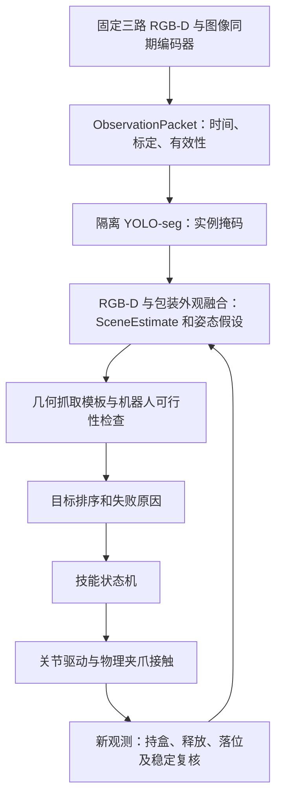

# 项目路线与当前状态交接

更新：2026-10-14。供新对话与接手开发者阅读。启动命令、代码目录和现有 API 只在 [README.md](README.md) 维护；协作硬约束见 [AGENTS.md](AGENTS.md)。本文件合并此前的路线、技能说明、三相机说明与实测摘要。

## 1 当前交接节点：2026-10-14（Linux 分支）

**当前交接范围：2026-10-14 第二轮工程提速已保存并收尾。** 用户明确无需论文式消融，不每优化一点就跑完整动作；采用针对性逻辑检查、短 CPU 基准，累计大改动后再集中验收。

当前源码 ad4b6d1：同帧点云复用、掩码内表面计算、三相机独立检测并行；按用户进一步要求，直立模型现默认 1 秒定时观测，可选 2 秒，阶段主动刷新保留。新图像 150 ms 时效与两次拍照间的运动支持超时分开，旧身份线索保留到下次观测。短测中，掩码优化使场景估计耗时减少约 23%，随后三路检测并行使该环节再减少约 19%；不同基准的比例不直接相加。调度测试 100 ms / 1 秒 / 2 秒分别为每分钟 600 / 60 / 30 次，阶段观测另算。461 项 Isaac SDK 检查及最新 GitHub CPU CI 通过，详情见 20.24–20.25。

dev6 在 APPROACH 按用户要求主动中止，原始结果已归档，不作为完整动作成绩；本轮未再启动完整动作。旧 ada6ead 完整成功的 15 分 49 秒不代表当前版本保证值。原独立对照仍为 geometry 3/3、GraspGen 1/3，不因工程优化变更分母。CPU 深度构图/路径检查和遮挡下身份关联仍有后续空间。

本轮新增结果与日志已保存云盘并完成复制/恢复校验，所有项目容器、模型/代理及 Xvfb 已停止；最新收尾记录见 20.24。下次先读该节及 README，不重启历史案例。本地连接 TXT 未追加研究记录。

项目主线已确定：固定三机位 RGB-D 与机器人状态 → 带不确定度的视觉场景估计 → 规则任务编排 → 抓姿与完整路径规划 → 单臂/双臂技能执行 → 传感器复核 → 重观察或恢复。本阶段交付范围为仿真；模块保留传感器与机器人驱动适配边界，不把实机部署设为完成前提。训练可以借助仿真真值，动作策略与在线监测只能使用现实可得输入。

用户已授权按照开题申请和合作者交接增量开发、逻辑检查及必要物理实测，并及时推送进展。本轮只推送 `linux-based`，保留 Windows `main`，不强推。按照合作者交接，先完成 GraspGen 的受控单盒完整抓放，再逐步扩展姿态调整与多盒；几何模板保留作对照，不重复已完成的采集、分割、IK 或任务循环，也不增加不必要的框架。

### 1.1 已完成部分：复用，不重新开发

- 固定三相机、`ObservationPacket`、`PolicyObservationAdapter`、图像同期机器人状态与腕相机 FK。
- 隔离模型环境及项目微调 YOLO-seg 接入、RGB-D/外观融合、`SceneEstimate V1`、目标关联与轮廓/可见边显示。
- 几何候选、解释性排序、Lula IK、球体碰撞、观测障碍检查与有限采样路径/RRT。它们已有实现，通用安全能力仍受下述验收边界限制。
- 受控直立单盒视觉抓放及侧放/倒置静态识别的上述实测；凸包边界查询及其专用测试已删除。

### 1.2 唯一当前待办清单

| 顺序 | 剩余工作 | 当前真实状态 | 完成条件与复用位置 |
|---|---|---|---|
| 0（当前） | 速度与受控直立单盒稳定性 | 15 mm 单臂开发曾完整成功：15 分 49 秒；最新工程优化通过 461 项 SDK 检查和短基准，dev6 按用户要求中止；完整耗时未重测，身份关联仍待解决 | 先针对 CPU 场景估计、构图与路径验证继续消除重复工作；另用保存的失败 RGB-D 定位 visual_0002 关联问题。分别报告计算等价性、完整耗时和成功率，不扩大到侧放/多盒 |
| 1 | 转动中的视觉持盒位姿与滑移判断 | 模型抓放已接入 `CuboidHoldingTracker` 和图像同期监测，完成近竖直开发案例的抬升/转移；尚未验证大角度转动、真实滑移及不同遮挡 | 复用现有 tracker，验证转动过程、实际滑移、遮挡与观测丢失。独立实测与 GRASP_CONSTRAINED 分开；直立模型可在可靠抓取关系下预测一个被遮挡方向，旋转和另外两方向仍由当前 RGB-D 测量 |
| 2 | 任意 TCP 姿态执行验收及调整抓取模板 | `execute_cartesian` 的全姿态、IK/插值/预检、逐段最新观测和终点检查已用于模型抓放；当前限定距竖直 ≤10° 的原始接近姿态，尚无大角度转动或侧放/翻面物理验收 | 复用 `simulation/robot_driver.py` 与已接通的通用 tracker，实测转动、撤离及持盒扫掠；开发有限调整技能，不重建控制器 |
| 3 | 视觉 SideAdjustment | 首版 `visual-adjust` 已保存；当前已有回归 420 项本地通过，SIDE 专项/Isaac/物理验证尚未完成 | 接收视觉目标，物理抓取并调整、释放后重新识别；顶面方向不明时保留假设，不能强行认定已正放 |
| 4 | 视觉 DualArmFlip | 仅有读取真值的历史交接基线，尚未迁移成视觉技能 | 复用 `baselines/dual_handover.py` 的动作经验，在 `skills/` 实现视觉输入和交接证据：发送端释放撤离、接收端独立持盒、最终正放稳定 |
| 5 | 技能分发及失败恢复闭环 | 排序/选择已有；实际主要接通 DirectPickPlace 和被动 Reobserve，侧放/倒置仍因技能缺失退出；持盒失败恢复仅有建议 | 在 `planning/selection.py` 与 `skills/` 接通新技能、重规划、有限重试和安全退出。相机内参与三个安装位置固定，允许经路径检查的腕部补看并独立验收 |
| 6 | 少量分离纸盒连续整理 | `skills/visual_sorting.py` 已有 1–3 盒循环、目标 ID/槽位管理和次数限制，尚无完整多盒物理验收 | 先验证两盒，再三盒：实际排序、邻盒干扰、槽位占用、连续执行及每次动作后复核；复用现有循环 |
| 7 | 遮挡/乱序场景逐步扩展到九盒 | 旧分割评估仍有漏检/误检；九盒释放沉降历史不能证明视觉整理 | 依据具体漏检、合并和几何失败补项目数据及算法，逐步验收遮挡少量盒再九盒；不重新部署重复检测模型 |
| 8 | 新能力的独立验收与路径安全边界 | 受控三初态对照已完成，模型仅 1/3 通过；转动、调整、交接、恢复、多盒及通用避碰尚无充分证据 | 每项新能力事先冻结条件/次数，报告全部成败和原因；补不同初态及相关路径验证。全臂未知空间、空臂撤回、连续/通用避碰仍未证明安全，不能恢复已删除的凸包边界检查或沿用旧范围成功率 |

**恢复开发时先读 20.24–20.25：当前按工程方式优先提速，用短测试确认收益，不逐项启动完整动作；新机恢复、15 mm 完整 dev2 和后续开发归档均已有记录，不重复旧前置工作。其他技能先不扩展。** 后续项目能力顺序仍为 1/2 → 3 → 4 → 5 → 6 → 7，第 8 项随对应能力验收；不重复静态 SIDE/INV 识别来代替转动或技能验收，不重写现有 IK、夹爪驱动、采集系统或多盒循环。

GraspGen 已按本轮交接接入，FoundationPose、ROS 迁移及真机适配不作为当前必做前置任务。真机传感器、手眼/TCP 标定与驱动替换属于后续部署工作。历史 JSON 保持原样，各次检查与实测分别报告。

### 1.3 接手时先确认的运行条件

- Linux 当前云盘工作树为 `/home/featurize/work/isaac-support/projects/Bimanual-manipulation-linux`，容器内对应 `/project/Bimanual-manipulation-linux`；同级旧 `Bimanual-manipulation` 工作树保留，不覆盖。当前 RTX 4090 使用官方 Isaac Sim 6.1.0 容器，SDK、缓存与大量输出在临时盘，代码、权重和精选/原始重要证据在云盘。
- 入口只用根 `launch.ps1` 或 `python -m workstation`。Linux 仿真经 `/isaac-sim/python.sh`；GraspGen 运行在独立容器，Panda 服务回环 5557、项目 HTTP 代理回环 5558。Windows 历史安装 `D:\Issaccc` 及工作树不作为 Linux 当前运行位置。
- 本轮 GraspGen 物理开发使用默认几何分割与真实模型抓姿，不能称为项目微调分割模型的完整复测。历史 YOLO11n-seg 运动视角权重为 `outputs/carton_seg_motion_training_20261007/fit/weights/best.pt`、阈值 `.4`；权重不在 Git 中，使用前需明确准备与单独验收。
- 当前只提交和推送 `origin/linux-based`；Windows `main` 不覆盖、不合并。提交与同步状态以 `git log -1 / git status -sb` 为准；不改写远端历史、不清理本地数据。
- 较早节点的源码快照和检查日志保存在 `outputs/visual_reorientation_20261009/`，精选记录为 `evidence/visual_checkpoint_20261009.json`。其中 `committed/pushed=false` 仅描述该历史节点，保持原始字段；快照是本地备份。本次发布检查日志在 `outputs/publish_20261009/`。
- 权重、依赖环境、完整图像/视频/运行报告均由 Git 忽略并保留本地，新克隆需要按 README 另行准备。上传源码不等于上传 SDK、模型或完整运行数据。
- 只查看当前状态时阅读本节；理解总体设计阅读第 5、6 节；Linux 环境与本轮模型数值见第 19、20 节。第 8–18 节保留各自历史条件，不再照着旧“下一步”重复实施。

## 2 当前成果与证据边界

下表保留截至 2026-10-06 的交接基线，2026-10-07 的新增模块、资源审查与独立验收见第 8 节。

| 能力 | 已有状态 | 未覆盖范围 |
|---|---|---|
| 固定双 Panda、桌面、卸料盘、逻辑三格与物理输送带 | Isaac Sim 6.1 中已实现；九盒 seed 6 释放与沉降有历史实测 | 未证明所有初态、全工作空间或长期运行 |
| 正式三相机采集 | RGB-D、K、诊断实例标签/动态外参、物理腕层级随动已有实测 | 实机拍摄/标定、真实噪声/延迟、全空间可见性 |
| `ObservationPacket / SimSensorAdapter` | 一次最小 Isaac 接口检查通过；三姿态、FK 对照与逐路异常隔离 | 逐 annotator 来源帧、真实采集延迟、真实适配、视觉消费者 |
| `PolicyObservationAdapter` | 本轮真实三姿态采集通过；双臂 qpos/qvel/TCP、16 维 state、三路 CHW/mask、ACT stack、LeRobot 字段与同步检查 | action 合同、归一化、模型/数据集接入、训练与策略执行 |
| 直立单盒物理抓放 | 固定左臂案例成功，最终三相机配置下完整回归成功 | 视觉驱动、通用抓姿、随机成功率 |
| 倒置单盒物理交接与翻正归位 | 固定位置/倒置姿态、无邻盒障碍的案例成功 | 正式三路下完整交接可见性、新三路录像、视觉持盒判定与泛化 |
| 三盒物理输送 | 预先放好的三盒出站有历史验证 | 自动整理与输送联合闭环、尾批处理 |
| 侧放扶正、通用避碰、失败恢复、多盒整理 | 未实现 | 依赖后续感知、规划与任务层 |
| 学习策略、真机传感器/驱动适配与实机运行 | 未实现 | 现场设备接口、标定和部署 |

### 保留的历史记录

目录整合时保留五份小型历史 JSON 和唯一成功录像 `evidence/dual_handover.mp4`，其他旧重复生成物已清理。录像仅本地保留、Git 忽略，新克隆不含；它来自旧 `overhead / oblique` 视角，不能代表新版正式三路录像或部署输入。旧 JSON 原始字段保持不变，其中 `recording.file=handover.mp4` 对应该归档录像。本轮另追加一份独立策略接口实测 JSON，失败与成功运行输出均保留。

| 仓库记录 | 支持的历史结论 |
|---|---|
| [evidence/single_pick_place.json](evidence/single_pick_place.json) | 最终三相机下固定直立单盒成功：抬升约 0.179967 m、最终 XY 误差 2.733 mm、胶带轴 yaw 误差 0.00913°、松爪撤臂后稳定 0.5 s、两臂回 home |
| [evidence/dual_handover.json](evidence/dual_handover.json) | 固定倒置单盒成功且交接验证通过：发送臂松开撤离，接收臂独立抬升约 0.04035 m；最终 XY 误差 0.522 mm、轴向 yaw 误差约 0.178°、稳定 0.5 s |
| [evidence/policy_input.json](evidence/policy_input.json) | home、左臂小幅运动、双臂小幅运动均输出三路 640×480 RGB-D；FK 外参最大位置差 0.007305 mm、旋转差 0.0008091°；`STALE / MISSING / INVALID` 隔离通过 |
| [evidence/three_camera.json](evidence/three_camera.json) | 当时全部 42 组相机文件的尺寸、有限深度、实例类型、标定关系、腕独立运动和低频采集检查结果；原数组与图像已清理 |
| [evidence/camera_performance.json](evidence/camera_performance.json) | 最终历史完整运行的渲染/读取/保存耗时和 GPU 整体显存采样；不是新版性能基准或进程专用显存 |

旧单盒与双臂控制使用 Lula IK、关节位置驱动和物理指爪接触，未使用物体绑定或运行中改写盒体位姿。两次同配置交接成功不能推出随机成功率。`ccb9ac3` 的目录整合当时仅做静态检查；本轮已重新运行整合后的 `sensor-check`。本轮没有重新执行完整单盒抓放、双臂交接或三路录像，不能把接口采集成功扩展为接触动作回归通过。

### 2026-10-06：策略 Observation V1 验收

精选原报告为 [evidence/policy_observation_v1.json](evidence/policy_observation_v1.json)，原始成功目录 `outputs/policy_obs_v1_20261006_212304_875/`，其中 `run_status.json` 为 `passed`、进程退出码 0。

| 级别 | 本轮命令与结果 | 支持的结论 |
|---|---|---|
| A：静态/单元 | `D:\Issaccc\python.bat -m unittest discover -s tests -q`，52 项通过；五模式配置、Python 编译、PowerShell 解析、`git diff --check` 通过 | 名称乱序提取、schema/类型/图像转换、占位 mask、时间容差与旧接口逻辑正确 |
| B：Isaac 初始化 | 根 `launch.ps1 -Mode sensor-check -Headless -IsaacRoot D:\Issaccc` 中真实初始化完成 | 两 Panda articulation、三路 Replicator、Lula FK 与 qpos/qvel API 可用 |
| C：物理运行采集 | 同次运行推进物理、驱动左/右关节小幅运动，home/left_moved/both_moved 三姿态采集通过 | 三路 640×480 RGB-D、完整机器人状态、16 维 float32 state、`(3,3,480,640)` stack、mask 全 True、sync_ok True |

实际两臂 DOF 顺序均为 `panda_joint1…7 / panda_finger_joint1 / panda_finger_joint2`；新接口按名称解析，乱序情况由单元测试覆盖。左右原生 finger 下标本次为 7/8，不作为永久假设。三姿态相机—机器人时间偏差为 0；这是仿真统一物理时钟下的配对，不是硬件同步或 annotator 同曝光证明。

真实运行内的异常注入覆盖：暂停渲染 19 个物理步产生 STALE；暂时移除右路产生 MISSING；左路 RGB annotator 注入异常产生 INVALID。对应策略 mask 为 False、占位全零，其他有效视图保留。另对实测包注入 0.03 s robot timestamp 偏差，超过 0.02 s 容差后 sync_ok=False。低频模式 48 步恰好 4 次渲染、2 次持续采集，无新增 PNG/NPY。

首轮 `outputs/policy_obs_v1_20261006_211623_532/` 已取得三组有效输入，但旧诊断固定等待 60 步后在右腕独立运动判据失败，整体记录为失败。本轮诊断改为按实测速度等待稳定：至少 0.5 s、两臂 arm 速度不超过 0.02 rad/s 并保持 0.1 s，最多 3 s；原独立运动阈值没有放宽。复测左右运动各等待 99 步/0.825 s，通过。右臂运动期间另一腕最大矩阵元素变化约 0.002282，scene 为 0；矩阵差不是统一的米制距离。

本轮没有改变两份基线控制器或三相机安装配置。C 只证明接口运行采集，不证明抓放、翻面、视觉判断或策略模型的成功率。

### `ccb9ac3` 的目录整理

启动入口已收敛为根 `launch.ps1` 和 `python -m workstation`。仿真、观测、真值基线与传感器诊断按模块划分，参数移到唯一 `config/scene.json`，逻辑检查移到 `tests/`。两份 CMD 快捷入口和第二套相机验证 CLI 删除；旧验证中的腕独立运动和 48 步低频无图保存逻辑纳入新 `sensor-check`，完整抓放通过 `single-pnp` 独立运行。

额外 `overhead / oblique` 相机配置与旧视频采样分支删除，双臂基线录像改为正式三路 RGB 拼接；默认不保存 PNG/NPY，通过 `--save-images` 显式开启。它们不改变当前真值基线的身份，也不构成视觉闭环。

## 3 场景语义与三机位安排

当前世界为米制 Z-up。台面高 0.76 m，两个 Panda 基座位于 `[-0.36,0.25,0.82] / [0.36,0.25,0.82] m`，均绕世界 Z 为 -90°。每臂 7 关节加 2 指关节，物理步长为 1/120 s。纸盒为 `100×55×45 mm / 80 g` 刚体，局部 +Z 是胶带所在的指定顶面，+X 是长轴；未建模纸板形变与真实材料辨识。

胶带无箭头，当前朝向按 180° 对称轴评价，0°/180° 等价。若要求唯一前向，需要可观察的非对称外观证据及有向 yaw 判据。是否允许方向标记仍待现场/任务要求确认，不能用仿真 ID 或固定初始朝向补足歧义。

三格是软件标定目标，没有可渲染几何、碰撞体或图像标签。目标坐标属于工位参数，可在真机标定得到。当前输送逻辑要求三格连续稳定合格、无额外阻挡且机器人联锁允许才输送；单盒完成后继续等待其余两格。三盒出站由接触摩擦产生位移，未改写盒位姿。尾批不足三盒的结束触发尚未设计。

正式机位数量与安装角色已经由用户确认，其他视角现实不可获取：

| 相机 | 当前仿真安装 | 闭环中的职责与限制 |
|---|---|---|
| `scene_camera` | 位置 `[0,-0.41,1.76] m`，look-at `[0,-0.11,0.80] m`，36 mm 焦距 | 全局选盒、遮挡/障碍关系和撤臂后落位复核；单盒下放时活动手掌会挡住目标大部分 |
| `left_wrist_camera` | 物理 `panda_hand` 下 mount 平移 `[-0.065,0,0.025] m`，20 mm 焦距 | 左臂接近、夹持、下放近景；历史下放同帧可见盒与夹指，仍有自遮挡 |
| `right_wrist_camera` | 物理 `panda_hand` 下 mount 平移 `[0.065,0,0.025] m`，20 mm 焦距 | 右臂接收/抓取近景或空闲时补观察；不是所有左侧动作的通用备份 |

三路均为 640×480，腕部外参完整四元数在配置中，不在文档再复制数值。腕挂载依靠 USD 物理手掌层级随动，无 Python 每帧写世界位姿；更换资产时须区分同名外观网格与带 `RigidBodyAPI` 的手掌 link。没有隐藏机器人几何来消除遮挡，相机外壳质量与碰撞模型尚未加入。

重新观察仅可取这三路新帧，或规划安全路径移动现有腕相机。移动腕部后应更新外参与场景版本；看不到胶带只能给出未知，不能直接判为底面或倒置。三路均不足以确认夹持/交接时，保持安全夹持、停止或恢复。

## 4 现有输入接口做到哪里

`env.observe_policy_inputs()` 和兼容别名 `get_observation_packet()` 返回同一个 `ObservationPacket`。既有 RGB-D、有效深度掩码、K、FK 外参、采样时间、序号及逐路异常隔离均复用；现已补入同期两臂 arm/finger qpos/qvel、夹爪宽度和名义 Lula TCP。原始包另保留组包时最新状态。完整字段和使用方法只在 README 维护。

`PolicyObservationAdapter` 将原有三路采集名称映射为 `cam_high / cam_left_wrist / cam_right_wrist`，不改变安装和记录器。输出三路独立 CHW float32、异常 mask 和按 schema 排列的 16 维 state；qvel/TCP 在 raw 包中保留，V1 不送入模型。ACT stack 与 LeRobot 字段转换是轻量格式 helper，不是已训练策略、数据集写入器或动作接口。

按 articulation 的实际名称提取 DOF，再按 Lula 的名称排列计算 FK。相机渲染前锁存两臂实测 qpos/qvel，策略 state 使用这份图像同期状态；组包最新状态不能替换它。同步容差默认 0.02 s、帧龄 0.15 s，配置集中于 `policy_observation`。缺视图、过期或时间偏差超限显式返回无效 mask/同步结果。原始 `OK / MISSING / STALE / INVALID` 保留，黑图只存在于格式转换层。当前仍无力觉、电流、精确接触反馈或场景版本。

初始目标识别可主要用 RGB/深度；执行阶段还需要关节和夹爪状态。腕图转换到工位系始终需要图像同期的关节与手眼标定：`T_workcell_from_camera(t) = T_workcell_from_hand(q(t)) × T_hand_from_camera`。初始识别不需要把关节角喂给外观网络，但几何定位依然需要该变换。当前 scene 外参来自名义配置，两腕由测得关节的 Lula `panda_hand` FK 和配置 mount 得到，真机须替换为实测标定。

策略路径在采集阶段不读取实例分割或渲染器相机变换；默认 `observe_cameras()` 仍保留这类诊断字段。实例标签表示渲染器知道哪块像素来自哪个物体；动态外参表示渲染器直接知道相机真实世界位姿。它们能做离线标签和核查，不能当作实际相机能直接输出的策略数据。

接口的剩余限制：

- 当前只锁存渲染物理时刻的关节，并提供统一渲染序号；各 annotator 的来源帧 ID 缺失，不能独立证明 RGB、深度和 K 严格同曝光。
- `STALE` 按仿真物理时钟计算；渲染/传输/推理的真实耗时不推进该时钟。`refresh=True` 可反复渲染却不推进物理，不能把序号增长当新物理观测。
- 仿真采用理想针孔与理想深度。真实适配需 RGB/深度配准、内外参、左右手眼/TCP/基座与目标槽标定、硬件时钟同步、实际延迟与缺测/噪声建模。
- 指位置可以计算夹爪开度，不能单独证明抓住盒子。现场是否提供抓取状态、力/电流或接触反馈尚需确认。
- 独立 `PrivilegedRecord` 和未来消费者的访问隔离仍未完成；目前基线持有环境引用，因此仍能读真值。不能因为输入包过滤完成就声称整个控制链隔离完成。

历史三路渲染每 4 个物理步一次，但完整回归 render+app.update 平均约 188 ms 墙钟耗时。30 Hz 是仿真步对应频率，未达到的实时视觉频率不能据此宣称。先在关键阶段采新图，底层跟踪和保护使用较高频机器人反馈；后续训练按实际帧间隔、延迟和缺帧设计输入历史。

## 5 总体思路、职责与闭环组合

### 为什么采用当前组合

任务最终需要决定“抓哪一个、怎样抓、是否先调整、动作是否真的成功”。分割模型解决图像中的实例范围；RGB-D 几何解决米制位置、轴向和可见面的约束；机器人模型解决可达性与路径限制；规则排序和状态机把这些证据变成可解释的动作与恢复分支。模型分数无法代替接触空间、路径检查和动作后验证，因此当前方案把学习用于实例分割，把可计算的约束留在几何、规划与执行层。

已经尝试 YOLOE 文本/参考图提示，项目图像中效果不足，随后使用项目数据微调 YOLO11n-seg。正式推理直接复用它一次输出的实例框和掩码，没有叠加第二个同功能检测器。已知盒型尺寸优先使用有限几何抓取模板；GraspGen 缺本机可运行服务及 TCP 标定，且用户选择暂缓。FoundationPose 或小外观分类器仅在当前几何/包装证据出现具体瓶颈时再引入，不是本阶段必须重选的方案。

### 一次在线决策如何形成



这是最终闭环结构，图中不表示所有技能均已完成；实际状态以第 1.2 节为准。各层当前职责如下：

1. **观测层先保证数据能解释。** 正式相机名不变，RGB/米制光轴深度/有效掩码/K 必须对应同一图像。腕外参使用图像时刻关节 FK 与安装标定；最新机器人状态只用于执行当前动作，不用于重新解释旧图像。缺帧、过期、不同步或黑图必须显式无效。
2. **感知层给出观测事实与未知。** 分割掩码只表示可见像素；绿色轮廓是实例边界，青色线是深度支持的可见面交界，不补画隐藏的十二条边。`SceneEstimate` 的 ID 来自感知跟踪。静态估计融合尺寸、几何与胶带/折边证据；看不到胶带不等于倒置，侧放仍可保留两种顶面方向假设。
3. **运动中重新测量盒体。** 原直立 tracker 已有有限物理证据，其局部表面支持不能称为通用 6D 测量。新增通用 tracker 用当前 RGB-D 的法向、平面和可见尺寸约束测量盒体位置/旋转；初始视觉假设与图像同期 FK 只提示对应关系。测量缺轴、位姿冲突或表面支持不足时返回未知，不复制 FK 推算的盒体位姿。对称方向不因几何拟合成功而自动消失。
4. **规划层先判断动作能否执行。** 检查夹爪开度与空间、邻盒、关节限位、机器人自身/另一只臂、固定工位及持盒扫掠。当前为球体/包围盒及采样路径近似，有有限 RRT；Lula IK 成功不等于整条路径安全。未观察空间保留未知，凸包边界查询不恢复。
5. **排序与技能层分别回答两个问题。** 排序比较估计质量、空间、可达性、路径余量、动作代价与失败记录；技能选择决定直接抓放、调整、翻面、重新取帧或退出。侧放/倒置不天然等于不能抓，直立也不天然等于可抓；当前直接模板仅支持直立是实现范围，不能当作物理定律。缺抓姿、遮挡、不可达、路径阻塞和语义未知分别记录原因。
6. **物理执行必须用观测确认。** 夹爪闭合命令和开度只说明机器人动作，不单独证明抓住。抬升要有视觉离台/持盒支持；交接要证明发送端释放撤离后接收端独立持盒；放置要在松爪撤臂后的新帧中确认格位、姿态和稳定。每次动作改变场景后重新估计，不沿用旧抓姿一直执行。

相机内参与三个安装位置保持不变；用户 2026-10-12 明确允许补看。可经路径检查移动机械臂取得腕相机新视角，用图像同期 FK 计算外参；许可不等于主动恢复已实现或验收。

### 数据合同：现有实现与拟议接口

下面前四项已有实现或对应数据输出；`SkillRequest / MotionPlan / SkillResult / PrivilegedRecord` 是后续统一合同设计，不能据此认定已经全部实现成正式类型。当前技能仍主要通过机器人端口、阶段状态和报告字典交互。

下面 `ObservationPacket / PolicyObservationAdapter` 已实现；其余是未来接口约定，不是已有可调用功能。

| 接口 | 关键内容 | 生产者 → 消费者 |
|---|---|---|
| `ObservationPacket` | 三路 RGB-D/有效掩码/K/FK 外参、时间、机器人状态、逐路可用性 | 仿真/未来真实适配 → 感知与执行监测 |
| `PolicyObservationAdapter` | 三路独立 RGB/mask、16 维双 Panda state、同步结果、可选独立 depth、ACT/LeRobot 格式 | 观测包 → 未来模型消费者；无动作执行 |
| `SceneEstimate` | 感知自身实例 ID、盒体中心/姿态假设、尺寸来源、可见掩码/面交界边、规则质量指标、失败原因、时间与版本；未知显式表达，规则分数不作为概率 | 感知 → 任务层和候选规划 |
| `GraspCandidate` | 对象与执行臂、TCP 抓姿、开度、接近/撤离方向、持盒碰撞体、代价和路径可行性 | 抓姿规划 → 任务层/技能 |
| `SkillRequest` | 技能、对象、目标槽、双臂角色、候选、前提、资源锁、超时与场景版本 | 任务层 → 技能执行器 |
| `MotionPlan` | 两臂关节轨迹、夹爪命令、持盒碰撞体、速度/力边界、允许接触阶段和取消条件 | 完整路径规划 → 仿真/真实驱动 |
| `SkillResult` | `SUCCEEDED / FAILED / UNKNOWN / ABORTED`、结束阶段、失败码、传感器证据、重观察与资源释放要求 | 技能/监测 → 任务层 |
| `PrivilegedRecord` | 仿真位姿、实例标签、速度、接触、奖励与成功标签，独立于运行路径 | 标签/训练教师/critic/离线诊断 |

后续任务层先顺序执行，进一步完善执行臂、槽位与共同交接区的资源预留。技能按 `check_preconditions → propose_grasps → plan → execute → verify` 组织；场景改变、失败、观测过期后重新规划。短时持盒预测只能供有界路径模型使用，不能冒充新的视觉测量或动作成功证据。未来接输送时，启带/出站与尾批结束也需要可部署的观测联锁，现有真值输送演示不自动获得视觉验收。

## 6 规则与训练如何分工

没有一种基础动作因动作名称而必须训练。“规则”包括基于估计状态的几何求解、候选搜索、约束规划、状态机和反馈控制；固定关节轨迹播放不能代表通用规则技能。

| 部分 | 第一版实现 | 何时考虑学习 |
|---|---|---|
| 盒体识别、顶面与姿态估计 | 当前已用微调 YOLO-seg 实例分割，几何与包装线索负责状态融合 | 严重遮挡、包装/盒型变化或正倒证据不足时，针对已测瓶颈微调分割或外观模型 |
| 直立抓放、倒置交接翻面 | 参数化现有动作阶段，加入估计状态、规划与传感器监测 | 候选排序或局部接触修正出现明确瓶颈 |
| 侧放扶正、拨动/分离、重抓 | 先低速规则动作与重观察，设置可恢复失败 | 摩擦、尺寸和形变导致规则接触长期不稳 |
| 高层选盒/选臂/选技能 | 可行性、优先级、资源锁与失败重规划 | 多盒选择成为明确性能瓶颈 |
| IK、避碰、安全约束、停止与联锁 | 确定性计算和明确限制 | 维持约束，不交给无约束网络替代 |

训练先解决视觉。训练输入仅含正式三路 RGB-D、可标定参数和关节 FK，真值掩码/位姿/顶面单独存为监督标签。教师可以用真值生成示范，奖励和只在训练时存在的 critic 可以用真值；任何最终会输出动作或决定继续/停止的 actor 输入只能来自观测包或其估计状态。感知实例 ID 也不能等同仿真 ID。

若规则技能已能完成但接触适应不足，再取一个短阶段训练：脚本示范 → 行为克隆初始化 → 有界残差策略。输入为估计相对位姿、置信度、技能阶段、关节/夹爪及现场实际反馈的短时历史；输出限幅 TCP 或夹爪/顺应设定修正，经过运动与安全层过滤。零修正沿用规则控制，不先训练整个端到端任务。不可观测时的示范应重观察或退出，不能要求学生猜隐藏真值。

训练域逐步扩大：已知尺寸单盒 → 位置/yaw变化 → 侧放/倒置 → 异尺寸和纹理 → 遮挡/多盒。覆盖实测光照、深度缺测/噪声、延迟、标定误差、质量/摩擦和驱动差异；视角只来自三个真实安装位及现有腕运动，不能随机生成第四机位。输入/动作单位、频率、控制模式和标定版本须在仿真与真机一致。

## 7 最近的实施顺序

实施顺序只维护在第 1.2 节。受控单盒 `SceneEstimate`、真值隔离通道与视觉 DirectPickPlace 已有实现和限定条件证据，不再列为从零开发项。接手从任意 TCP 姿态接口及通用持盒估计的物理验收继续，复用现有姿态 IK、四元数插值、路径检查和驱动，再接侧放、翻面、恢复和多盒。

原始方案中的完整规划、任务重试与重抓案例仅作为设计参考；ROS/MTC/FoundationPose 未成为已验证运行依赖。后续输送视觉联锁、尾批结束、实机适配和现场标定列为部署扩展项，不作为当前停止节点已完成的能力。

待现场确认的条件包括：允许的方向标记与唯一前向语义、盒型尺寸先验/范围、真实机器人和夹爪接口、实际可获得的接触反馈、目标槽/输送传感器与安全边界。三个机位的数量和角色已经确定；精确外参、手眼、TCP、两臂基座与时间同步仍需实测。

## 8 2026-10-07 只读审查、资源与视觉开发

### 起点与保留

起点为 main `ccb9ac3`，首先记录 `git status`。原工作树 11 个修改文件和 3 个未跟踪文件（策略接口、其测试及证据）均保留，未 pull、stash、回滚、清理、提交或修改历史证据。初始状态、差异与源码哈希存于 `outputs/visual_development_20261007/initial_*`。这批原接口改动仍未提交。

沿根 `launch.ps1 → __main__/app.py → SortingEnvironment → mode` 核对：旧单盒/交接在构造、阶段监测和成功判据中读取 `observe_ground_truth()`；默认 `step()` 的输送监控与 `settle()` 也用真值。新视觉 runner 使用固定 3 s 观察等待及 `step(monitor_conveyor=False)`，感知与技能不调用上述真值路径。历史 JSON 的测量条件不外推；现存未跟踪 `policy_observation_v1.json` 为上一轮成功接口记录。

### 资源核对

| 资源 | 本轮状态 | 核对结果/限制 |
|---|---|---|
| Windows/硬件 | 已可用 | Windows 11；RTX 4060 Laptop 8188 MiB、驱动 560.94；约 31.8 GiB 可见内存。显存空余约 5.6 GiB 是查询瞬时值 |
| Isaac SDK | 已可用 | `D:\Issaccc\VERSION` 为 `6.1.0-rc.26+release.49347.2d230af4.gl`，不能当成已验证所有正式 6.1 API |
| Isaac Python/几何依赖 | 已可用 | Python 3.12.13、NumPy 2.3.1、SciPy/OpenCV/Pillow 实际导入可用；普通 `D:\Scripts\python.exe` 缺 NumPy |
| Franka/Lula | 已可用 | 两臂官方 USD 在本轮真实初始化加载；本机旧兼容扩展有 URDF、robot descriptor、IK、限位和碰撞球；保留原驱动经验 |
| 三相机/标定 | 仿真可用、实机需配置 | packet 同期编码器与 FK 外参已有历史实测；本轮实际读到三路 RGB-D。当前为名义理想标定，尚无硬件配准/手眼/时钟验证 |
| 模型权重 | 未配置 | 在项目与 SDK 检索未发现已验证的盒体分割、FoundationPose 或 GraspNet 权重；不是全盘扫描结论 |
| Torch/Open3D/ROS 2 | 当前环境不可用 | Isaac Python `find_spec` 为 False；不自动装入 SDK，不把远端开源仓库视为可运行环境 |
| 测试/诊断/输出 | 已可用 | 当前逻辑测试、sensor-check、新增 vision-check；旧 JSON 保留。旧三相机全量图像已清理，不能重复离线检查原数组；新 RGB-D 输出单独保存 |
| VS Code | 已配置，UI 待刷新确认 | `.vscode/settings.json` 与 `isaac.env` 指向 SDK；独立进程已导入 NumPy 并通过测试。未直接检查 Pylance UI |

### 成熟资源评估（读取官方源码/文档与原论文）

| 方案 | 输入 → 输出、版本/许可 | 当前集成结论 |
|---|---|---|
| [Isaac 原生 Franka 示例](https://docs.isaacsim.omniverse.nvidia.com/latest/examples/manipulation_franka_pick_place.html) | pick/place 目标 + 机器人测量 → 抓放阶段/运动命令；本机 6.1 RC 的共享控制器源码带 Apache-2.0 标记，物理完成反馈与超时状态机可参考 | Windows 原生例程可用资源，但不是从图像定位的算法。本轮保留现有 Lula/物理夹爪，不采用 SurfaceGripper 附着，也不直接替换跑通基线。指定 `/6.1.0/` 文档请求失败，在线 latest 与本机源码分别记录 |
| [Isaac for Manipulation](https://github.com/NVIDIA-ISAAC-ROS/isaac_ros_manipulation)、[官方 4.3 仿真教程](https://nvidia-isaac-ros.github.io/v/release-4.3/reference_workflows/isaac_for_manipulation/tutorials/isaac_sim/tutorial_isaac_sim_pick_and_place.html) | RGB-D、标定、机器人描述、物体模型、任务 → 分割/位姿、MoveIt 轨迹与抓放；教程使用 Isaac 5.1 样例场景 | 解决完整感知规划编排，但当前 Windows/6.1 RC/双 Panda 工位不能直接套教程。需 Linux ROS 工作区、桥接、机器人配置、话题与控制器；不同 release 不混用 |
| [Isaac ROS 分割](https://github.com/NVIDIA-ISAAC-ROS/isaac_ros_image_segmentation) | RGB + DNN 权重/部分方法提示 → 语义标签或 SAM 掩码；源码 Apache-2.0，模型许可另核；main README 已出现 5.0/Lyrical，4.3 文档为 Jazzy | 语义分割不自动等于每盒实例/跟踪。后续相邻盒无法拆分或包装变化成为瓶颈时再选模型。依赖 ROS/TensorRT、输入 resize 与提示/实例关联 |
| [FoundationPose 官方实现](https://github.com/NVlabs/FoundationPose)、[CVPR 2024 原论文](https://arxiv.org/abs/2312.08344) | RGB-D、K、初始物体 mask、米制 CAD 或参考图 → 6D 位姿/跟踪；研究/评价非商业许可 | 能补复杂姿态几何，但不能代替实例分割或自然包装正倒语义。需 scorer/refiner 权重、Torch、CUDA 编译的 PyTorch3D/NVDiffRast/mycpp；官方流程偏 Linux Docker/Conda，没有本项目 Windows 3.12/6.1 可运行证据 |
| [cuMotion](https://github.com/NVIDIA-ISAAC-ROS/isaac_ros_cumotion)、[官方机器人描述说明](https://nvidia-isaac-ros.github.io/v/release-4.4/concepts/manipulation/index.html) | 机器人 URDF/XRDF、关节、目标、障碍/SDF → IK/碰撞约束轨迹、ROS action/service；仓库根为 NVIDIA Isaac ROS Software License，不能一概称 Apache | 对通用避碰有实际价值；但需双臂描述、持物几何、ROS 控制与深度自过滤。当前版本兼容未验证，先保守拒绝无可行模板的路径，不能把 IK 当避碰 |
| [MoveIt Task Constructor](https://github.com/moveit/moveit_task_constructor)、[ICRA 2019 原论文](https://noah.nrw/ubbihs/download/pdf/5137431) | PlanningScene、任务/阶段约束 → 多阶段候选与完整轨迹；master 是 ROS 1，ros2 为 MoveIt 2 main，humble 是 Humble 稳定分支；package 声明 BSD | 参考阶段串联、失败传播与解释，不直接引入 ROS/MoveIt C++ 工作区。规划的 attached collision object 是预测持物几何，不允许复制成仿真刚体绑定 |
| [GraspNet baseline](https://github.com/graspnet/graspnet-baseline)、[CVPR 2020 原论文](https://openaccess.thecvf.com/content_CVPR_2020/html/Fang_GraspNet-1Billion_A_Large-Scale_Benchmark_for_General_Object_Grasping_CVPR_2020_paper.html) | 点云 → 抓取姿态/开度/模型分数；README PyTorch 1.6、Open3D ≥0.8、自定义 pointnet2/knn；基线为非商业研究许可 | 处理复杂抓姿的候选来源，不能证明 Panda 可达/避碰或指定顶面归位。旧编译栈与本机 Python 3.12 不直接兼容；当前盒型有限模板足够优先验证 |
| [ReorientBot 官方仓库](https://github.com/wkentaro/reorientbot)、[ICRA 2022 原论文](https://arxiv.org/abs/2202.11092) | RGB-D 位姿/体积重建、已知 CAD、学习 waypoint → 重定向/重抓规划；ROS Noetic/catkin、PyBullet/吸盘案例，仓库许可限制非商业内部/学术研究 | 借鉴“位姿调整 → 再抓 → 放置”，与双 Panda 指爪工位成本高；模型、吸盘接触假设和仿真约束不能直接迁入正式物理技能。未下载/运行，不声称兼容 |

[Isaac ROS 官方 4.0 环境要求](https://nvidia-isaac-ros.github.io/v/release-4.0/getting_started/index.html)列出 Ubuntu 24.04、CUDA 13+、驱动 580+ 等条件；本机驱动 560.94 不满足该参考组合。最新 main/release 的平台要求还会变化，后续安装必须固定并再核版本。以上兼容性与代价是基于官方依赖及本机缺项的判断，没有运行上述外部完整栈。

### 本轮阶段记录

第一阶段事前定义：单盒静止低遮挡，连续 3 帧位置误差 ≤5 mm、轴向 yaw ≤5°、ID 稳定；正倒不明确须 UNKNOWN，姿态缺证据不执行。`vision_check_20261007_01` 进程退出 0，三个样本误差 0.6476–0.7232 mm、轴向 0.00540–0.00555°，ID 相同；该首版的浅色胶带被颜色门限排除，正确输出 UNKNOWN。随后通过同次保存的 RGB-D 离线复查发现并修正门限，顶部胶带可见。原报告保持不变；新入口验收追加 UPRIGHT 的外观证据要求。

逻辑验收已运行 `D:\Issaccc\python.bat -m unittest discover -s tests -q`：72 项通过（原 52 项 + 新视觉估计 12 项 + 规划 8 项）；包括缺深度/缺帧、过期、不同步、旧图同期状态、正倒未知、侧面假设、合并拒绝、跟踪、排序、邻盒空间、自/互臂碰撞与在线源码禁用属性检查。这不是图像噪声/物理成功率证据。

第二阶段事前定义：图像定位并选臂/模板，物理夹持、视觉离台 ≥0.08 m 与近 TCP 随动，松爪撤臂回 home；重新观察槽位 XY ≤0.018 m、Z ≤0.008 m、轴向 ≤8°，视觉估计速度 ≤0.015 m/s 并保持观测稳定 ≥0.5 s。

`outputs/visual_pnp_20261007_01/` 首轮失败：完成图像选臂、PREGRASP/APPROACH/CLOSE；抬升预检拒绝 `STATIC_PATH_BLOCKED:visual_0003`，未取得视觉离台证明。图像显示手掌将同盒分割为碎片，旧跟踪丢 ID 后当作邻盒，部分足迹还误匹配侧面高度。随后加入最近视觉几何的唯一碎片关联；只有多块可见表面重建成完整足迹、法向与深度一致时合并，无未观测像素/真值填充。部分足迹不输出 SIDE，并拒绝推断底面低于支撑面的尺寸假设。

新增两项遮挡测试后曾有一项失败；第二次 `visual_pnp_20261007_02` 在动作前人工停止，保留 `development_stop.json`，不计成功实测。修复后全 74 项逻辑测试通过。第三次 `visual_pnp_20261007_03` 仍在抬升预检失败：碎片的视觉关联历史过早过期，误当邻盒。关联历史改为最多 3 s，但仍只用当前可见面重建新几何，禁止输出旧位姿冒充新测量。

第四次 `visual_pnp_20261007_04` 实际进入 LIFT，随后 `HELD_CARTON_NOT_OBSERVABLE` 失败。独立事后真值显示纸箱仍在支撑面，没有成功抬起或归位；报告中的 0.028 m 来自不可靠局部几何，不可当成真实抬升。最新监测已拒绝用带失败码/部分轮廓的中心累计抬升，并区分“可靠视觉显示纸箱留在支撑面”与“可靠观测缺失”；这项监测改动仅通过纯逻辑检查，尚未重新物理验证。

新版视觉 runner 初次按原 12 次渲染预热，其后每次在冻结物理期间用现有相机系统渲染 3 次，按同期 FK 读包；不改相机系统或旧模式频率。来源帧 ID 仍缺，不能宣称严格同曝光或实时性能。

### 最新分割轮廓、可见面边与验收

用户指出旧矩形框不贴盒边，随后指出右上角暖色夹爪误分及前面交界边遗漏。图像现改为真实掩码轮廓/半透明区域；浅色像素需满足当前顶面深度和范围，暖灰夹爪侧面不因宽颜色门限纳入。该限制的第一版误排除浅色顶面，`vision_check_20261007_02` 三帧验收失败并完整保留；修正为先测顶面，再限制浅色区域后，第三次 `vision_check_20261007_03` 三帧均通过 UPRIGHT、位置 ≤5 mm、轴向 ≤5°、稳定 ID 判据。小型精选记录见 `evidence/visual_progress_20261007.json`，原始 RGB-D、标定、配置和报告在各独立输出目录。

`perception/visible_edges.py` 只在掩码内两侧都有有效深度时，用水平/垂直面的法向变化与米制直线拟合提取面交界边，写入 `SceneEstimate.edges`，青色显示；绿色显示分割轮廓。真实旧帧的独立复查图 `outputs/visual_development_20261007/visible_edge_review_left_wrist_camera.png` 去除了右上角夹爪，并识别前面交界边。该图为旧数据用新算法复查，不改写历史运行结果，也不包含缺失的同期编码器回放。几何边尚未用于修改抓取动作；不补画不可见边，不把胶带纹理作为盒边。

最新 `D:\Issaccc\python.bat -m unittest discover -s tests -q` 通过 **82 项**：原 52 项加视觉估计、候选/碰撞、轮廓、可见边与持盒证明检查。覆盖暖灰夹爪误分、浅色胶带/顶面保留、仅 RGB 纹理不产生几何边、可见前面交界的米制支持及部分几何不证明抬升。日志见 `outputs/visual_development_20261007/logic_checks_latest.log`。这些检查不能替代噪声、遮挡随机场景或物理成功率试验。

| 阶段/能力 | 历史实测证据及条件 | 本轮实际验证 | 已实现但未通过完整验收/未验证 | 尚待开发 |
|---|---|---|---|---|
| 工位、固定物理基线 | `evidence/single_pick_place.json`、`dual_handover.json`；固定纸箱初态、真值控制，不是视觉成功率 | 本轮新视觉模式正常初始化两臂、三相机、单盒；不继承旧基线成功 | 当前版本固定基线的完整物理回归 | 随机位置/姿态的成功率与边界 |
| 图像同期状态与策略包 | `evidence/policy_observation_v1.json`；上轮 sensor-check 特定诊断条件 | 本轮真实采集三路 RGB-D，并消费同期 FK 外参；原接口与测试保留 | 严格曝光 ID、真实相机时间/手眼/TCP 标定 | 实机传感器适配与时钟验证 |
| 静止单盒视觉估计 | 首次本轮旧门限版本仅几何通过、语义 UNKNOWN | `outputs/vision_check_20261007_03/vision_report.json` 三帧通过；固定直立、静止、低遮挡、已知尺寸 | 部分面重建/跟踪仅有限逻辑与旧帧复查；不可泛化 | 复杂姿态、贴靠盒拆分、稳定多盒跟踪 |
| 可见轮廓/面边 | 旧框仅为轴对齐包围框 | 新掩码去除指定夹爪误分；真实旧帧有前面面交界，逻辑检查通过 | `visible_edges.py` 仅近水平可见面；几何边未驱动技能 | 遮挡/倾斜、多面联合估计与不确定度验证 |
| 视觉直接抓放 | 无历史视觉成功证据 | 3 次完整运行均失败，另 1 次开发中停止；保存全部原因和输出 | `selection.py`、`robot_driver.py`、`visual_pick_place.py` 候选、驱动、监测；最新监测未物理复测 | 查清实际夹持失败；完整搬运前预检、目标允许接触细分、持盒与本臂碰撞覆盖 |
| 调整、恢复、多盒 | 历史固定倒置真值交接不代表视觉调整 | 本轮未实测 | 重观察/停止建议仅报告，不是执行恢复 | 侧放、倒置可靠语义与视觉迁移、主动腕观察、少量到多盒闭环、通用规划 |

当前到达**受控静止单盒视觉估计实测通过**，下一阶段仍是**单盒直接抓放闭环**。具体缺口是实际夹持失败与运动中可见性、可靠持盒证明、完整路径/接触碰撞边界；先补这些，不能直接推进随机多盒或宣称组长全部目标完成。

侧放调整、倒置翻面视觉证明、主动腕重观察、多盒整理与通用避碰尚未完成。

## 9 2026-10-07 至 10-08 模型接入与几何模板推进

### 审查、资源与选型

接续开发首先记录 `outputs/model_integration_20261007/initial_git_status.txt` 与 `initial_working_tree.patch`；未回滚、清理、拉取、暂存或提交。HEAD 为 `ccb9ac3`。原三相机、观测包、策略别名和图像同期关节均复用；旧抓放/交接源码保持真值基线身份。新入口沿 `app.py → diagnostics/visual_run.py → skills/visual_pick_place.py`，在线估计、排序、路径与结果判断只读取 RGB-D、标定、固定先验及机器人编码器。运行结束后 `privileged_evaluation.json` 独立读取真值，不能回送技能。

| 资源 | 本机实际状态 | 用途与限制 |
|---|---|---|
| Windows、GPU、内存 | RTX 4060 Laptop 8188 MiB，驱动 560.94，约 32 GB RAM；Isaac 实际为 `6.1.0-rc.26+release.49347.2d230af4.gl` | 原生 Isaac Python 3.12.13 可运行；不能按正式稳定版或 Linux 推理栈作兼容保证 |
| Isaac 核心环境 | NumPy 2.3.1；原环境未安装模型 Torch | 未升级核心依赖；普通系统 Python 缺 NumPy 的编辑器问题不代表 Isaac 缺失 |
| 独立模型环境 | `.venv-models` Python 3.12.13，Torch `2.6.0+cu124`、torchvision `0.21.0+cu124`、Ultralytics `8.3.253`、NumPy 2.2.6；实测 CUDA 可用 | stdlib 来自 SDK，site-packages 与 SDK 隔离。锁定声明见 `workstation/models/requirements.txt`，安装快照见 outputs 的 `installed_requirements.txt` |
| 相机、盒型、机器人 | 正式三路 640×480 RGB-D/K/FK 外参、100×55×45 mm 盒型先验、Lula URDF/球体与官方 Franka USD 实际加载 | 图像同期 FK 用于腕图与持盒比较。名义手眼/TCP 标定、严格曝光 ID 和真实深度噪声仍未验证 |
| 分割权重 | 官方 YOLOE-11s 与 YOLO11n-seg 已下载；两轮项目微调已完成 | 本地权重、数据和 venv 被忽略；新克隆不能直接获得它们。权重/划分清单保留 SHA256，不自动部署 |
| 几何抓取与路径 | 两臂各两个 180° 对称直立模板；整套预抓、下降、抬升、转移、下降、撤臂、回 home 预检已接入 | 官方 Lula 球体、手指代理、固定 AABB、视觉邻盒和持盒扫掠；采样检查不是通用连续规划，未观察区域尚未建占用/未知空间模型 |
| GraspGen | 点云与 ZMQ 接口已有纯逻辑检查；本机无已验证服务，5557 请求超时，nvcc/C++ 构建栈未就绪 | 用户已选择“暂用几何模板继续推进”。Panda 输出到项目 TCP 的实测变换未标定，接口默认拒绝执行；没有实际 GraspGen/模板效果对比 |

模型选型来自实际图像：先验证 [YOLOE 官方文档](https://docs.ultralytics.com/models/yoloe/) 与 [官方仓库](https://github.com/THU-MIG/yoloe)，使用官方 `yoloe-11s-seg.pt`、`cardboard box` 缓存文字提示及一张手工 RGB 框参考图。文字与参考提示均未通过本项目验收，所以按用户授权微调小型 [YOLO11n-seg](https://docs.ultralytics.com/models/yolo11/)，没有另部署重复检测器，也没有因版本更新而换成更大的新模型。Ultralytics/YOLOE 按上游 AGPL-3.0 条款使用；Torch CUDA 12.4 Windows 组合参考 [官方版本说明](https://docs.pytorch.org/get-started/previous-versions/)。

[GraspGen 官方代码](https://github.com/NVlabs/GraspGen)、[Panda 权重](https://huggingface.co/adithyamurali/GraspGenModels/tree/main/checkpoints) 接收米制部分目标点云，输出 SE(3) 抓取与模型分数。官方服务实际只收目标云；相机场景云仍由项目保留作碰撞检查。Panda 模型约 105 mm 的训练开度不能当成本项目 80 mm 开度，模型坐标也不能直接当 `right_gripper` TCP。官方依赖 Linux/Python 3.10、CUDA 扩展等，本机 Windows 3.12 尚未兼容实测；上游 NVIDIA 研究/评价许可与资产许可须分别遵守。[FoundationPose](https://github.com/NVlabs/FoundationPose) 可在几何跟踪瓶颈明确后评估 RGB-D、初始视觉掩码与静态 CAD/参考图方案；其 Linux CUDA 扩展与许可尚未配置，不能直接解决顶底语义或对称歧义。此轮没有引入 ROS 2、分类权重或替换控制器。

### 接口与训练数据边界

`workstation/models/yoloe_client.py` 启动常驻独立进程，清除 Isaac 的 Python 环境注入；只发送 RGB、相机名、时间与序号。`yoloe_worker.py` 一次推理直接输出检测框与实例掩码；原图 `retina_masks`、RGB→BGR、形状/帧身份检查已验证，禁止盲目缩放掩码后与深度融合。模型失败不回退到颜色规则或真值。权重哈希、模型版本和阈值写入 `model_runtime.json`；检测分数和排序分数均未经成功概率校准。

`CartonEstimator` 注入模型掩码后复用米制 RGB-D、K、图像同期外参、视觉 ID 与 SceneEstimate 合同。有效深度比例按整个掩码计算；混合多个盒体的点云不能仅因某一个顶面尺寸吻合就通过。几何判断侧面，顶面胶带支持 UPRIGHT；没有看到胶带保留 UP/INVERTED 假设，未训练方向分类器。青色可见面交界与绿色外轮廓仍为独立可视化，不补画隐藏棱边。

`diagnostics/model_capture.py` 先采正式三路白名单包，再独立读取渲染标签存入 `evaluation_labels/`；标签不进入在线协议。按整个初始场景种子划分：训练 1/2/3/4/5/7/8/9，验证 10/11，测试 12/13；同种子所有相机与阶段不跨集合。第一次使用 24/6/6 静态图，运动补充版使用 69/6/6 图，各训练 80 epochs。分离场景含直立、侧放、倒置；老师仅来自训练种子 1/2 的旧真值单盒控制。种子 12/13 的老师运动图单独评价，不进入训练。所有遮挡标签来自可见实例面，没有用完整盒轮廓填补夹爪遮挡。

老师四次运行全部保留：种子 1 在 APPROACH 失败，2 完成；12 在 TRANSFER IK 不连续失败，13 完成。这些记录只证明离线教师/采集路径可用，不能算视觉技能成功。模型评价也只衡量本次有限渲染条件；种子 12/13 已用于多轮开发比较，后续泛化评价必须增加未参与开发的新场景，不能把小集合当最终随机成功率。

### 已完成的模型评价

分割验收事前定义：可见标签至少 80 px，一对一匹配 IoU≥0.5、平均匹配 IoU≥0.85、FP/FN 均为 0。几何另要求位置≤5 mm、轴向 yaw≤5°、无失败码；分割通过不自动表示几何或物理技能通过。

| 权重/条件 | 实测 TP / FP / FN | 平均匹配 IoU | 结论与报告 |
|---|---|---|---|
| YOLOE-11s 文字提示；分离与九盒，6 帧/29 标签 | 0 / 0 / 29 | 无 | 未通过；`outputs/yoloe_text_eval_20261007/report.json` |
| YOLOE-11s RGB 参考提示；同标签及 3 帧无标签遮挡复查 | 4 / 1 / 25 | 0.883 | 未通过，遮挡/合并明显；`yoloe_visual_eval_20261007` |
| 静态 YOLO11n 微调；验证种子 10/11，阈值 0.15 | 14 / 2 / 0 | 0.961 | 右上机器人区域有低分误检；保留原失败报告。根据验证集选择阈值 0.4 后 14/0/0，IoU 0.961；`yolo11n_validation_threshold_20261007` |
| 同静态权重；测试种子 12/13，阈值 0.4 | 14 / 0 / 0 | 0.960 | 有限静态分割通过；某些裁切腕图几何仍不通过。`yolo11n_heldout_threshold_20261007` |
| 运动补充版；测试静态 12/13，阈值 0.4 | 14 / 0 / 0 | 0.964 | 静态分割通过；`yolo11n_motion_heldout_eval_20261007` |
| 运动补充版；种子 12/13 教师 54 帧、36 可见标签 | 36 / 0 / 0 | 0.960 | 运动/遮挡分割通过，残缺面几何仍会误选尺寸/姿态并被拒绝；`yolo11n_motion_teacher_eval_20261008` |
| 运动补充版；早期分离/九盒开发帧 | 12 / 1 / 17 | 0.893 | 未通过复杂遮挡；`yolo11n_motion_development_eval_20261007`；不能宣称九盒分割解决 |

运动评价单进程暖态推理 p50=9.36 ms、p95=14.55 ms；IPC 和渲染另计。并行 Isaac/训练时其他测量更慢，不能把这组小样本推理延迟说成整套实时视觉频率。模型记录的 CUDA 峰值是 Torch 分配量，不是进程/整机总显存。

官方 YOLOE 原始 SHA256：`8e439445c87338b79d9ce21dec109f4621e26df67e94d26ea1a98c1e64dce3e3`；官方 YOLO11n-seg：`55ed65c56c91713d23e8402371c6c49a6fd84f257f7dce452e8d70e41dcbe152`。静态训练 best：`e1d123fbc6057088275c9cd72bf4d0f9659d3d97825013c001dee047ef3a156b`；运动版 best：`402e0c8e63005e408624ce85544a5ae1da5784c72dd67b4b67ed6d999fa35f11`，位于 `outputs/carton_seg_motion_training_20261007/fit/weights/best.pt`。

### 物理闭环与下一步

静态模型真实 Isaac `outputs/model_vision_check_20261007_02/vision_report.json`：固定直立盒连续 3 帧通过，位置误差 0.342–1.025 mm、轴向误差≤0.030°、视觉 ID 稳定。第 01 次因额外候选未通过，报告保留。此结论只适用于静止、已知尺寸、当前光照与低遮挡条件。

模型版物理试验已保留：`model_visual_pnp_20261007_01` 在预检目标掌部间隙失败；02 左臂两种模板完整预检通过，右臂模板因 IK 不连续拒绝，执行 PREGRASP 后漏检导致退出；运动版 `model_visual_pnp_20261008_03` 完成 PREGRASP/APPROACH/CLOSE，在 LIFT 预检因持盒世界 AABB 对掌部产生保守碰撞而退出。三次均不是视觉抓放成功。退出保持测得关节与闭爪预载，获取新图；持盒不确定不直接松爪。

`model_visual_pnp_20261008_04` 通过有向持盒距离检查，完成物理抬升与转移，视觉最大抬升 0.179672 m；LOWER 阶段因可靠观测缺失退出，未松爪/撤臂/归位验收。其局部顶面被遮挡后，完整位姿估计误选 100 mm 高度假设，产生约 27.5 mm 的中心 Z 偏差；这个完整位姿不能用于持盒证明。`perception/held_surface.py` 新增独立的当前盒面验证：在抓前完整视觉 UPRIGHT 与同期 TCP 上锁存相对假设，用当前分割 RGB-D 的整实例表面一致性、顶面覆盖/跨度、侧面支持、平面残差和高度随动检查假设。输出 `full_6d_pose_measured=False`，不修改 SceneEstimate、不制造隐藏轮廓、不绑定纸盒。失败不得退回一个看似完整的中心估计；只适用于当前受控直立搬运，不能当通用姿态跟踪或接触传感器。

新方法在 04 的保存帧上得到抬升 0.179969 m、下降途中相对初态高度 0.026868 m，顶面模型误差小于 1 mm；这只是独立观测回放，不能替代新技能物理验收。回放见 `outputs/model_integration_20261007/hold_surface_replay.json`，后续物理试验使用唯一新目录继续记录。

已补齐全阶段有限模板预检、仅手指允许目标接触、持盒自身/另一臂检查、采样点实际 FK 旋转、向量化碰撞谓词和闭爪后新视觉检查。持盒与球体距离改为有向盒体计算，保留位置/尺寸余量及非手指检查；固定障碍仍用保守包围盒。重观察已执行三次被动新帧尝试，未实现主动移动腕相机。排序支持透明失败历史/任务优先级，但尚未接入持续多盒执行器；侧放/倒置模板未迁移，不能把“当前没有模板”解释为“该姿态物理上一定抓不了”。

后续顺序仍为：完成固定单盒视觉持盒、搬运、释放/撤臂与稳定验收；扩大独立位置/yaw 实验并记录失败边界；补主动观察、未知空间与动态视觉碰撞；再迁移侧放、双臂翻面、少量分离纸盒循环，最后增加随机遮挡到九盒。任何一项只有真值教师或离线分割通过，都不能跳过对应视觉物理验收。

2026-10-08 已执行全部 **112 项**纯逻辑检查：`D:\Issaccc\python.bat` 中 unittest discover tests，使用 stdout runner 保留明确退出码 0，日志 `outputs/model_integration_20261007/sdk_tests_20261008_final.txt`。此前普通 PowerShell 重定向把 unittest 正常 stderr 当作 NativeCommandError 的记录保留，不能把该包装器退出码误判成测试失败。新增覆盖原图掩码/身份、实例合并、训练场景划分、整套阶段预检、有向持盒距离、图像同期 FK、当前盒面/滑移/混合掩码/旧帧拒绝。配置校验、所有 Python AST 和 `launch.ps1` 解析通过；原有受保护源码/配置/证据哈希对照没有变化，见 `preservation_audit_20261008.json`。未进行 Git 提交或上传。

### 左下掩码遗漏与蓝色面交界修正

用户指出 `model_visual_pnp_20261008_04/failed_left_wrist_camera.png` 左下棕色盒面落在掩码外。复查原始 RGB-D 后，在 `perception/mask_refinement.py` 增加窄边界修正：模型掩码作种子，新增像素必须同时满足有效深度、距当前可见面不超过 8 mm/12 px、面残差≤1 mm、邻近颜色差≤18；禁止扩入其他已检测实例。不膨胀所有边、不用凸包填洞、不投影隐藏面。原帧补回 365 像素，见 `outputs/mask_boundary_fix_20261008/refined_left_wrist_camera.png` 与原始/修正掩码 NPZ。边界修正使用外观相似性，不限定纸盒一定是棕色。相邻同色共面物体仍需进一步评价，不能据此宣称任意遮挡分割已经可靠。

54 帧教师独立评价中，原模型仍为 36/0/0、IoU 0.9598；RGB-D 修正后的提案掩码为 36/0/0、IoU **0.9700**，见 `outputs/rgbd_refined_teacher_eval_20261008/report.json`。两套指标分开记录；包含几何被拒绝的掩码，不把丢弃失败候选包装为模型召回提升。

蓝线表示可见面的几何交界。旧 `visible_edges.py` 分别拟合短 Hough 线，胶带凸起、深度边缘采样及有效法向边界导致细小断点、错位和短端点。新实现用两片当前可见面的实测平面统一交线，沿有效掩码与深度连续支持区间输出；遇到真实遮挡/缺深度仍分段。端点仅在邻近可见轮廓和米制线距离支持时延长，绘制采用抗锯齿。原帧现为一条线，图像端点 `(133,347) → (504,352)`，右端连接可见轮廓交点；见 `outputs/edge_continuity_fix_20261008/continuous_aa_left_wrist_camera.png`。这不是完整 cuboid wireframe，也没有用于虚构抓取或隐藏棱边。

最新逻辑回归为 **122 项通过**，Isaac Python 退出码 0，日志 `outputs/model_integration_20261007/sdk_tests_20261008_release.txt`。新增检查包括：实际缺口补回，夹爪颜色/其他深度/其他实例不扩入；碰撞位移来自当前侧面及完整可见跨度，不来自 TCP；同一可见边连续到有深度支持的角点，真实遮挡仍断开，缺深度端点不补画。

### 首个完整视觉物理抓放案例

05 完成 LIFT/TRANSFER/LOWER/OPEN，撤臂被部分面估计造成的目标碰撞模型拦下；06 使用当前面约束求得平面位置，但释放后机械臂驱动下垂仍使保守掌部球体与 3 mm 膨胀盒体间隙不足。失败检查指出 link 8 球心、半径与目标模型，均保留。新增撤臂估计独立要求 X/Y 各有当前可见带符号侧面或完整已知尺寸跨度，Z 来自当前顶面；TCP 只提供方向假设及一致性门限，不直接给返回平移。顶底语义仍 UNKNOWN；完整视觉成功判定在撤臂后重新观察。

07 将仅新视觉技能的放置 TCP 间隙从 2 mm 改为 **6 mm**，纸盒依靠重力/接触自然落放，掌部/前臂检查保持开启。`outputs/model_visual_pnp_20261008_07/visual_task_report.json` 首次完整成功：PREGRASP → APPROACH → CLOSE → LIFT → TRANSFER → LOWER → OPEN → RETREAT → HOME → VERIFY → DONE；视觉最大抬升 **0.182604 m**、稳定 **0.6 s**、两臂归 home 且松爪、视觉最终 XY 误差约 2.63 mm/Z 误差 0.215 mm。独立事后评价 XY **2.704 mm**、轴向 yaw **0.178°**。无刚体绑定或纸盒位姿改写。该次约 311 s 墙钟对应约 50.5 s 仿真时间，不是实时运行能力。

随后补充放置后撤臂的预测盒体预检：未来盒体放在规划槽位，不再使用抓取初态位置；运行时仍须新视觉约束通过。08/09 两次预先约定同条件复测均已完成并通过，验收文件 `outputs/model_integration_20261007/fixed_repeat_acceptance_20261008.json`。两次的 26 份在线源码哈希完全一致，模型 SHA256 与阈值 0.4 一致；每次保存同步帧、阶段、在线结果与独立事后评价。07 是开发成功案例，不混作 08/09 的同版本统计。

| 同版本固定重复 | 在线视觉抬升 | 视觉稳定时间 | 独立事后槽位 XY / 轴向 yaw | 完整结果 |
|---|---|---|---|---|
| `outputs/model_visual_pnp_20261008_08` | 0.182588 m | 0.6 s | 2.716 mm / 0.0847° | 松爪、撤臂、两臂 home/open、DONE，退出码 0 |
| `outputs/model_visual_pnp_20261008_09` | 0.182520 m | 0.6 s | 2.671 mm / 0.0742° | 松爪、撤臂、两臂 home/open、DONE，退出码 0 |

条件为当前工位与相机标定、100×55×45 mm 单个直立纸盒、固定 XY `[-0.2,-0.06]` / yaw 20°、左槽位 `[-0.2,-0.4]`、低遮挡、运动补充版 YOLO11n-seg 与几何模板。纸盒位姿/实例真值只在技能结束后独立评价，不能回送在线。两次结果为固定条件重复 **2/2**，不是位置/yaw 随机化成功率；只改变 `--seed` 不会随机化当前 `visual-pnp` 的单盒初态。原有 30 份保护的源码/配置/证据与初始快照一致，既有三相机和真值基线未覆盖。精选证据为 `evidence/model_progress_20261008.json`，详细生成物仅在本机 `outputs/`。

| 阶段 | 历史实测 | 本轮验证通过 | 已实现但未验证/未充分验收 | 尚待开发 |
|---|---|---|---|---|
| 三相机/同期机器人输入 | `evidence/policy_observation_v1.json` 特定接口诊断 | 本轮静态、教师及视觉技能实际消费同一白名单包 | 严格曝光 ID、真机手眼/TCP/噪声 | 真机驱动及采集适配 |
| 实例分割 | 原规则有限低遮挡 | 项目微调静态 14 标签、教师运动 36 标签及边界复查 | 跨域、训练未见场景、复杂遮挡；零样本 YOLOE 未通过 | 增加独立数据，减少九盒漏检/合并 |
| 状态估计 | 规则单盒静态几何通过 | 微调单盒静态、当前盒面随动、有限释放面约束 | 任意 6D 姿态、运动全位姿/语义与校准不确定度 | 倾斜、多面状态融合、主动观察 |
| 目标/抓姿/路径选择 | 真值基线固定动作不代表视觉选择 | 有限单盒两臂候选评估、左臂模板执行；预测撤臂在 08/09 物理通过；122 逻辑检查 | 多目标排序实际比较、未见区域/连续避碰 | 完整规划/未知空间、动态多物体与多技能调度 |
| 直接视觉抓放 | 无历史视觉成功 | 07 开发案例成功，08/09 同版本固定复测 2/2；全部失败试验保留 | 随机位置/yaw 可行域未建立；默认规则模式未继承模型成功 | 扩大位置/yaw、分离多盒循环 |
| 恢复/调整/翻面 | 旧固定倒置真值交接成功 | 新视觉失败实际保持关节/指令并获取新帧 | 被动 Reobserve 已实现；主动观察未验证 | 侧放、倒置视觉技能迁移及物理验收 |

目前到达**固定直立单盒视觉物理闭环同版本复测通过**。下一阶段先补目标槽位/路径未观察区域的占据与可见性约束，显式随机化位置/yaw 建立独立可行域，再进入主动观察/调整与少量多盒。当前无检测不等于未观察区域无障碍；球体/AABB 与采样检查也不证明通用连续避碰。侧放、倒置视觉技能、主动腕重观察和连续多盒仍待开发，不能声称随机成功率、九盒整理或组长目标已全部完成。

## 10 2026-10-08 继续开发：观测空间、标定与重观察

开始先执行并保存 `git status`，初始状态、工作树补丁和 77 份已有文件哈希见 `outputs/visual_continuation_20261008/initial_*`。所有原文件保留，没有 pull、回滚、清理或提交。第 9 节固定视觉复测 **2/2 是加入未知空间检查之前的历史版本**，不能替代当前版本验收。

### 实际起点与资源

调用链为 `launch.ps1 → app.py → simulation/environment.py → diagnostics/visual_run.py → skills/visual_pick_place.py`；多盒入口在相同 runner 调用 `visual_sorting.py`。继续使用原三相机、别名及 `ObservationPacket / PolicyObservationAdapter`；腕外参按图像同期关节 FK 解释，最新关节只用于执行。`baselines/single_pick_place.py / dual_handover.py` 仍调用真值接口，仅为历史基线/离线教师；在线视觉技能不调用它们，特权评价在 actor 返回之后独立运行。

| 资源 | 实际状态 | 限制 |
|---|---|---|
| GPU / RAM | RTX 4060 Laptop 8188 MiB、驱动 560.94；RAM 31.80 GiB | 初审可用约 15.26 GiB；不同时运行多个仿真/训练 |
| Isaac | `D:/Issaccc`，6.1.0-rc.26；Python 3.12.13、NumPy 2.3.1，已实际运行物理仿真 | 老 motion generation API 已 deprecated；未修改核心依赖 |
| 隔离推理 | `.venv-models`：Python 3.12.13、NumPy 2.2.6、Torch 2.6.0+cu124、Ultralytics 8.3.253，CUDA 可用 | RGB-only 管道；不把纸盒真值/实例标签送入模型 |
| 分割模型 | 项目运动视角补充版 YOLO11n-seg，conf 0.4；权重 SHA256 `402e0c8e63005e408624ce85544a5ae1da5784c72dd67b4b67ed6d999fa35f11` | 历史 YOLOE 零样本未通过；九盒开发评价仍 12 TP / 1 FP / 17 FN，不能宣称可靠九盒分割 |
| 资产/先验 | 官方 Franka USD、SDK Panda collision STL、同期 FK、100×55×45 mm 纸盒尺寸与自然胶带外观 | 实机手眼/TCP 未标定；胶带方向仍 180° 对称 |
| 规划 | 有限几何模板、Lula IK、球体碰撞、深度障碍、TCP/持盒空间、有界 RRT-Connect | 全臂凸包可见性已取消；有限采样，不是连续避碰或全局可达证明 |
| GraspGen / FoundationPose | 已查官方输入、依赖与许可，尚无本机可运行服务 | 用户已选择先用几何模板；不声称已有 Panda 模型比较或推理结果 |

权重：`outputs/carton_seg_motion_training_20261007/fit/weights/best.pt`。模型与监督划分/许可/Windows 集成成本详见第 8、9 节及 `evidence/model_progress_20261008.json`。[YOLOE 官方文档](https://docs.ultralytics.com/models/yoloe/)、[GraspGen 官方仓库](https://github.com/NVlabs/GraspGen)、[Isaac 6.1 Lula API](https://docs.isaacsim.omniverse.nvidia.com/6.1.0/py/source/deprecated/isaacsim.robot_motion.motion_generation/docs/index.html)、[Lula RRT 示例](https://docs.isaacsim.omniverse.nvidia.com/6.1.0/manipulators/manipulators_lula_rrt.html) 已复核；未整体迁移 ROS/cuMotion。

### 阶段审查

| 项目 | 历史实测 | 本轮实际验证 | 实现但未充分验收 | 尚待开发/验收 |
|---|---|---|---|---|
| 三相机与统一观测 | `evidence/policy_observation_v1.json` 的特定接口诊断 | 本轮真实三路 RGB-D、K、同期状态用于控制；静态平面审计发现并修正半像素中心偏移 | 严格 annotator 曝光 ID 尚未验证 | 实机标定与部署 |
| 分割与 SceneEstimate | 低遮挡静态/教师运动评价，第 9 节 | 固定 UP 目标、视觉 ID/速度/几何及不确定性实际输出 | `packaging_evidence.py` 仅合成检查和旧帧回放，尚未接在线 | 倒置正向证据、倾斜/遮挡/九盒鲁棒性 |
| 候选、排序、路径 | 旧版四候选与固定左臂执行 | 路径拒绝保留；部分试验通过七阶段采样几何检查并实际接近闭爪 | 双臂球体/局部搜索有限采样，未来局部可见性显式待新帧检查 | 更广可行域、动态多盒与连续安全保证 |
| 直接视觉抓放 | 旧版本固定位置/yaw **2/2**，源哈希相同 | 当前严格约束：**42 次开发试验、0 次完整通过**；无遗留运行 | 当前源码与配置各有记录，禁止沿用旧成功 | 当前完整抓放、冻结版本重复、独立初态 101/102/103 |
| 重观察 | 历史失败保持 | 空腕抬升、旋转、前缀和目标点观察实际执行；25 的观察相机 FK 误差约 0.25 mm；31 前侧观察实际执行 | 一点可见不等于整个抓放可行，更新后重新预检 | 补看后完整任务恢复及带载安全退出 |
| 侧放/翻面/多盒 | 固定倒置真值交接历史记录 | 当前不支持的视觉技能显式停止 | `visual_sorting.py` 已接 CLI，共享跟踪/槽位/失败记录，纯逻辑通过 | 视觉 SideAdjustment / DualArmFlip、分离多盒与乱序九盒物理验收 |

### 本轮改动与边界

- `planning/observed_workspace.py`：10 mm 深度体素、2.5 mm 边界样本；当前有效光轴深度、K/外参与同期机器人模型共同提供证据。未知和未建模障碍分别拒绝，没检测到纸盒不等于槽位为空。范围 XY `[-.38,.38]×[-.51,.16]`、支撑面上方 0.60 m；区外不由该观测体素评估，仍做固定/双臂碰撞，不能声称整个工位均已观测。
- `planning/robot_geometry.py`：官方 STL 凸包按编码器 FK 定位。01..35 曾额外查询全臂凸包 +3 mm 的未知空间边界；35 原机位运行约 1239.6 s，所有候选在预抓前拒绝，历史复用计数为 0。**用户指出这一额外检查没有必要，36 起不再调用全臂凸包边界查询**，仅保留凸包的同期机器人深度自过滤。全臂继续做 Lula 球体碰撞及观测深度障碍检查；39 起也取消指爪代理外壳可见性，保留 3 mm TCP 接近通道及持盒未知空间检查。全臂未知空间未证明安全，不清空未知地图，不声称通用避碰完成。
- 历史凸包查询仅遍历相交的未知/占据粗格；20 个合成查询结果一致，100 次全已知查询原型约 0.0812 s→0.00301 s，只代表该查询。36 起这些边界函数保留离线检查源码，正式全臂路径不调用，不能将原型加速比推断为完整运行性能。
- `robot_driver.py`：指爪开合按 ≤1 mm 行程预检后才驱动；运行轨迹从实测编码器开始，预测阶段显式传计划关节；视觉更新后优先沿用上一已检查 IK 分支但重检完整任务；碰撞报告不再残留上一盲区的错误细节。
- 38 起七阶段预检只证明采样几何/当前障碍条件；未来 LIFT/TRANSFER/LOWER/RETREAT 的局部可见性明确列入 `pending_observation_phases`，实际动作前用新帧检查，不能写成提前证明未来视野。40 起持盒碰撞扫掠与 `HeldSurfaceTracker` 共用闭爪后视觉估计与同期 FK 的相对位姿；它是假设，不是物理绑定。41 起直立模板 TCP 高度统一为视觉中心上方 4 mm，以增大手掌间隙；仍保留盒体 3 mm 裕量与手掌 2 mm 碰撞间隙。42 起持盒空间查询按实际朝向的长方体进行，不要求旋转盒体外接 AABB 的空角部可见；盒内未知和观测障碍仍拒绝，机械臂凸包边界查询未恢复。3 项专项检查通过，物理结果按每次报告。
- 历史补看试验曾执行有限空腕运动，35 起自动补看停用并保留被动新帧。2026-10-12 最终约定：相机内参与三个安装位置不变，允许经路径/碰撞检查的腕部补看，外参使用同期 FK。新补看效果需另验收；未知载荷不盲目松爪。
- 新增 `planning/occlusion_memory.py`：不是因一点遮挡就清掉整条路径，也不要求当前帧重新证明所有历史空闲空间。仅对当前 3×3 深度足迹能由机器人几何解释的自身遮挡，复用过去有效光轴射线证实的空间；5 s 过期、0.4 s 取样、最多 15 快照。当前非机器人前景、旧/新视觉物体的运动/不确定范围和真实占据均拒绝；从未观测的区域不能被历史补造。0.02 m/s 不确定增长是透明启发式，不能保证未知运动物体不会进入盲区。9 项专项逻辑检查通过；物理结果见各次报告。
- `skills/visual_sorting.py`：视觉 ID、已观察槽位、失败次数与动作上限；1..3 是显式请求数量，不读取仿真真实纸盒数。未有连续多盒物理通过记录。
- 显式诊断 CLI 保留默认配置文件，覆盖 scene 安装、腕镜头、机器人初始 stow 与物理背景面。背景面实际渲染/碰撞，定义与规划共用 `station_priors.py`，不是补造深度；这些实验结果仅适用于各自 `config_used.json`。`--visual-fixture` 才实际随机化初始 XY/yaw。
- **标定修正**：31 的六组三相机真实静态平面数据，用原 K 的最大残差约 1.9–8.6 mm；将主点从角点坐标转换到整数像素中心（cx/cy −0.5）后约 0.6–1.6 µm。只修正 `observations/camera_geometry.py` 的内参转换及元数据，RGB/深度不移动、三相机架构不重建。证据 `pixel_centre_offset_audit.json`，原源码副本 `camera_geometry_before_pixel_centre_fix.py`。33/34 显式试验 1 mm 深度带，运行前各三机 ≥500 个真实背景面样本、最大残差 ≤0.5 mm 才执行；33 实测最大约 0.037 mm，机器人 +3 mm 保持。35 起原相机安装回归使用默认 3 mm；旧帧不改 K，此精度仅为 SDK 静态平面诊断，不代表真实深度相机精度。
- 新增 `diagnostics/depth_error_audit.py`：只读已有 RGB-D、K/外参与静态背景面；前景像素被排除于平面统计，**不标为空闲**。`path_replay.py` 禁用驱动，只诊断保存的视觉/编码器数据；不算物理试验。

### 验收与失败记录

事前条件在 `stage_acceptance.json`：视觉抬升 ≥80 mm、XY ≤18 mm、Z ≤8 mm、轴向 ≤8°、释放撤臂、双臂 home/open、当前视觉稳定 ≥0.5 s；无绑定、无运行中纸盒位姿改写。开发试验间改变源码/配置，不把累计试验当同版本成功率。

01..08：窄视场、粗格和自身代理问题阻止预抓。09..14：修正边界和腕旋转保持，实际执行空腕抬升、旋转和三个短前缀，仍无完整抓放。15..19：补看高度/视角与西侧真实背景面，18/19 实际到预抓位，下降仍因自身遮挡停止。20..22：凸包查询及数值边界修正、顶视/西视对照，未完成抓取。23：初始 stow 实际执行十段观察前缀及六个主动视角，下降预检指尖区域仍未知；壁钟约 1264 s。24：西视/stow/稀疏查询约 96 s，实际预抓后前臂遮挡。25：观察腕提前放置成功，目标点可见，完整预检仍在下降拒绝。26：西板加宽后接近和抬升预检通过，转移背景无深度。27/28：南侧背景/IK 分支保持/实测轨迹起点，七阶段预检通过并实际预抓，但新帧前臂外缘仍拒绝。29/30：前侧观察提案未通过；30 的宽腕镜头最终执行后侧提案，仍未闭爪。31：低西视和东侧背景使前侧观察提案实际执行，七阶段预检与预抓通过，下降新帧仍拒绝；离线平面审计由此发现半像素内参问题。32 起只用新 K 做当前物理回归，以各次完整报告为准。

32：新 K 原3 mm 带仍无完整可行候选。33/34：校准1 mm 带、西/后侧机位，七阶段预检与实际预抓通过，新帧接近仍因自身遮挡停止，均未闭爪；机位试验结束。35：原相机/home/3 mm 带及观测历史，约1239.6 s，未得到预抓可行候选。36 起：按用户要求取消额外全臂凸包边界检查，其余物理与视觉验收保持，结果只按各次报告列出。不同检查范围不能混算同版本成功率。

36/37：全臂凸包查询取消后，指爪代理或未来转移视野导致预检拒绝。38：未来局部可见性改为待新帧检查，实际完成预抓，接近仍被指爪外壳要求阻止。39：改查 TCP 接近通道，实际接近及闭爪完成，抬升前因持盒空间未知停止。40：使用视觉相对位姿，实际闭爪；抬升前手掌模型间隙不足：名义约 4.475 mm，加入 3 mm 估计裕量剩约 1.475 mm，低于 2 mm 要求。这不是已观测到实际手掌碰撞。41 起调整抓取高度重新验证，以各次完整报告为准；指爪宽度或闭爪阶段均不独立证明抓取成功。

41：原机位实际接近闭爪，手掌间隙检查通过；抬升前仍被持盒外接框角部未知空间拒绝，视觉抬升为 0。以初始视觉 yaw 近似诊断，该点超出加裕量盒体轴向约 1.28 mm、竖向约 0.45 mm；这是近似诊断，不是该 FK 样本的精确 6D 反算。42 起改为按朝向查询盒体空间，并在失败报告保存实际旋转和加裕量尺寸，重新物理回归。

42：按朝向查询后实际接近/闭爪完成；抬升前仍有查询点位于当前纸盒模型上方、被自身遮挡，返回 `UNOBSERVED_PATH_SPACE`，视觉抬升 0，完整验收未通过。这次拒绝来自持盒空间，不是全臂凸包边界；没有为取得成功清空未知空间、跳过手掌碰撞或更改相机。当前最近达到闭爪及抬升前置检查，完整物理抓放仍待验收。

各次报告：`outputs/visual_space_pnp_20261008_XX/visual_task_report.json`；同目录保存配置、RGB-D/标定、视觉 trace、在线源码哈希/ZIP、官方模型哈希、独立事后评价。日志与事前协议在 `outputs/visual_continuation_20261008/`。小型汇总为新增 `evidence/visual_continuation_20261008.json`，含每次相机配置与当前保存配置是否一致、显式深度带和实际校准门槛，原历史 evidence 不覆盖。

处理自身遮挡参考成熟思路而不迁移整套框架：[MoveIt 占据地图与机器人自过滤](https://moveit.picknik.ai/humble/doc/concepts/planning_scene_monitor.html)、[cuRobo v0.7.6 深度融合接口](https://nvlabs.github.io/curobo/v0.7.6/get_started/2d_nvblox_demo.html)。当前是原生 Python 有限历史规则，未宣称等价复现其地图/安全性，也不把模型评分当抓取成功概率。

当前纯逻辑：隔离环境 **234 项，OK，`logic_234.txt`**；SDK Python **234 项，OK，`sdk_logic_234.txt`**。两者均为真正运行所得，不替代物理成功。初始 77 文件缺失 0；21 份保护范围文件中，仅上述相机内参源码为本轮有证据的主动修正，其余未变；备份和哈希审计见 `preservation_audit.json`。

当前主线为**修复观测几何、在严格约束下恢复受控单盒闭环**。先取得新版本完整物理验收，再冻结源码/配置复测和独立初态矩阵；随后补可靠倒置证据、视觉调整/翻面，再做分离少量纸盒到遮挡九盒。姿态不适合、遮挡、夹爪空间、不可达、路径受阻与估计未知分别处理。组长全部目标尚未完成。

### 2026-10-08 凸包边界检查专项复核

以下是当时的历史记录；2026-10-09 已按用户后续要求彻底删除查询实现，当前范围见第 14 节。

针对用户要求省去额外凸包边界检查，本次沿 `RobotMotion.validate_path` 核实：正式执行没有 `check_convex` 调用；该函数仅保留历史离线查询，并补充用途说明。取消的是要求全臂凸包外壳具备观测空间证据的门槛，自身遮挡可能使该门槛过于保守。凸包仍用于同期 FK 下的机器人深度自过滤，以免把机械臂自身像素当外部障碍。

本次实际执行 `.venv-models/Scripts/python.exe -X utf8 -m unittest tests.test_arm_observation_checks -v`，**6 项通过**：确认执行不调用凸包边界查询，全部球体的已观察障碍检查及 3 mm TCP 接近通道仍有效，已观察障碍和从未观察的 TCP 通道仍可拒绝动作。持盒空间查询与自碰、双臂及固定/视觉物体碰撞检查继续保留；本次未修改相机、物理或成功判据，未新增 Isaac 物理实测，不证明全臂未知空间或通用避碰安全。

## 11. 2026-10-08 持盒观测、释放与路径接口续做

本节接续第 10 节的 42 次开发试验和 234 项逻辑检查；前述原始结果保留。本轮先记录工作树到 `outputs/visual_continuation_20261008/resume_after_convex_review_git_status.txt`，续做快照为 `resume_payload_uncertainty_git_status.txt`。未提交、未跟踪文件均保留，没有 reset、clean、提交或推送。后续试验使用保存的三相机安装/朝向/焦距、原 home、默认 3 mm 光轴深度裕量，没有专门补看运动、机位覆盖、stow 或背景板。

### 实际起点与资源

入口仍为 `launch.ps1` / `python -m workstation`，实际视觉链为统一三相机包 → 隔离 YOLO11n-seg → RGB-D/外观与跟踪 → `SceneEstimate` → 几何候选与可解释排序 → `RobotMotion` → `VisualPickPlace` → 新帧与结果判断。YOLOE 历史比较未通过，因此当前使用项目运动视角微调权重，未增设第二个检测模型。权重及 SHA256 延续第 9、10 节；GraspGen 按用户选择继续暂用几何模板，不声称已有推理比较。

本轮再次读取到 RTX 4060 Laptop 8188 MiB、驱动 560.94、物理内存 31.7967 GiB；模型环境 Python 3.12.13、NumPy 2.2.6、Torch 2.6.0+cu124、Ultralytics 8.3.253、OpenCV 4.12.0.88，实际用于这些仿真试验。WMI 内存查询拒绝访问，改用只读 `GlobalMemoryStatusEx`，不采用失败查询的零值。证据为 `hardware_resume53.json` / `model_resources_resume53.json`。SDK Python 检查与 Isaac 物理运行实际执行，核心依赖没有升级。机器人碰撞模型、纸盒尺寸先验、标定及资产延续第 10 节；实机手眼/TCP、通用规划、GraspGen 服务仍未就绪。

| 能力 | 历史实测的适用条件 | 本轮实际验证 | 实现但仍未充分验收 / 尚待开发 |
|---|---|---|---|
| 三路观测与同期状态 | 原接口诊断见 `evidence/policy_observation_v1.json` | 43 起原机位 RGB-D、内外参、图像同期关节实际用于估计与物理控制 | 严格曝光 ID、实机标定仍未验收 |
| 分割与状态 | 第 9 节低遮挡/教师运动评价；九盒仍 12 TP / 1 FP / 17 FN | 当前单盒估计、持盒顶面/侧面、掩码同期性实际使用；抬升后的短 footprint 不再强行判 SIDE | 正倒语义、倾斜/严重遮挡/九盒可靠性未通过 |
| 候选与路径 | 旧版本固定单盒视觉 2/2，在新增未知空间约束前 | 51 保存帧整段竖直抬升回放 340 采样点通过；52 保存帧新释放高度下降回放 380 点通过；物理 53 完成下降 | 全臂未知空间未证明安全；有限采样不是连续避碰；更广可行域未验证 |
| 直接抓放 | 真值基线及旧视觉固定案例不能替代新范围 | 55 完成全流程；同源码/配置/机器人模型 56/57 冻结复测 2/2；独立初态 101/102 失败、103 完整通过 | 三初态套件 1/3，未通过全部成功门槛；复杂遮挡和更广可行域仍待验收，固定成功不证明通用避碰 |
| 调整、翻面、多盒 | 固定倒置真值交接仅适用于原基线 | 不支持的视觉技能继续显式停止，未用真值回退 | 视觉 SideAdjustment / DualArmFlip、连续分离多盒、乱序九盒尚未验收 |

### 增量修改与边界

- `planning/occlusion_memory.py`：45 起合并机器人/载荷的像素支持；46 起只修补有实测盒面支持的细小分割孔/边缘掉点。47 起区分前景与位于查询点后方的背景，混合 3×3 足迹不再要求背景也属于机器人。50 起另一当前机位的完整持盒支持允许按实际盒面深度自过滤本机位的漏标像素，严格 3 mm，原掩码与持盒证据不修改。
- `skills/visual_pick_place.py`：48 起显式阶段观测与周期观测共用当前持盒验证，替换工作空间后立即注册当前证据，缓存只属于同一 packet/scene/tracker；49 起转移/下降后的精确 RGB-D、掩码、关节与估计另存，缺少当前持盒证据不启动下一段或松爪。
- `planning/observed_workspace.py`：当前已支持的朝向盒体仅替代本目标的裁切视觉代理，不替代其他目标；过期证据失效。52 起保留闭爪时的视觉不确定度（3..8 mm）及原有 2 mm 模型映射 allowance，避免换成精确盒体后丢失估计误差。它是当前已建模占据，不是新增空闲射线；向外的新扫掠空间仍需观测。碰撞扫掠也保留相同视觉不确定度，非有限/无界值拒绝。
- `perception/rgbd_cartons.py`：高于支撑面、缺少相应高度实测的 SIDE footprint 输出 `VERTICAL_EXTENT_UNRESOLVED` / UNKNOWN，保留 SIDE/UP/INV 假设；不确定中心变化不当作已观察速度。它避免当前持盒裁切误判，不代表一般遮挡位姿估计已解决。
- `simulation/robot_driver.py`：扩展现有 IK knots 接受归一化 `wxyz` 姿态；52 起受控竖直持盒抬升保留当前实测姿态，抬升目标从闭爪同期 FK 的实际 XY 开始。关节限制、全部球体碰撞/已观察障碍、持盒扫掠和未知空间检查仍执行。没有恢复全臂凸包或指爪外壳可见性门槛。
- 53 起处理已测量固定表面在光轴误差带内的像素：只有查询点位于实测固定面前方、距离不超过原光轴裕量、该像素匹配允许的固定几何表面（原 2 mm 映射 allowance）时，它不再被当作未知前景。仍要求九像素有效深度及另一份原始空闲射线；固定面后方、未解释前景、从未观测/过期空间仍拒绝。52 的首个拒绝点，总览背景光轴间隙约 2.843 mm，而原左腕空闲射线为 3.269 mm；修正后该点支持完整，但原 6 mm TCP 放置目标的整段下降仍未通过。
- 53 起放置目标明确区分 **4 mm TCP/盒心偏移 + 10 mm 盒底释放间隙**，预检与执行共用定义。松爪后只用重力/接触自然落位，不写盒体姿态。`HeldSurfaceTracker.collision_estimate` 用当前盒面/有符号侧面/完整尺寸跨度拟合释放后的中心；允许由释放前当前视觉与同期 FK、固定支撑面算出的有界下落（≤20 mm），横向一致性仍 ≤8 mm。释放后的盒体不随松爪后机械臂卸载位移更新位置先验；普通持盒检查不放宽，正倒语义仍未知，最后需无遮挡再观测。
- 54 已物理执行：`grip(..., held_size=...)` 的松爪预检使用当前已验证持盒朝向几何，避免部分图像中高度膨胀的代理与手掌误碰。每 ≤1 mm 指爪增量仍走同一完整碰撞/空间检查；当前持盒证明缺失或过期，或存在真实模型碰撞，均在驱动前拒绝。它不是取消松爪碰撞检查。
- 55 起实际验收的修改：将指爪接触许可与 TCP 接近可见性分开。已释放空臂的 RETREAT 不再因接触许可被当成 APPROACH；实际接近仍检查 3 mm 通道，持盒仍检查未知扫掠。撤臂前用独立实测释放后几何同时替换当前碰撞目标与工作空间的裁切代理。全部球体碰撞、全部已观察深度障碍、目标手掌碰撞继续保留；未知地图不清空，空臂撤回及全臂未知空间未证明安全。

### 本轮物理试验与回放记录

| 试验 | 实际完成与失败 | 最大视觉抬升 |
|---|---|---|
| 43..46 | 接近/闭爪，抬升前未知空间；完整失败 | 0 |
| 47 | 完成抬升；显式新帧替换工作空间后未重新注册载荷，转移前拒绝 | 0.179972 m |
| 48 | 完成抬升与转移；下降预检拒绝 | 0.180658 m |
| 49 | 完成抬升与转移，保存精确 `transferred` 帧；下降预检拒绝 | 0.180722 m |
| 50 | 闭爪/当前支持有效；新朝向模型丢失 padding，抬升前拒绝 | 0 |
| 51 | padding 对齐后，名义姿态纠正引入小旋转，新扫掠仍拒绝 | 0 |
| 52 | 实测姿态/XY 与不确定度保留后完成抬升、转移；下降末端靠近支撑面的未知空间拒绝 | 0.180749 m |
| 53 | 完成抬升、转移、下降；OPEN 仅进入检查，尚未驱动松爪，部分代理约 117 mm 高导致 `TARGET_BODY_COLLISION` | 0.188693 m（含转移高度） |
| 54 | 完成松爪；当前 RGB-D 独立拟合盒心约 `[-.200086,-.397297,.782500]`、下落 7.810 mm；RETREAT 在驱动前被误用的接近通道拒绝，完整任务失败 | 0.188682 m（含转移高度） |
| 55 | 完整通过；最终视觉 XY 误差 3.077 mm、稳定 0.6 s、两臂 home/open、退出不持盒 | 0.188677 m（含转移高度） |
| 56/57 | 事前冻结复测两次均完整通过；最终视觉 XY 误差 3.077/3.093 mm，均稳定 0.6 s、home/open、退出不持盒 | 0.188677 / 0.188680 m（含转移高度） |
| 独立 seed 101/102 | 到达闭爪后 `CLOSED_TARGET_UNCERTAIN`；当前几何 COMPLETE_TOP、无几何失败，但胶带证据未通过，姿态 UNKNOWN；抬升前停止，退出保持闭爪请求，持盒未证明 | 0 / 0 |
| 独立 seed 103 | 完整通过；视觉 XY 误差 3.138 mm、对称轴 yaw 误差约 0.212°，稳定 0.6 s、home/open、退出不持盒 | 0.188723 m（含转移高度） |

43..55 是源码逐步改变的开发试验，不能合并成同版本成功率；56/57 单独按事前冻结协议复测。各次完整报告仍为 `outputs/visual_space_pnp_20261008_XX/visual_task_report.json`，原始帧、掩码、源码 ZIP/哈希和独立事后评价同目录保留。事前标准、条件与次数见 `outputs/visual_continuation_20261008/` 的各编号 `*protocol*.json` 和 `stage_acceptance.json`。`frozen_repeat_results56_57.json` 核对 55/56/57 完整 online 源码哈希、全部使用配置和机器人模型清单一致，当前文件哈希也匹配；三路相机均与保存配置一致。视觉 Z/yaw 数值来自理想仿真深度、已知尺寸和对称轴估计，不能宣称真实纳米精度或唯一正向。真值只在 actor 返回后独立评价，不回送在线模块。路径回放入口 `python -m workstation.diagnostics.path_replay <run> --prefix <phase> --audit-held-history --check-held-lift/--check-held-lower`；不建立物理工位、不驱动机器人，不算物理成功。

独立初态套件按 `independent_upright_protocol101_103.json` 事先定义三次，结果为 **101/102 失败、103 成功（1/3，套件未通过）**。目录为 `outputs/visual_upright_holdout_20261008_101/102/103`，汇总 `independent_upright_results101_103.json`。源码和机器人模型与 55 一致，使用配置只改变 `seed / diagnostic_visual_fixture`，相机仍为原配置。种子 101..103 不在训练/验证/测试的 1..13 分组；这组三次预定义试验不估计通用随机成功率。

101/102 的只读 RGB-D 复查见 `closed_tape_holdout101_102_audit.json`：当前胶带亮像素比例已超过 0.28，但可见长轴范围约 40..45 mm，小于规则要求的 60 mm，所以姿态变为 UNKNOWN。这是闭爪外观证据规则的缺口，不是凸包拒绝。复查采用保存的原 RGB、有效深度和掩码及融合视觉轴向，没有使用目标真值；融合轴与各视图独立拟合轴可有小差异。后续应在当前可见范围内验证胶带的长窄结构、同面局部对比、冲突与负例，保留真正不确定状态；不能仅删除姿态/持盒检查或改相机来让试验通过。

精选新报告为 [evidence/visual_payload_memory_20261008.json](evidence/visual_payload_memory_20261008.json)，保留 43..57 的 15 份记录，并分别引用冻结复测和独立初态套件。它们不合并为一个成功率；旧 `visual_continuation_20261008.json` 等历史 JSON 没有改写。工作树续查记为 `resume_after_frozen57_git_status.txt`，无清理或回滚。

本轮实际执行隔离环境与 SDK 的 `unittest.defaultTestLoader.discover('tests')`，**各 276 项通过**，日志 `logic_276_verified.txt` / `sdk_logic_276_verified.txt`。首次 255、263、272、276 检查的失败日志保留，最终通过日志另存；272 的首次失败来自用理想中心替代原有采样几何拟合中心作断言，修正为比较同一实测点云拟合前后的下落差；276 的首次失败来自旧 mock 未接收新的接近阶段标志，更新后同时断言接近门槛仍启用。120 个 Python 文件 AST 与配置 JSON 检查通过（`syntax_config_resume55.json`，检查范围为冻结版本 55），`visual-pnp --validate-only` 通过（`visual_entry_resume55.txt`），根启动器 PowerShell 解析 0 错误。276 不替代完整物理验收。

凸包复核另执行 `.venv-models\Scripts\python.exe` 中 `tests.test_arm_observation_checks` **7 项通过**（`convex_review_7_verified.txt`），覆盖不调用全臂凸包门槛、全臂已观察障碍仍拒绝、实际 TCP 接近仍查未知空间、空臂撤回不被当作接近。随后 120 文件 AST/配置复查见 `syntax_config_frozen_report.json`；离线汇总器以新证据名实际执行成功，拒绝覆盖既有历史证据。

继续参考 [MoveIt 官方规划场景源码](https://github.com/moveit/moveit2/blob/main/moveit_ros/planning/planning_scene_monitor/src/planning_scene_monitor.cpp) 中机器人及规划载荷的深度自过滤思路；没有引入 ROS 或物理绑定。[Isaac 6.1 Lula RRT 示例](https://docs.isaacsim.omniverse.nvidia.com/6.1.0/manipulators/manipulators_lula_rrt.html) 作为规划接口参考，当前有限模板/本地关节搜索不能声称通用连续避碰。

完整固定单盒与冻结复测已通过，独立三初态验收尚未通过；下一步补齐部分可见胶带的外观证据，再按新版本协议复测独立 XY/yaw 初态，随后推进视觉调整/翻面、少量分离盒和遮挡九盒。整段动态再校验、通用 6D 持盒状态、正倒语义与更复杂分割仍有缺口；全臂和空臂撤回未知空间未证明安全。组长完整目标尚未完成。

## 12. 2026-10-08 部分可见胶带与折边证据续做

上一目标回合属于实际进展：新增完整固定案例与冻结复测，并用独立三初态定位了闭爪的外观缺口。本回合先重读目标文件、仓库约定与真实工作树，记录为 `outputs/visual_continuation_20261008/resume_partial_tape_git_status.txt`；未回滚、清理或提交，三相机、物理与原控制器不改。GPU 实际仍为 RTX 4060 Laptop 8188 MiB / 560.94；隔离模型依赖仍为 NumPy 2.2.6、Torch 2.6.0、Ultralytics 8.3.253、OpenCV 4.12.0.88，核心 SDK 依赖未升级。GraspGen 继续按用户选择暂用几何模板。

### 修改、检查与适用范围

- 只在在线 `perception/rgbd_cartons.py` 增量修改。原全长胶带线索保留，另检查至少五段相邻的 5 mm 当前顶面：中央与两侧必须实际可见，中央比两侧较亮者高 12 灰度，支持像素比例至少 0.28，条带宽 6..18 mm、中心偏差 ≤3 mm、总范围至少 20 mm 且为宽度两倍以上。缺段不填补，窄小亮点、宽泛反光、错位和缺少一侧支撑不能使用这条部分线索。
- 几何可融合多个当前机位，亮度不能跨机位拼成对比。103 的旧 UP 判断在逐机位复查中不足，不能为保留旧通过结果恢复混合亮度。已复用现有 `packaging_evidence.py`，在符合当前已知尺寸盒体的端面点云中识别上/下折边，分别提供正放/倒置的正向证据；来源机位写入姿态假设，票数只作观测诊断。没有正向线索仍未知，矛盾线索产生 `PACKAGING_CUE_CONFLICT`。正倒各保留 180° 轴对称，不输出唯一方向或校准概率。
- 新 `tests/test_tape_evidence.py` 与原估计测试增量覆盖部分条带、光照混合、负例、折边方向、合并实例拒绝和冲突。两个 Python 环境各 **294 项通过**，日志 `logic_partial_fold_294_verified.txt / sdk_logic_partial_fold_294_verified.txt`。首次 294 检查的失败来自新相机冲突测试的假数据缺少自身 mask，按原合同补齐后通过，失败日志 `partial_fold_first_logic.txt` 保留，没有放宽实际判断。121 个 Python 文件 AST/配置检查及 `visual-pnp --validate-only` 通过，记录 `syntax_config_partial_fold58.json / partial_fold_entry58.txt`。
- 只读保存帧回放为 `partial_tape_fold_saved_replay_results.json`，复用旧 RGB-D、处理后的模型掩码与此前视觉几何记录，未调用仿真世界或机器人驱动。101/102 的当前总览给出约 38 mm、约 10 mm 宽的部分胶带支持；103 由当前上部折边支持 UP；旧固定 57 仍识别 UP。原始帧、K、报告与第一版回放均保留。不可把回放写成重新推理、物理技能通过或新泛化评价。

### 冻结物理复测

事前协议为 `partial_tape_protocol58_60.json` 和在启动前写入的 `partial_fold_protocol58_60_addendum.json`：同源码、原三相机、原 home/3 mm 深度裕量与同微调权重，按 seed 101/102/103 三次完整抓放；保留全部结果。此前 101/102 已用于定位规则，因此本轮属于开发后回归，新的泛化评价须使用未参与开发的种子。

58/59/60 已全部完成并验收通过，属于本版开发后回归 **3/3**。三次的完整 online 源码哈希、机器人模型和保存相机配置一致，使用配置之间只改变 seed；当前源码哈希仍与冻结版一致。独立汇总为 `outputs/visual_continuation_20261008/partial_fold_regression_results58_60.json`，原报告、帧、掩码、源码 ZIP 和独立事后评价在各次目录保留。

| 试验 / seed | 视觉最大抬升（含转移高度） | 最终视觉 XY 误差 | 对称轴 yaw 误差 | 稳定、home/open、退出不持盒 |
|---|---|---|---|---|
| 58 / 101 | 0.188499 m | 3.358 mm | 0.002° | 0.6 s，均满足 |
| 59 / 102 | 0.187952 m | 3.216 mm | 0.058° | 0.6 s，均满足 |
| 60 / 103 | 0.188799 m | 3.144 mm | 0.255° | 0.6 s，均满足 |

三次均保留 `whole_arm_convex_boundary_query=False`，实际 TCP 接近通道及持盒扫掠、球体碰撞与已观察障碍检查仍启用。不能据此证明全臂/空臂撤回未知空间安全。视觉 Z 数值来自理想仿真深度及已知尺寸，不代表真实相机测量精度。此前版本 101/102 的失败记录未改写，本版不沿用 55/56/57 的物理证据。

新的未参与该版开发种子 104/105/106 已在启动前按 `partial_fold_fresh_protocol104_106.json` 冻结源码、权重、原机位、次数和完整验收条件，全部结束。104、106 完整成功，105 在动作前 `NO_FEASIBLE_DIRECT_GRASP`、未闭爪、未持盒，套件 **2/3、未通过**。源码与机器人模型清单均相同，配置只改变 seed；汇总 `partial_fold_fresh_results104_106.json`。它们与开发回归分别报告，不作为通用随机成功概率。新精选报告为 [evidence/visual_partial_tape_20261008.json](evidence/visual_partial_tape_20261008.json)，没有覆盖旧历史 JSON。

倒置正向线索目前有纯逻辑验证，原三相机倒置场景识别尚未在本版实测；视觉 SideAdjustment / DualArmFlip、动态路径再校验、持盒安全退出、少量多盒与九盒仍需逐级实现。全臂及空臂撤回未知空间未证明安全。完整组长目标保持未完成。

## 13. 2026-10-08 当前帧跨相机局部表面关联

105 的总览已给出可靠的完整 UP 盒体，左右腕只拍到图像边缘的一部分。原融合用局部拟合中心的 25 mm 距离关联，局部高度/中心有偏差，产生三个视觉 ID；巨大不确定邻盒代理触发 `NEIGHBOUR_SPACE_INSUFFICIENT`。这不是凸包检查失败。只读度量复查 `cross_view_clipping105_metric_audit.json`：左腕 414 个有效点中 96.38%、右腕 176 个点中 100% 位于同一帧总览视觉盒体的 6 mm 表面范围；不读取纸盒真值。

在线仅增量修改 `perception/rgbd_cartons.py`，保留原几何融合和历史片段重建。当前完整视觉几何可关联另一个机位的局部实例：每份实例至少 60 点、有效深度比例 ≥0.9、全实例点的表面支持比例 ≥0.95，不能裁掉离群点制造支持。多个完整视图只有中心差 ≤10 mm、轴差 ≤10°、尺寸差 ≤3 mm 时可视为同一个几何候选；多个不同兼容盒体仍保持歧义。当前完整几何与语义保留，局部 mask 引用加入同一视觉 ID；没有填补掩码、改写深度、清空未知地图或使用真值身份。

新增 `tests/test_current_fragments.py` 八项检查。两环境各 **302 项通过**，日志 `logic_current_fragments_302_verified.txt / sdk_logic_current_fragments_302_verified.txt`；首次失败来自测试构造的旧帧没有同期机器人状态，随后又使用了输入合同不允许的 `UNSYNCED` 状态，按已有白名单合同修正测试，在线检查没有放宽。原失败日志保留为 `current_fragments_first_logic.txt / current_fragments_302_first_isolated.txt / current_fragments_302_first_sdk.txt`。122 个 Python 文件 AST、配置和入口检查通过；首次 PowerShell `python -c` 引号丢失造成的命令失败另记录，改用脚本文件调用，不修改源文件来避开语法检查。记录为 `syntax_config_current_fragments61.json / current_fragments_entry61.txt`。

`current_fragments_replay105_results.json` 只读回放 initial/tracked/failed 保存帧，三份原来均为三个目标，现在得到同一个视觉 ID、UP 和三路 mask 引用；回放没有重新推理或驱动物理。修改前源码从 60 的源码 ZIP 恢复到备份 `rgbd_cartons_before_current_fragment_association.py`，旧数据和旧 2/3 记录保持。

事前 `current_fragments_protocol61.json` 定义一次 seed 105 完整开发回归，冻结新源码、相机、权重、原 home 与 3 mm 裕量；物理运行目录 `outputs/visual_space_pnp_20261008_61`。进程已结束、退出码 1：初始三个局部目标已正确关联，完成 PREGRASP/APPROACH/CLOSE/LIFT/TRANSFER，到 LOWER 的路径检查返回 `STATIC_PATH_BLOCKED:visual_0003`，未下降、松爪或完成落位。视觉最大抬升 0.188402 m（含转移高度），退出保持闭爪；`held_on_exit=True` 表示执行状态/闭爪请求，不能据此宣称安全持盒退出已验收。完整任务失败，不能把已用于开发的种子算作独立评价。

新精选记录为 [evidence/visual_current_fragments_20261008.json](evidence/visual_current_fragments_20261008.json)：源码与事前协议和当前文件哈希一致、权重一致、相机与保存配置一致，两环境 302 项结果及全部失败路径单独引用。旧 2/3 与 3/3 的历史 JSON 没有改写。当前源码仅证明初态关联与实际抓取/抬升/转移进展，完整抓放仍未通过本版验收。

下一次应先处理持盒局部目标身份：transferred 时仅有 `visual_0003` 的 UNKNOWN 局部几何，其 mask 引用为总览与左腕当前 417 帧；已确认的载荷仍以原视觉目标 ID 管理，未知局部代理没有被当作当前载荷而触发碰撞。需用当前持盒观测支持的 mask 与度量表面核实别名，再一致处理规划载荷及观测地图中的同一目标；不能直接删除陌生邻盒、放宽碰撞裕量或清空未知空间。

新初态评价缺口保留。静态诊断目前仍只接受 UP，侧放/倒置评价合同尚待扩展，正倒物理识别、通用 6D 持盒证据与视觉调整/翻面是下一阶段缺口。已核实 `planning/collision.py` 的邻盒代理使用当前测得的几何长宽高，侧放代理不是直接套用直立高度，避免凭旧说明重写已完成部分。全臂未知空间及空臂撤回安全不作证明；组长完整目标仍未完成。

## 14. 2026-10-09 彻底删除凸包边界检查

用户明确要求将凸包检查彻底删除。本次删除 `ObservedWorkspace.check_convex` 的全部实现及数值失败码，删除仅供该查询使用的 `ConvexLink.world_bounds / clip`，清理五项专用查询/投影测试和 `whole_arm_convex_boundary_query` 报告字段。源码及测试目录已无这些符号，查询不再作为历史离线接口保留。第 10 节的“仅停用、保留函数”是此前记录，现已被本节更新。

保留同期机器人几何的 `contains / extruded`，用于深度自过滤与指爪占用解释；保留 Lula 球体碰撞、已观察深度障碍、3 mm TCP 接近通道及持盒未知空间检查。相机配置、真值基线和既有 evidence JSON 未修改。检查代码删除前后备份、工作树记录和保护范围哈希在 `outputs/convex_check_removal_20261009/`。

本次实际检查：`.venv-models/Scripts/python.exe -X utf8 -m unittest discover -s tests -q`、`D:/Issaccc/python.bat -X utf8 -m unittest discover -s tests -q`，两环境各 **306 项通过**；数量减少包含删除的五项专用测试，日志为 `logic_full.txt / sdk_logic_full.txt`。同一 Python 入口的 `--mode visual-pnp --validate-only` 通过，Python AST 与删除符号扫描及文件保护审计见 [evidence/convex_check_removal_20261009.json](evidence/convex_check_removal_20261009.json)。本次没有 Isaac 物理回归，不继承旧物理成功范围；全臂未知空间、连续避碰及完整视觉整理目标仍未证明完成。

## 15. 2026-10-09 当前持盒表面支持下的目标关联

本轮首先记录 `outputs/visual_continuation_20261009/initial_git_status.txt` 并重读完整目标。第 13 节的下降前失败不是未知空间导致：当前持盒实例改成新 ID，而规划仍持有原 ID，生成了同一纸盒的额外邻盒代理。此前保存帧回放 `path_replay_associated_held_lower_transferred_4030d239bb.json` 根据原当前 RGB-D 和图像同期 FK，将 `visual_0003` 关联到 `visual_0001`，398 个完整下降采样点通过；这份回放不算物理成功。

`CartonEstimator.associate_supported_target` 只在当前整份实例的持盒表面证据满足原门槛时关联身份：支持比例 ≥0.95、顶面覆盖 ≥0.3、侧面至少 20 点、平面残差 ≤2 mm、倾角 ≤8°、时间和 mask 引用一致。部分支持的实例、无证据的其他盒及独立可见的原目标不能据此删除或合并；冲突显式拒绝。保持当前测得的局部位置、UNKNOWN/假设和失败原因，不输出机器人预测的完整位姿。`VisualPickPlace.observe` 先取当前测量、关联 ID，再建立观测地图、确认载荷并保存历史；同一帧不重复模型推理。机器人端确认失败则撤销该帧持盒证据。新增七项身份关联检查及两项监测顺序/撤销检查；随后删除专用凸包查询测试后的实际全套检查为两环境各 306 项通过。

事前 `supported_target_protocol62.json` 冻结源码、权重、原机位/home、3 mm 深度裕量和一次 seed 105 开发回归。实际命令为 `D:/Issaccc/python.bat -X utf8 -m workstation --mode visual-pnp --headless --visual-fixture upright --seed 105 --segmenter yolo-seg --prompt-mode trained --weights outputs/carton_seg_motion_training_20261007/fit/weights/best.pt --confidence .4 --output outputs/visual_space_pnp_20261009_62`。进程退出码 0，完整经过 PREGRASP/APPROACH/CLOSE/LIFT/TRANSFER/LOWER/OPEN/RETREAT/HOME/VERIFY/DONE。视觉最大抬升 0.188377 m（含转移高度），最终 XY 误差 3.150 mm，0.6 s 视觉稳定，双臂 home/open、退出未持盒；源码、权重、原相机及机器人模型清单均匹配事前条件。完整数值见 [evidence/visual_supported_target_20261009.json](evidence/visual_supported_target_20261009.json)。

该种子已用于开发，因此只是一例受控回归；未重新冻结开展独立初态套件，不能宣称随机成功率或多盒整理。没有改写纸盒位姿、绑定物体、清空未知地图、修改原相机或恢复凸包查询。持盒监测仍是限定直立模板的表面一致性支持，未实现独立通用 6D 位姿观测。当前继续补侧放/倒置的静态评价与实测，再迁移视觉调整/翻面、恢复与少量多盒。

## 16. 2026-10-09 侧放与倒置静态识别验收

先核实 `diagnostics/vision_check.py` 的旧成功判据只接受 `UPRIGHT`，即使 SIDE/INVERTED 估计正确也会失败。本轮在该独立诊断内新增 `evaluate_single_estimate`，几何与类别分别给出判定；真值仅在每次视觉估计完成之后用于参考类别和误差，未传入感知、规划或技能。参考面需在 8° 内与水平/垂直轴对齐，倾斜参考明确为不支持；UNKNOWN 不是成功。轴向对应当前较长水平尺寸，避免把高侧放的竖直局部 X 轴当作图像中的长轴，保留 180° 对称性。位置 5 mm、轴向 5°、三帧单目标稳定 ID 的阈值保持。

新增十项 `tests/test_vision_evaluation.py`：UP、INV、SIDE、高侧放水平轴、轴对称、未知、正倒误判、几何误差、倾斜及部分几何失败。两环境实际执行 `-X utf8 -m unittest discover -s tests -q`，各 **316 项通过**，日志 `outputs/visual_continuation_20261009/logic_posture_evaluation.txt / sdk_logic_posture_evaluation.txt`；专项十项、侧放模式入口检查通过，124 个 Python 文件 AST 检查通过。

`static_posture_protocol63_64.json` 在运行前冻结两例、原相机、权重/源码与验收门槛。命令使用唯一入口 `D:/Issaccc/python.bat -X utf8 -m workstation --mode vision-check --headless --visual-fixture <side或inverted> --seed 6 --segmenter yolo-seg --prompt-mode trained --weights outputs/carton_seg_motion_training_20261007/fit/weights/best.pt --confidence .4 --output <对应目录>`。两进程均退出 0，精确结果与假设/外观证据见 [evidence/visual_static_posture_20261009.json](evidence/visual_static_posture_20261009.json)。

| 试验 | 范围 | 三帧结果 | 最大位置误差 | 最大轴向误差 | 证据目录 |
|---|---|---|---|---|---|
| 63 | seed 6 静止 SIDE | SIDE、几何及稳定 ID 均通过 | 0.1063 mm | 0.000136° | `outputs/visual_state_20261009_side63` |
| 64 | seed 6 静止 INV | INVERTED、几何及稳定 ID 均通过 | 0.1113 mm | 0.002272° | `outputs/visual_state_20261009_inverted64` |

SIDE 仍保留顶面方向未解的两个姿态假设；INV 使用正向包装折边证据并保留 180° 轴对称。两例都没有修改相机或执行专门观察运动。它们是开发用受控静态案例，每例三帧为相邻观测，不是独立重复次数或随机姿态成功率；未验收掩码 IoU、推理时延、真机精度、抓取或翻面。

为推进下一阶段，仅用 63 的当前保存 RGB-D、mask 与两个 SIDE 姿态假设复查物理顶面胶带：`outputs/visual_continuation_20261009/side_top_direction_audit63.json`。按原胶带门槛，两种假设均无正向条带通过；总览第一种候选面的亮条带长度约 74.66 mm，但长度本身不足以确认方向。不能由另一面没有胶带推导唯一物理顶面，也不能用独立评价的真值方向指导调整。离线脚本首次直接运行缺少 package 路径，修正该输出脚本的导入路径后成功；没有为通过复查放宽在线外观门槛。后续可完善可见面外观证据，或在保持姿态假设的前提下物理调整后重新识别 UP/INV。

下一阶段：先从这些当前 RGB-D 完善转动时的盒体位姿/不确定度观测及任意 TCP 姿态执行接口，再以视觉目标迁移 SideAdjustment、DualArmFlip。侧放要保留物理顶面方向歧义，交接要证明发送端松爪撤离与接收端独立持盒；不能直接把静态类别标签或编码器预测位置当成转动中的盒体真值。随后完成有限恢复、分离少量多盒与遮挡九盒。当前完整目标仍未完成。

## 17. 2026-10-09 当前可停止节点：通用盒体估计与交接

用户要求在最近可停止节点整理交接。本次在完成相关逻辑与保存帧验证后收束，没有继续增加姿态执行、调整或多盒动作。完整视觉整理目标仍未完成；本节点不构成全部任务成功，也没有提交或推送工作树。

### 本轮完成的增量

- `perception/cuboid_pose.py`：验证图像/场景时间与坐标系，用当前配准深度反投影、可见面法向和带符号平面测量盒体轴向与位置。至少两个可见法向提供旋转约束；只有一个面时必须有充分完整矩形几何，局部片面不能继承提示中的隐藏边。每个平移轴必须有当前面或尺寸范围约束，输出 `GEOMETRY_OBSERVED` 或明确的 `UNKNOWN` 原因。
- `perception/held_surface.py`：新增 `CuboidHoldingTracker`，初始目标与多个姿态假设来自视觉。图像同期 FK 只提供关联提示，当前返回的位姿由 RGB-D 测得；保留顶面方向/对称歧义、可见抬升量及误差。原 `HeldSurfaceTracker` 及现有直立技能的调用保持。
- `perception/rgbd_cartons.py`、`planning/observed_workspace.py`、`simulation/robot_driver.py`：支持新的测量证明进行身份关联和规划载荷确认。身份关联不擅自改写局部 `SceneEstimate` 的 UNKNOWN/失败码；规划用测得的当前盒体位姿及盒—TCP 关系预测后续扫掠。失效证明撤销地图中的载荷确认，不删除其他目标、清空未知空间或将关系模型变成物理绑定。
- `tests/test_cuboid_pose.py`：新增 20 项专项测试，覆盖任意转角、侧放/倒置、两种对称假设、单完整面/局部面、掩码污染、实际位置偏离提示、缺帧/旧帧/无效深度、误差保留、身份关联及规划确认/撤销。

### 本轮实际检查和回放

本轮只检查受影响的七组模块，没有重复运行全仓资源审查或重新评估已选模型：

```powershell
.\.venv-models\Scripts\python.exe -X utf8 outputs/visual_reorientation_20261009/check_checkpoint.py models
D:\Issaccc\python.bat -X utf8 outputs/visual_reorientation_20261009/check_checkpoint.py isaac_python
```

两环境各 **116 项通过、0 失败、0 错误、0 跳过**；其中新专项为 20 项。日志为同目录 `models_targeted.txt / isaac_python_targeted.txt`，结构化记录 `models_checks.json / isaac_python_checks.json`，六个本轮相关 Python 文件 AST 检查通过。SDK Python 检查没有启动 `SimulationApp`，不能称为物理验证。

保存帧回放使用 62 的 initial/closed/final 三份以及 63/64 各三份 RGB-D、精确分割掩码、K、同期 FK 外参与已有视觉假设；不读取 `release_states.json` 或事后真值报告，不重复模型推理，不驱动机器人。首次回放 **5/9 份**给出几何，其余四份长轴平移约束缺失，原记录 `cuboid_saved_replay.json` 保留。

专项度量复查发现：已通过全实例 95% 表面支持门槛的掩码仍有少量离群像素，直接用全部像素的极值会把它们当作盒体尺寸，反而丢失实际完整面的尺寸约束。修正为从已测得、法向/有符号位置一致的平面点计算尺寸范围；全实例的两次 95% 支持检查、残差 ≤2 mm、提示误差和不确定度门槛均保留。新增少量污染测试，同时保持合并实例拒绝。

最终回放 **9/9 份**给出几何，共两种视觉假设的 **18 次拟合**均通过，记录为 `cuboid_saved_replay_refined.json`。这不是九次物理试验，三帧相邻样本也不是独立成功率。这些帧只有静态 SIDE/INV 与近直立抓放阶段，没有实际任意转角的持盒录像；几何拟合通过也不证明正倒语义唯一、抓取成功或路径安全。源码和条件冻结在 [evidence/visual_checkpoint_20261009.json](evidence/visual_checkpoint_20261009.json)。

### 交接边界与下一次的具体工作

| 分类 | 到达的节点 | 下一次所需证据 |
|---|---|---|
| 已有物理成果 | 62 的受控单盒完整抓放；63/64 静态 SIDE/INV 识别 | 均为此前条件下的有限案例，不作本轮新源码的全部物理回归 |
| 本轮验证通过 | 通用估计及机器人端口相关逻辑、保存 RGB-D 回放 | 实际转动、滑移、不同遮挡及帧丢失的动态持盒观测 |
| 已写但未完全落地 | `CuboidHoldingTracker`、测量身份/载荷确认端口；多盒有限循环 | 新技能实际调用通用 tracker，多盒物理连续执行 |
| 尚未开发/迁移 | 任意姿态公开执行接口、SideAdjustment、视觉 DualArmFlip、完整失败恢复 | 分别完成接口、物理动作及动作后视觉证明 |
| 尚未达标 | 独立初态成功率、乱序遮挡九盒、通用/连续避碰、视觉输送尾批 | 新协议下的全部成败记录及各能力实际验收 |

恢复时只从第 1.2 节当前清单继续。首先把现有 `cartesian_knots` 的四元数插值和 `solve_pose` 接到任意姿态执行请求，保留现有路径/限位/持盒检查与图像同期监测；然后进行受控转动物理验收，接视觉 SideAdjustment。不要重新实现分割、三相机、观测包、静态姿态识别、直立抓放或多盒循环；保持相机内参与三个安装位置，允许补看并独立验收；不要恢复凸包边界查询、安装额外核心依赖或用真值补动态估计。

本节点源码/配置快照 `outputs/visual_reorientation_20261009/source_snapshot.zip`、对应文件哈希和条件 `checkpoint_manifest.json` 均是本地备份。权重、`.venv-models`、SDK 及大体积运行输出没有打入源码快照；它不是自带全部依赖的部署包，也不是已提交版本。

## 18. 2026-10-09 发布检查与姿态执行接口增量

用户授权上传最新成果，并要求仅更新原有对应文档。本次将累计视觉模块、统一策略观测接口、诊断/训练适配、测试与精选 JSON 纳入提交；README 管入口/API，AGENTS 管约束，本文件管进度与证据，没有新增 Markdown。开始时本地 `main` 与获取后的 `origin/main` 同为 `ccb9ac3`，没有新增远端提交需要合并；使用普通提交与推送，不强推或改写历史。

### 姿态接口收束

`simulation/robot_driver.py` 的 `execute_cartesian` 新增可选 `orientation_wxyz`，完整姿态从同一编码器快照的 FK 起步，复用 `cartesian_knots` 四元数插值和 `solve_pose`，保持指爪驱动预紧。省略参数仍走原 yaw/直立搬运分支。全路径预检保留，每个下一段用监测端口最近安装的观测场景复查，完成后检查位置误差 ≤12 mm、姿态误差 ≤0.05 rad。

带盒全姿态动作要求 `geometric_pose_measured` 的当前 RGB-D 证明、正确目标/机械臂/尺寸以及持续监测；同时按数据包时间和最新编码器时钟检查有效期。证明撤销或过期则中止，最终保持结束后再次核查；旧直立 observer 不能许可任意转动。输入位置/四元数/持盒尺寸不合法时在驱动前拒绝。此接口尚未由正式侧放/翻面技能调用，未取得转动物理成功证据；逐段采样仍不等于连续碰撞证明，也未证明全臂未知空间安全。

### 本次实际验证

```powershell
.\.venv-models\Scripts\python.exe -X utf8 -m unittest tests.test_robot_driver tests.test_cuboid_pose -v
D:\Issaccc\python.bat -X utf8 -m unittest tests.test_robot_driver tests.test_cuboid_pose -v
.\.venv-models\Scripts\python.exe -X utf8 outputs/publish_20261009/check_publish.py models
D:\Issaccc\python.bat -X utf8 outputs/publish_20261009/check_publish.py isaac_python
.\.venv-models\Scripts\python.exe -X utf8 outputs/publish_20261009/review_scope.py
```

- 两组专项检查在两环境各 **50 项通过**，其中完整姿态执行新增 **15 项**，覆盖预检拒绝、当前 FK/夹爪预紧、四元数与终点误差、新场景障碍、监测异常、证明撤销/过期和尺寸冲突。
- 发布脚本用 `unittest` 全量发现并执行，两环境各 **351 项通过，0 失败、0 错误、0 跳过**。本地日志 `models_tests.txt / isaac_python_tests.txt` 与结构化 `models_checks.json / isaac_python_checks.json` 位于 `outputs/publish_20261009/`。新克隆可用 README 的 `python -m unittest discover -s tests -v` 重跑；本地检查脚本与日志不是仓库依赖。
- 两环境九个模式 `scene / single-pnp / dual-handover / conveyor-check / sensor-check / vision-check / visual-pnp / visual-sort / model-capture` 的 `--validate-only` 均退出 0；`visual-sort` 显式使用 `separated-upright / max-items=2`。未启动推理服务、下载、训练或模型评价；离线模型模式不能用本轮配置检查冒充实测。
- 最终发布范围检查确认 95 个待上传 Python 源文件 AST 通过；18 个配置/精选证据 JSON 解析与 `launch.ps1` 的 PowerShell 语法检查通过。初次 AST 遍历还包含 31 份忽略的旧备份，它们保留本地、不上传。`git diff --check` 在仓库现有 CRLF 设置下通过；最终还检查暂存内容。
- `review_scope.py` 确认仓库仅有原三份 Markdown，原三机位、除新增策略输入配置外的场景/物理配置、已有跟踪证据及真值基线保持；没有模型、录像或二进制资产进入上传清单。范围记录在 `outputs/publish_20261009/scope_review.json`。

本次没有启动 `SimulationApp`、执行物理动作、变更相机配置或修改历史 JSON。62 的完整抓放、63/64 的静态姿态识别和第 17 节保存帧回放保留各自历史条件；不能把它们写成新姿态接口的物理回归。下一次从第 1.2 节剩余清单继续，先接通转动监测并验收，然后迁移调整/翻面，不重复研究已完成的观测、分割、静态识别与循环。

## 19 Linux / Featurize 适配与 Stop/Play 修复（2026-10-10）

本轮范围是 Linux 运行环境与资源生命周期，不改变三路相机安装、机器人模型、物理参数、规划或抓放成功判据。代码已放入云盘 `/home/featurize/work/isaac-support/projects/Bimanual-manipulation`。使用官方 `nvcr.io/nvidia/isaac-sim:6.1.0`、RTX 4090、宿主驱动 580.95.05；机器图形修复和 SSH 视频中继在仓库外的 `isaac-support` 中维护。

- 平台路径集中于 `runtime_paths.py`；Linux 默认 `/isaac-sim`，模型默认 `.venv-models/bin/python`，支持 `ISAAC_PATH`、`WORKSTATION_MODEL_PYTHON` 和 `WORKSTATION_OUTPUT_ROOT`。模型子进程移除 Kit 私有动态库路径，保留驱动路径。
- 唯一 Python CLI 增加 `--livestream` / `--stream-host`，没有另建业务入口。PowerShell 入口按平台选 `python.sh` / `python.bat`。
- `CameraSystem` 订阅时间线：Stop 释放并清空采集资源与旧帧状态，Play 按原 USD 机位重建；关闭环境先清理相机、再停止仿真，关闭可重复调用。
- GLFW 问题由基础设施提供带 Xauthority 访问控制的 Xvfb 显示解决，未关闭警告日志；渲染仍是 NVIDIA Vulkan。验收演示的已保存样本不再永久占用采集资源。

实测与边界：

1. Linux Isaac Python 执行 `python.sh -m unittest discover -s tests`：355 项逻辑检查通过（含 4 项新的平台路径/子进程隔离测试）。
2. 同一项目入口执行 `--mode sensor-check --headless`：`run_status.json` 为 passed，`sensor_check_report.json` 为 success=true，范围为 camera_robot_policy_interface_only。包括原机位三路 RGB-D、腕随动、FK 外参和策略输入检查；不继承为视觉抓放回归。
3. 独立真实双臂场景执行初次采集、Stop/Play、再次 Stop/Play：三轮三路 RGB 为 480×640×3、深度 480×640，均有有效深度，序号 12→24→36；两个 Stop 后资源数均为 0。重复 close 两次未报错。修复后该轮日志没有 GLFW 初始化失败或 HydraTexture 已释放警告。
4. 原未修复简单三相机对照也能在 Stop 后继续出图，但出现 HydraTexture 重复释放；因此不能把旧画面可见等同于资源释放正确。

证据保存于云盘 `isaac-support/reports/bimanual-linux-20261010/`。临时运行输出在 `/home/featurize/isaac-runtime/output/bimanual-linux/`，重要结果已另存云盘。当前源码不包含微调权重、模型环境或完整历史数据；未重新训练/推理模型，未进行完整视觉抓放、多盒或真机验收。云盘工作树中的本轮改动与 GitHub 远端提交状态应分别核对。

补充：Linux 串流 `scene` 九盒运行在 15.0083 s 仿真沉降期限内未满足原稳定判据（inside_upstream_tray=true、above_table=true、settled=false；最大线速度约 0.00616 m/s、角速度约 0.09887 rad/s），CLI 按原失败行为退出，导致网页断流。没有放宽判据、改物理参数或将失败改写为成功。失败输出目录为 `scene_20261010_090025_345188`，已保存云盘证据。优先以已通过的 sensor-check 模式验收 Linux 基础环境；九盒沉降的跨环境复现需单独调查。


### 交互任务失败保持现场（2026-10-10）

版本交接：本轮 Linux 适配在独立 `linux-based` 分支维护，Windows `main` 不合并这些改动。本次提交前重新执行新增的 8 项平台路径与交互失败逻辑测试，全部通过；359 项 Linux Isaac 测试及真实串流验证为上次服务器上的记录。本次不部署新机器、不推进模型或九盒物理调试。

`--livestream` 或 `--keep-open` 下任务异常仍记录 failed 和 failure.txt，但暂停时间线并持续更新 GUI，不再立即关闭应用。错误面板给出原因与报告路径；关闭面板仍保留会话，只有 End this session 或关闭应用才结束。失败后 Play 不会恢复任务，需要诊断后重新启动。批处理模式保持非零退出；进程崩溃和网络故障不在此保障范围。未修改物理、相机或验收阈值。Linux Isaac Python 359 项逻辑测试通过，新增 4 项覆盖失败保留、暂停而不重置、不推进任务及明确退出。

真实串流回归：scene_20261010_092402_752850 再次发生 Cartons did not settle inside the tray，run_status 仍为 failed，容器持续 running，浏览器实际显示九盒现场与 Task failed - scene preserved 面板。证据保存在云盘 reports/bimanual-linux-20261010/interactive-failure/。本项证明失败时保留 GUI，不代表九盒沉降已通过。

## 20 GraspGen 分阶段接入（2026-10-12）

用户恢复推进并要求按阶段推送到 `linux-based`，Windows `main` 保留。新增的首阶段是快照候选诊断，不包含模型抓放动作。原三路相机和物理参数保持；10 mm 释放与支撑后松爪留待实际对照，当前不改申请书或放置时机。

已实现：源帧/坐标/掩码检查、完整 SE(3) 候选保留、观察请求关联、超时与畸形响应拒绝、独立模型环境回环代理，以及 `graspgen-check` 单入口诊断。记录明确标注 TCP 未验证、开度未知、路径未检查、不可执行；GUI 显示的是模型夹爪基座坐标轴。当前冻结快照只适用于离线候选检查，不是在线时延或运动安全验收。

2026-10-10 的独立 Linux Python 逻辑检查为 367 项通过，包含 8 项新增诊断测试；当日用户要求停机时模型镜像尚未构建完成，因此没有真实 GraspGen 服务/项目点云推理通过记录。官方源固定为 `NVlabs/GraspGen@2dd8852e1be60f5f9d277fafcc621835cdf59110`，Panda 生成器/判别器及校验清单已保存在云盘。后续先完成真实推理，再验证 TCP 变换和可执行候选；不跳过这些门槛宣称物理抓放完成。

2026-10-12 在新 4090 的独立 Python 3.11 环境重新执行 `python -m unittest discover -s tests`：367 项通过，0 失败/错误。该次是纯逻辑回归，不是 Isaac 物理或真实模型推理。

真实服务阶段已通过：隔离容器 Python 3.10.13 / Torch 2.1.0 / CUDA 12.1，官方 Panda 生成器和判别器在 RTX 4090 上加载。官方保存点云的三次重复各返回 20 个有限、合法刚体位姿；首次推理约 0.830 s，后两次约 0.145 s，进程内峰值 CUDA allocated 781,986,304 字节。重复同一样例不构成三个独立试验。精选原记录为 `evidence/graspgen_official_sample_20261012.json`，包含权重和样例哈希。

项目 HTTP 代理 → 官方 ZMQ Panda 服务的真实请求也通过，返回 20 个候选，端到端 1.216 s；原始关联和未验证标志见 `evidence/graspgen_proxy_20261012.json`。这仍是官方样例，尚不能声称项目三相机点云、TCP 或物理动作已经验收。构建定义保存在 `workstation/models/graspgen_inference.dockerfile`，构建上下文使用上述固定官方源码；不往 Isaac 核心环境安装模型依赖。全部日志、精确环境清单和样例 NPZ 在云盘 `isaac-support/graspgen/reports/20261012`。

### 项目快照与静态坐标变换实测（2026-10-12 后续阶段）

本节是上述官方样例之后的新验收，不覆盖或改写历史记录。新机器的 Isaac Sim 6.1.0 已恢复 NVIDIA Vulkan、显示与 WebRTC。当前项目工作树为云盘 `isaac-support/projects/Bimanual-manipulation-linux`，旧 `Bimanual-manipulation` 工作树保留。执行仍使用唯一入口 `python -m workstation`；基础设施脚本通过 `ISAAC_WORKSTATION_PROJECT=Bimanual-manipulation-linux` 选择它。

先运行原相机配置的受控单盒 `vision-check`，三次连续观测均通过，位置误差约 0.124–0.130 mm；这只是同一初态的传感器几何检查。随后以 `graspgen-check --save-images --graspgen-assets /home/featurize/isaac-runtime/graspgen-source` 取得真实项目点云。两次时间相隔的视觉观测用于形成运动估计，再暂停时间线保存同一快照，不采用物体真值沉降或姿态作为模型输入。

最新运行 `graspgen-check_20261012_020408_771276`：

- 5,957 个目标观测点；原三路安装、朝向和焦距与仓库配置一致。
- 同一快照三次各返回 20 个候选，请求往返 0.234879 / 0.174462 / 0.172781 s，服务内推理 178.536 / 158.653 / 155.083 ms。它不是在线新鲜度验收或三个独立物理试验。
- 同快照几何模板有四个候选通过原有接近检查；模型候选仍未做 IK、开度或完整路径检查，数量不可用于比较抓取成功率。
- 所有模型候选仍为不可执行：`GRIPPER_GEOMETRY_EQUIVALENCE_UNVERIFIED / OPENING_UNVERIFIED / PATH_NOT_CHECKED`。没有移动机械臂执行模型抓取。
- 浏览器实际显示双臂场景、20 候选诊断面板及固定 TCP 验证状态；串流在诊断结束后保持打开。

精选摘要为 `evidence/graspgen_project_snapshot_20261012.json`。完整 RGB-D、掩码、点云、候选矩阵及日志保存在云盘 `isaac-support/graspgen/reports/20261012/graspgen-check_20261012_020408_771276`。摘要保留原报告哈希；历史 `comparison_scope` 中的 “model TCP/path not yet checked” 表示模型候选的运动检查未做，固定坐标变换状态以独立字段和下面的标定记录为准。后续报告已改用 IK/开度/完整路径的明确措辞。

固定坐标变换与夹指形状分开核验：

1. 官方模型与 Isaac SDK 的刚性掌部网格在 `Rz(+90°)` 下唯一匹配，最大最近顶点距离约 `7.85e-9 m`。此范围仅核验这两份资产的基座约定。
2. 两臂各三个关节配置的 Lula FK 得到固定 `T_panda_hand_from_project_tcp = Rz(180°), z=+0.1 m`，六次结果最大矩阵差约 `4.44e-16`。因此 `T_graspgen_base_from_project_tcp = Rz(-90°), z=+0.1 m`。验证仅计算 FK，没有执行这些关节姿态。
3. 模型与 SDK 的夹指碰撞网格不同。最近顶点指标为 16.25 mm，受网格离散影响，不能解释为物理表面偏差；另以两侧顶点到对方三角面测量，最大采样距离约 2.118 mm。这也不是连续表面或闭爪接触验证。
4. `TCP_calibration_verified=true` 仅表示固定资产坐标与 Lula FK 通过；`gripper_geometry_equivalence_verified=false`、`candidate_execution_authorized=false`。尚未验证实际 USD 夹指接触、完整模型抓取路径和真机 TCP。

原记录为 `evidence/graspgen_tcp_frames_20261012.json` 与 `evidence/graspgen_finger_geometry_20261012.json`，含资产/配置哈希。新增逻辑检查覆盖掌部唯一旋转、错误尺度、双臂固定 FK、不固定变换拒绝以及“坐标通过不放行不同夹爪”。独立 Python 3.11 与 Isaac Python 3.12.13 分别执行 `python -m unittest discover -s tests` / `/isaac-sim/python.sh -m unittest discover -s tests`，均为 **370 项通过、0 失败/错误**；日志为云盘同目录的 `final-tests.log` 和 `isaac-python-tests.log`。逻辑检查不等同于物理抓取回归。

下一阶段按依赖顺序继续：核对实际 Panda 夹指资产与允许开度，接入完整 SE(3) 候选的原有 IK/路径/观测约束，最后在新帧时效和持续持盒观测下做受控单盒物理试验。几何模板继续作为对照；不改相机、不恢复全臂凸包检查、不放宽未知空间或成功判据。放置时机仍留待后续实际比较。

### 完整候选合同与预检接入（2026-10-12）

新增 `--grasp-backend geometry / graspgen` 候选诊断选择。模型候选保留完整 TCP 四元数、接近向量、预抓距离、观测/请求关联、夹爪开度和闭合宽度、模型评分及标定摘要。开度来自当前视觉盒体在实际闭合轴上的投影、尺寸先验与不确定度；不伪造服务宽度，不平移或投影模型抓姿。项目固定 Panda 行程为每指 0–40 mm；对偏离对称夹持中心超过 4 mm 的候选显式拒绝，尚未验证偏心接触抓取。

原排序函数接受可替换候选提供器。完整姿态预检沿模型接近方向生成预抓点，复用原 IK、关节路径与采样碰撞；预测闭爪、抬升、转移、下降、松爪、撤离及 home。放置 TCP 由当前视觉盒体与候选 TCP 的相对关系计算，不能沿用几何模板的固定偏移。预测关系仅在预检中临时使用，结束/失败均恢复原持盒记录；未来阶段未知空间仍待当时新帧检查，不能把预测当作实际持盒证据。上游夹指网格差异仍存在，预检采用项目机器人模型独立检查，不声称网格已相等。

独立 Isaac 无界面开发试验 `graspgen-check_20261012_023012_466103` 已结束，原网页会话未停止。原三相机、固定直立单盒、同一快照及可见空槽位下：几何四个候选中两个通过原完整任务预检，两个因 `IK_DISCONTINUITY` 拒绝；模型二十个候选分别检查两臂共四十项，全部同时出现 `GRIPPER_SPACE_INSUFFICIENT / GRASP_OFF_CENTRE`，未进入 IK。这证明比较与早期拒绝接通，**不证明模型完整路径或物理抓放通过**。报告的 passed 仅表示诊断执行完成。

精选结果为 `evidence/graspgen_preflight_20261012.json`；全部原观测、候选和日志已保存到云盘 `isaac-support/graspgen/reports/20261012-stage3`。Isaac Python 本轮 **375 项测试通过**，五项新增检查覆盖姿态不投影、开度/中心偏差、过期/错误服务拒绝、完整预检的传参与临时持盒记录恢复、碰撞失败传播。模型物理后端暂不开放，直到刷新逻辑、实际夹指接触、持续持盒观测与在线时效接通。

继续排查候选多样性：同一保存点云请求 256 个原始候选后，有两个通过开度/中心门槛。输入高度范围约 44.36 mm，包含实际可见侧面点，不能说输入只有顶面。最高分二十个集中在不适合当前盒体的抓姿，不应在机器人检查前仅凭模型分数截断候选。该试探不是独立初态或物理成功率，原记录保存在云盘 `diversity-256.json`；下一步让这些原始候选实际进入项目路径检查。

已修复上述截断：官方请求的 `topk_num_grasps` 与有界 `num_grasps` 一致，保留全部返回抓姿，而不是固定截为二十个。新增回归检查确认 256 个候选能原样交给下游；Isaac Python **376 项测试通过**。

新运行 `graspgen-check_20261012_023947_985711` 使用原相机和同一固定开发初态，三次均请求/返回 256 个候选，最后一次的完整池分别检查两臂。**512 项模型评估中 3 项通过完整任务预检**，均为左臂；开度单项放行八项臂评估，开度与中心联合放行六项；其中三项通过，另外三项在 IK/路径检查中被拒绝。拒绝原因计数为开度 504、中心偏差 502、IK 不连续 1、不可达 2；同一候选可有多个原因。几何仍为 2/4 通过，两项在 TRANSFER 出现 IK 不连续。

三项模型通过记录保留原始完整姿态，包含接近、闭爪、抬升、转移、下降、松爪、撤离和 home 的预检，未运行任何抓取动作。它们来源于同一开发快照，不能称为 3 次物理成功。通过姿态包括约 1.8° 的近竖直接近以及约 28–30° 的倾斜接近；后续物理技能应先明确自己支持的范围，不能把倾斜候选投影后冒充模型执行。

新证据 `evidence/graspgen_full_pool_preflight_20261012.json` 保存所有拒绝项、通过候选及完整报告哈希，原 RGB-D/点云/全部矩阵和容器日志保存在上述云盘 stage3 目录。实际执行仍缺原始候选的当前帧再验证、真实夹指接触检查、持盒几何监测及由测得相对关系计算的放置验证；总体任务继续进行。

### 受控模型物理执行接线与首轮失败（2026-10-12）

唯一入口 `visual-pnp --grasp-backend graspgen --num-grasps 256 --graspgen-assets <官方源码>` 已接入原技能。第一阶段要求直立目标、接近轴距竖直 ≤10°，保留原始完整四元数和位置；不把其他姿态投影成直立模板。最多三批候选，无几何后端回退。原始观测时间不变，另记 `validated_time_s` 与新帧序号；新帧必须目标关联明确、位置变化 ≤2 mm、长轴变化 ≤3°、尺寸一致、运动与深度有效。模型请求在后台执行，等待时保持关节并推进物理，响应后至少再推进一次物理采样。

预抓后刷新也复用同一原始模型姿态；接近全开 80 mm，闭合目标由该候选投影尺寸计算。接近、抬升、转移、下降及撤离使用完整姿态接口。模型路径的持盒观察使用 `CuboidHoldingTracker` 当前几何测量，周期为观测有效期的一半以内（当前每 9 个物理步）；放置 TCP 从当前测得的盒—TCP 关系和目标盒体姿态计算。释放后仍使用原有可见几何、撤臂、home/open 和 ≥0.5 s 稳定证据。尚未对这些后续阶段宣称物理通过。

事前协议保存在云盘 `isaac-support/graspgen/reports/20261012-stage4/protocol.json`。第一次有效物理开发运行 `visual-pnp_20261012_025626_798064`：真实服务返回 256 个候选；推理/新帧期间物理推进约 0.05 s，代理往返约 0.293 s，包含复核的请求流程约 1.831 s。候选原时间约 3.2 s，接近前新帧核验约 7.858 s；位置变化约 0.198 mm，原始候选位置与完整姿态保留。机器人实际完成 PREGRASP 并进入 APPROACH，随后以 `STATIC_PATH_BLOCKED:visual_0002` 停止；没有 CLOSE、没有抬升证明，试验失败。

失败帧显示腕相机将右夹指上的窄色块误检成第二个未知盒体，其可见足迹约 5.7×0.12 mm、表面倾角约 88°，被盒体先验和不确定度扩成大障碍。没有删除障碍 ID、忽略碰撞或放宽成功阈值。修复增加图像时刻编码器 FK 与现有机器人网格的自过滤：只从感知候选掩码移除匹配的机器人测量点，原 RGB-D 不变，观测障碍和未知空间检查继续使用原数据。同步状态不满足条件时明确拒绝。具体失败证据为 `evidence/graspgen_physical_dev1_20261012.json`，完整图像、掩码、观测日志和当时源码快照已保存云盘 stage4 目录。

本轮还发现观测空间整图构建占用较多计算。保持“每个角点必须有任一有效证据”的原布尔条件，只跳过已经确定失败的格子、已经被射线证明的角点和已匹配机器人几何的点；没有降低分辨率、少查角点或清空未知地图。包含缺失深度、遮挡、前景、过期相机与机器人模型的逐格参考比较通过。新增执行时效、自过滤及等价性测试后，Isaac Python **385 项逻辑检查通过**。实际失败帧重放和后续物理复测仍需单独记录，不能用逻辑通过替代它们。

保存帧的独立只读重放已通过：误检掩码的 **89/89** 个深度点位于图像时刻的机器人模型内；过滤后仅保留真实目标，其估计位置与过滤前相同。该帧共剔除 scene 相机 18 点、左腕相机 115 点，原 RGB-D 没有改写。对同一修正后的视觉场景，逐格穷举参考与短路计算的未知/占用地图完全一致（95,654 个未知格、0 个未建模占用格），整图构建耗时分别约 6.342 s / 1.483 s；这是这一个保存帧的测量，不能推广为所有场景的固定加速比。证据为 `evidence/graspgen_robot_self_filter_20261012.json`，重放脚本、图像和完整日志也已保存云盘 stage4 目录。修复后的物理复测另行记录。

第二次有效物理开发运行 `visual-pnp_20261012_032505_617503` 已结束：自过滤修复使机器人通过原误检位置，完成 APPROACH、CLOSE 并进入 LIFT。闭爪帧通过当前 RGB-D 完整几何检查；随后新的持盒几何不满足要求，以 `CURRENT_ROTATING_PAYLOAD_GEOMETRY_UNSUPPORTED` 停止并保持指令，没有转移或松爪。最大视觉抬升仅约 **0.199 mm**，未达到 80 mm 验收要求。末段编码器 FK 显示 TCP 上升约 6 mm，而盒体视觉高度基本不变，尚不能证明抓住；不能把闭爪几何可见写成夹持成功。

该次模型原始位置/完整姿态和接近前新帧校验保留，两个推理批次各返回 256 候选，并分别推进约 0.05 s 物理时间。精选证据为 `evidence/graspgen_physical_dev2_20261012.json`，完整观测、关节记录和运行源码快照已存云盘 stage4。第二次失败与第一次夹指误检是不同问题，历史记录均保留。

根据末段实际指位置约 27.6–27.7 mm、原闭合指令约 27.04 mm，增加有界位置预紧：新命令为原闭合命令与“当前较小指位置减 4 mm”中的较小值，并限制在有效行程内。先初闭、观察目标，再 PRELOAD、重新观察、建立持盒几何；不修改原 30 N 力上限，也不以编码器位置证明夹住。坏反馈、无效行程及过大预紧明确拒绝。新增两项检查后 **387 项逻辑测试通过**。后续使用这一控制改动复测；模型候选具有随机性，不能把单次结果差异直接归因为预紧。

第三次有效物理开发运行 `visual-pnp_20261012_034327_645764` 已结束：模型原始位置/四元数实际进入接近、闭爪、PRELOAD、LIFT 和 TRANSFER，**最大视觉抬升 0.187025 m**，随后在 LOWER 阶段遇到 `UNOBSERVED_PATH_SPACE` 而保持夹爪停止，没有 OPEN、RETREAT、HOME 或落位稳定成功。独立逐项审计确认原始模型姿态未被模板覆盖、完整姿态确实下发、推理期间物理推进、接近前新帧核验、相机与物理配置不变；完整任务仍判失败。证据为 `evidence/graspgen_physical_dev3_20261012.json`，原图像、轨迹、源码快照和容器日志均已持久保存。

下降失败时观测时间约 33.225 s，最初两份保留观测分别为 3.0/3.2 s，已超过原 30 s 限制，因此当时 anchors=0。失败位置在三个当前视角中分别被机械臂/夹爪遮挡或位于视野外。但实际保存的预抓 7.9 s 和抬升完成 23.467 s 帧中，scene 相机对该位置具有有效自由射线，后者在失败时仅约 9.758 s。逐帧射线证据为 `evidence/graspgen_stage_rays_20261012.json`；没有把未见区域直接改为空闲。

修复仅增加预抓与抬升完成两个正常阶段的新观测保留；持盒时必须先得到当前几何支持。原帧时间戳、30 s/四份上限和 5 s 普通历史均保持，不专门移动腕相机。发生异常时另保存保持动作前的 `failure_trigger` 原始帧，避免只有停止后帧而缺少触发时证据。两项新增检查覆盖新阶段采样与过期旧帧的淘汰；Isaac Python **389 项逻辑测试通过**。

只读重放使用停止后保存帧（比触发时晚约 0.208 s）、原受阻体积及剩余下降目标，未执行机器人动作，也不包含所有中途帧。仅最初观测仍返回 UNOBSERVED_PATH_SPACE；加入预抓/抬升新观测后，原体积检查通过，剩余下降路径的 **244 个采样检查通过**。保留的时间为 7.9/23.467 s，未延长有效期。记录为 `evidence/graspgen_stage_anchor_replay_20261012.json`；这支持修复方向，但不替代新的完整物理抓放验收。下一轮按同一固定开发条件复测，完成后再用独立初态验收。


第四次有效物理开发运行 `visual-pnp_20261012_042704_599712` 已结束（容器 dev5，退出码 1）：同一固定初态下完成 PREGRASP、APPROACH、CLOSE、PRELOAD，LIFT 阶段最大视觉抬升 **0.006645 m**，随后在 18.825 s 以 `CURRENT_ROTATING_PAYLOAD_GEOMETRY_UNSUPPORTED / VISIBLE_PLANES_UNRESOLVED` 停止。只有预抓阶段观测被保留，尚未到抬升完成与下降；因此该次不能验收正常阶段观测保留对下降问题的修复。没有释放、撤臂或落位成功。

该次真实模型 TCP 距视觉盒体中心的水平偏移约 27.6 mm（第三次约 7.4 mm），两次都执行各自未修改的完整模型姿态，并使用相同有界预紧。触发帧与关节轨迹已保存，事后独立真值检查显示盒体倾斜约 8.52°；不能仅凭不同随机候选的两次成败证明单一原因。继续核对可见几何与候选选择，不放宽当前持盒或落位阈值。精选完整审计为 `evidence/graspgen_physical_dev4_20261012.json`，包含原始抓姿、预紧命令、时效及配置检查；原报告、触发 RGB-D、源码快照、日志和审计脚本均已保存云盘 stage4。模型完整落位仍未通过。

对第四次失败的原始掩码/深度作独立可见平面拟合：左腕相机的近水平盒面由 PRELOAD 后约 0.013° 变为触发时 **8.679°**（15,366 个面点、平面 RMS 约 0.081 mm），scene 的主要面片约 8.776°。这支持真实相对倾斜而非单纯报错文本；诊断使用的宽法向分组仅用于离线分析，未改在线 8° 几何约束。新证据 `evidence/graspgen_visible_tilt_20261012.json` 不读取盒体真值、不执行动作。

原排序在可行性检查后考虑了模型分数与关节代价，但未惩罚沿夹爪 TCP X 的偏心位置。现增加无量纲视觉中心偏移扣分：`min(abs(offset_x) / projected_half_extent_x, 1)`，保留原始模型位姿、所有拒绝条件及闭环验收阈值。几何中心只是启发式，不是假设已测得真实质心或夹持力。对保存的两个可行候选重排，181 的偏移/半长约 29.24/51.63 mm、193 约 13.65/50.64 mm，选择从 181 转为 193。此重放用稍晚的 `before_model_pregrasp` 场景重算偏移，并非完整还原原排序瞬间；没有重跑路径或物理，不能称为修复成功。记录为 `evidence/graspgen_balance_replay_20261012.json`。

Isaac Python 本轮 **391 项逻辑测试通过**，两项新增覆盖中心偏好、坐标变换不变性、原姿态保留以及碰撞拒绝不被排序绕过。下一次物理开发试验继续使用原相机、预紧、有限观测历史与全部验收门槛，仅检验这一排序变更的实际表现；不将开发初态作为独立验收数据。

第五次开发运行 `visual-pnp_20261012_044630_289610`（源码 `088d790`，容器 dev6）在动作开始前结束：三批各 256 个抓姿、每批各 512 项左右臂评估均无可行项，停止原因为 `NO_FEASIBLE_DIRECT_GRASP`。三批开度拒绝数为 496/494/510，闭合轴中心偏差为 490/500/506，直立技能接近角限制为 506/498/502；各原因可重叠，不能相加当作独立抓姿数。每批推理后都推进约 0.05 s 物理时间，没有 PREGRASP、夹持或抬升，也未执行几何模板回退。

该次尚未进入可行候选排序后的物理动作，因此不能验证中心偏好对夹持的作用。完整报告与三批候选全部存云盘，精选 `evidence/graspgen_physical_dev5_20261012.json` 中“执行来源/姿态保留”等检查为 false 表示未执行，不表示模型位姿被改写或使用了其他后端。接下来仅追加一次同条件开发复测：源码与全部限制保持，每次最多三批，结果无论成败均记录；不将该重试或同初态结果计作独立验收。


第六次开发运行 `visual-pnp_20261012_045102_969948`（运行版本 `24e0488`，容器 dev7）已结束，完整模型姿态实际进入 PREGRASP、APPROACH、CLOSE 和 PRELOAD；还未开始 LIFT，在 `CLOSED_PAYLOAD_SURFACE_UNSUPPORTED` 停止。本轮只有一个候选通过全任务预检，因此新增中心排序没有另一个可行抓姿可选，不能据此推断排序已解决夹持问题。最大视觉高度变化约 0.110 mm，未通过抬升门槛。事后盒体倾角约 0.00181°；原始 RGB-D 的具体拒绝为 `TRANSLATION_AXIS_UNOBSERVED:0`，而非上一轮的倾斜平面问题。精选审计为 `evidence/graspgen_physical_dev6_20261012.json`，完整数据和日志均已存云盘。

保存的预紧帧中，scene 相机提供 533 个合格顶面点，左腕相机提供 84,442 个，腕图裁掉了盒体一端。旧代码合并全部点后取 0.2%/99.8% 分位数，稀疏 scene 相机看到的有效端部被密集腕图压掉，测得长边仅 88.992 mm。对每个视角的合格平面分别取同样分位数再合并范围，实际可见长边为 97.581 mm、宽边 54.327 mm，满足原 100×55 mm 尺寸的 6 mm 门槛。诊断证据为 `evidence/graspgen_extent_density_20261012.json`；没有增加相机、补造隐藏点或执行补看运动。

修复 `perception/cuboid_pose.py`：平面法向仍由当前深度拟合，各视角范围证据必须单独通过原点数、二维分布、残差和法向门槛，再合并其已测范围。完整实例 95% 几何支持、8° 姿态差异、8 mm 位置差异/不确定度、尺寸容差和时效要求保持。共同缺失的边界仍不可观测，稀疏视角过期时不复用。对同一原始帧加载运行源码快照与修复版作对照：旧版重现 UNKNOWN，新版 GEOMETRY_OBSERVED，位置相对原视觉提示差 0.305 mm、不确定度约 4.371 mm；这是几何回放通过，**不是新的物理夹持或落位成功**。前后结果及源码哈希在 `evidence/graspgen_extent_replay_20261012.json`。

Isaac Python **395 项逻辑测试通过**，四项新检查覆盖不等密度视角的互补边缘、两路共同裁切时拒绝、稀疏视角过期时拒绝及旋转冲突不被范围融合绕过。新合成 RGB-D 案例也确认旧版失败、新版通过。下一次完整物理试验使用这一修复，继续保存全部成败；当前尚未开展不同初态的独立验收或侧放/翻面技能。


### 第七次开发运行：首次完整模型抓放通过（2026-10-12）

`visual-pnp_20261012_051020_174687`（容器 dev8，源码 `159b15b`）已退出，退出码 0、`run_status=passed`。完整阶段为 PREGRASP → APPROACH → CLOSE → PRELOAD → LIFT → TRANSFER → LOWER → OPEN → RETREAT → HOME → VERIFY → DONE。第一批 256 个候选没有可行项，第二批同样 256 个候选产生两项通过完整任务预检的左臂评估；未增加原三批上限，也未回退到几何抓姿。每批等待/取新帧均推进约 0.05 s 物理时间，代理往返分别约 0.278/0.265 s、含新帧复核流程约 1.818/1.838 s；不等于硬件实时性验收。

原始模型 TCP 位置与完整四元数保留，实际接近指令与该姿态一致，执行前使用新帧复核。最大视觉抬升 **0.186231 m**。预抓 8.917 s 和抬升完成 24.483 s 的正常阶段新观测被保留，原 30 s/四份限制不变；本次实际通过下降和释放。释放前当前视觉/FK 支持的下落上界约 **9.48 mm**，符合原 20 mm 门槛；不等于真值测得释放间隙，也不是新的放置策略对照结论。

释放、撤臂、两臂 home/open 后，视觉稳定样本连续满足原位置、方向、速度要求达 **0.60 s**。独立事后盒体评价：XY 误差 **1.018 mm**、Z 误差约 **0.000031 mm**、倾角约 **0.0000038°**、按 180° 等价的长轴误差 **0.0174°**；细小残差仅是本次仿真数值，不代表真实机器人精度。最终图像显示纸盒独立位于输送带、双臂已撤回。独立审计还核对原始模型姿态、完整阶段、稳定样本、配置未变及原报告哈希，所有检查通过。

精选证据 `evidence/graspgen_physical_dev7_20261012.json`；原始三路 RGB-D、掩码、全部候选、轨迹、阶段图像、源码快照、容器日志和审计脚本均已保存云盘 `isaac-support/graspgen/reports/20261012-stage4/`。运行从 05:10:19 到 05:44:21 UTC，约 34 分 2 秒墙钟时间，末次观测为 52.133 s 仿真时间。开发过程是七次有记录的运行，其中前六次失败、第七次通过，版本和问题逐步变化；**不可写成冻结算法的 1/7 成功率**。侧放、翻面、多盒和独立初态成功率仍未验收。

下一步使用三个未预览的新种子 411/412/413，显式 `--visual-fixture upright`，分别运行 geometry 和 graspgen，共六次。两种后端均用几何分割，对象尺寸、原相机与物理配置固定；每条件一次，不在同一组里改代码或失败后重抽。完整开发通过后才激活并冻结该组版本；结果按每个后端分母 3 逐项报告，不能推断杂乱/尺寸变化/一般成功率。具体前置条件、顺序和评价门槛另以小型 JSON 协议记录；不是新模型部署或新框架。

独立对照协议已激活并在首个运行前记录为 `evidence/graspgen_independent_protocol_v1_20261012.json`。冻结源码版本为 **`8cff8404253360697b24b2c3b2c618d09288351d`**；组内即使追加资料提交，也不更新云盘执行代码。运行顺序为每个种子先 geometry、再 graspgen，失败不在本组补跑。基础设施启动器在云盘报告目录验证开发审计通过、协议有效、源码一致以及目标运行不存在后才启动唯一项目入口。每两秒采样整卡显存，明确包含并存 GUI/模型服务，采样峰值只是实际峰值下界。协议激活不代表这六次运行已经完成或通过。

该对照比较完整后端流程：模型路径使用完整姿态、通用持盒几何与候选相关预紧，几何路径保留已有直立控制及 observer；不能把耗时或成功差异全部归因于抓姿模型本身。首个 `geometry / seed 411` 已于 05:56:13 UTC 启动，容器 `isaac-independent-v1-geometry-411`，输出为临时盘 `output/bimanual-linux/independent-v1/` 下的同名目录；之后按协议顺序执行并分别归档。启动前换行格式预检失败时没有启动任何仿真，修正基础设施脚本后才开始本案例，冻结项目源码未变。

`geometry / seed 411` 已于 06:01:48 UTC 结束并通过独立审计：完整阶段、源码/配置/初态核对、松爪撤臂和 home/open 均通过；视觉抬升 187.10 mm、稳定 0.60 s、事后 XY 误差 2.640 mm、长轴误差约 0.00492°。墙钟约 5 分 35 秒，末次视觉采样 53.567 s；整卡采样峰值 7,791 MiB（145 个样本、无采样错误，包含并存服务）。证据为 `evidence/independent_v1_geometry_411_20261012.json`，原始数据、日志、资源 CSV 与审计脚本已保存云盘独立组目录。

首次离线审计误以为几何报告也含 `grasp_backend` 字段，导致仅“请求后端”检查为 false。冻结版仅模型路径写该字段；修订审计依据真实 Docker 启动参数、执行候选来源及冻结源码哈希核对，其他物理/稳定判据保持。原审计和脚本保留，新版另存 `audit-v2` 并记录旧审计哈希；没有重跑该仿真或修改原始结果。当前独立组完成 **1/6**，其余五项尚未完成，不能发布整组成功率。下一项为同一初态的 `graspgen / 411`。

余下案例已由云盘独立组目录中的有限协调器 `run-cohort.py` 串行衔接。它接管已在运行的 `graspgen / 411`，没有重新启动该案例；每项终态后保存日志、审计、原始输出并汇总，再启动协议中的下一项。协调器使用进程锁，遇到缺失的已启动容器、启动/审计错误或意外状态时停止，不自动重试或增加案例。接手时先读 `cohort-runner-state.json`，再用实际进程和 Docker 状态核实；不要仅凭旧进度文件另起相同任务。`summarize_cohort.py` 只按协议的六个案例读取 `audit-v2`，缺失审计保留为未完成，后端三项未齐前不计算成功率。以上是仓库外的运行/记录工具，冻结的执行源码未变。

新初态 411 的只读观测暴露了一个后续改进点：两种后端初始视觉长轴均约 **179.13°**，已经满足任务按 180° 等价对齐的方向要求，但现有放置规划仍指定 0°。模型路径在转移时实际经过约 43.82° 的可见方向，执行了本可避免的大角度水平转向；这也是当前后端流程的一部分，不能把耗时全部归因于模型推理。**本组不改这一行为。** 完成六项并记录结果后，再在预检与执行中统一选择等价的较短放置转向，保留模型原始抓姿、顶面朝上、原碰撞与落位门槛。这里没有声称侧向翻面或一般三维转动技能已验收。

`graspgen / seed 411` 已于 06:51:49 UTC 结束并通过独立审计：完成原始模型完整姿态的接近、真实夹持、抬升、转移、下降、释放、撤离、home/open 与稳定验证。最大视觉抬升 **185.66 mm**，稳定 **0.60 s**，独立终态 XY 误差 **2.592 mm**、长轴误差 **0.3242°**。一批 256 个原始抓姿经两臂检查得到两项全任务可行候选；推理及新帧期间物理推进约 0.05 s，代理约 0.344 s、含复核流程约 1.853 s。原模型抓姿、冻结源码、初态、相机与物理配置核查均通过。

本案例墙钟约 **44 分 22 秒**，整卡采样峰值 **7,791 MiB**（1,104 个样本、无采样错误）。源码、整个后端流程和相机/几何检查开销都在这个耗时中，不能把它当作模型推理耗时或单独的模型因果效应。原报告、RGB-D、全部候选、源码快照、日志与资源 CSV 均已归档；精选证据为 `evidence/independent_v1_graspgen_411_20261012.json`。当前 411 的两种后端均通过，独立组完成 **2/6**；每种后端仍有两个计划案例未完成，暂不发布整组成功率。

队列首次切换到 412 时，Docker 的 `error: no such object` 使用小写，原协调器把它误当临时查询故障等待，没有启动该案例。修正为大小写无关的精确缺失匹配，归档原协调器与修正记录，只重启队列工具，跳过已审计案例；没有重跑 411、改执行源码或消耗额外试验次数。`geometry / 412` 已于 06:58:41 UTC 启动，后续继续按原顺序完成。

### 20.8 独立对照 v1 最终结果（2026-10-12）

六项于 07:20:47 UTC 全部审计归档，协调器已正常退出。执行源码始终为 `8cff8404253360697b24b2c3b2c618d09288351d`；每种子每后端仅运行一次，没有补跑、丢弃失败或组内修改算法。前述 1/6、2/6 是当时进度，以本节最终结果为准。

| 后端 | seed | 结果 | 墙钟秒 | 最大视觉抬升 mm | 稳定秒 | 独立终态 XY mm | 整卡采样峰值 MiB |
|---|---|---|---:|---:|---:|---:|---:|
| geometry | 411 | 通过 | 334.76 | 187.10 | 0.60 | 2.640 | 7791 |
| graspgen | 411 | 通过 | 2662.08 | 185.66 | 0.60 | 2.592 | 7791 |
| geometry | 412 | 通过 | 320.41 | 188.93 | 0.60 | 2.910 | 7814 |
| graspgen | 412 | APPROACH 失败 | 334.16 | 0 | — | 未执行放置 | 7641 |
| geometry | 413 | 通过 | 328.42 | 188.72 | 0.60 | 2.875 | 7791 |
| graspgen | 413 | APPROACH 失败 | 298.66 | 0 | — | 未执行放置 | 7641 |

因此本组 **geometry 3/3，GraspGen 1/3，模型套件未通过**。两次模型失败均为 `STATIC_PATH_BLOCKED:visual_0002`，阶段止于 PREGRASP → APPROACH → FAILED，没有 CLOSE/LIFT/OPEN。图像提示夹爪遮挡下的纸盒局部观测可能被分成不同 ID；在原始点云复核前这只是排查方向，不能据此删除障碍或跳过碰撞检查。失败审计中的 `full_orientation_commanded=false` 表示接近未完成而缺少完成路径记录，不代表已证明输入四元数未送入驱动。

比较对象是完整后端流程，含不同持盒监测、预紧及姿态控制，不能解释为模型本身的孤立因果效应。三例均为固定尺寸、受控直立单盒、几何分割，不代表杂乱/多尺寸/一般成功率。墙钟包含渲染和几何检查；整卡峰值为约两秒采样下界，包含并存 GUI/模型服务。失败报告中的约 345 mm 终态距离是盒子仍在原处到槽位的距离，不能当作放置精度。

最终汇总为 [independent_v1_summary_20261012.json](evidence/independent_v1_summary_20261012.json)，六项审计按 `independent_v1_{backend}_{seed}_20261012.json` 保存。全部原始 RGB-D、候选、轨迹、源码快照、日志、审计与资源 CSV 已归档云盘 `isaac-support/graspgen/reports/20261012-independent-upright-v1/`。后续修复后的 412/413 重测属于已见初态开发回归，不能覆盖此组结果。

### 20.9 接近失败回放与等价放置方向修正（2026-10-12）

按原始 `failure_trigger` 的 RGB-D 与掩码回放现有 cuboid fitter，没有驱动机器人或使用盒体真值：412 的两份完整实例掩码均支持同一当前箱体，支持率 1.0、平面残差约 0.079 mm、平移差约 0.96 mm，观测可独立约束三轴；413 返回 `ORIENTATION_NOT_OBSERVABLE_FROM_PARTIAL_FACE`。因此不能用统一删除 `visual_0002` 的方式修复，也不能把 413 的旧姿态当作当前观测。此处尚未修改关联逻辑或将回放算作物理成功。记录为 `evidence/graspgen_approach_identity_replay_20261012.json`。

放置规划已按任务既有 180° 轴对称条件修正：几何路径选择距当前 yaw 最近、未经 ±π 截断的整数 π 目标，TRANSFER/LOWER/RETREAT 保持同一目标；模型预检按视觉箱体旋转、运行按当前 RGB-D 持盒旋转，从顶面朝上的 0°/180° 两种槽位姿态选择较短旋转，再通过原 TCP/箱体关系计算放置姿态。原始模型抓姿不变，未知空间、当前几何支持、碰撞与最终位置/方向/稳定判据均保留。目标较近不保证 IK 或避碰可行，仍须原路径检查，未增加绕过或兜底。

Isaac Python 执行 `python.sh -m unittest discover -s tests` 为 **400 项通过**，包括 ±π/多圈角度、略倾斜完整姿态、180° 对称假设下同一 TCP 目标、非法旋转拒绝、几何逐阶段预检与模型原始抓姿保持。精选检查记录为 `evidence/placement_symmetry_logic_20261012.json`，此提交阶段物理回归尚待完成。后续用已见 seed 411 做两后端开发回归，不能覆盖 v1 对照或称作新独立验收。

### 20.10 放置方向开发回归与释放身份修正（2026-10-12）

源码 `1cba00d` 的 seed 411 两后端开发回归均已结束，**两项均未通过完整流程**，没有修改 v1 的独立结果：

- geometry：实际从 179.13° 转向等价的 180°；完成夹持、188.67 mm 视觉抬升、转移、下降与释放，事后 XY 误差 0.347 mm、轴误差 0.024°。RETREAT 开始前被 `STATIC_PATH_BLOCKED:visual_0059` 拦下，未 home/稳定验收，整体失败。耗时约 260.79 s。证据 `evidence/placement_symmetry_geometry_dev1_20261012.json`。
- graspgen：动作前 `NO_FEASIBLE_DIRECT_GRASP`。三次有限候选流程中两次无候选，一次 256 抓姿/512 双臂评估全部含 `POSTURE_UNCERTAIN`，并叠加原有开度、倾斜、偏心或目标复核拒绝；未进入 PREGRASP，不能据此评价新的放置轨迹。耗时约 47.22 s。证据 `evidence/placement_symmetry_graspgen_dev1_20261012.json`。

几何失败的 released 帧中，当前拟合已同时支持原目标 `visual_0001` 和局部别名 `visual_0059` 的两路掩码，但释放流程只替换原目标的碰撞几何，遗漏别名。现修正为 `collision_estimate` 保留本已通过的当前时间、整实例支持率、顶面覆盖、侧面点数与平面误差证据；创建释放碰撞代理前，调用已有 `associate_supported_target`。只有完整掩码均受当前证明支持的成员才关联，未支持邻盒和冲突仍保留；没有删除原始掩码、填补未知像素或强判顶面语义。

401 项 Isaac Python 逻辑检查通过。原始 released 帧回放将两份已证明掩码归为原目标，支持率 1.0、顶面覆盖约 99.55%、侧面 2251 点、平面残差约 0.276 mm；原像素不变，姿态保持 UNKNOWN。回放以同帧先前记录的实测释放拟合作关联提示，不是全轨迹或物理成功证据，见 `evidence/released_identity_replay_20261012.json`。本修正暂不处理接近时的未知姿态，也不跳过碰撞检查。下一项为独立命名的 geometry / seed 411 开发回归。

### 20.11 释放身份修正的完整物理回归通过（2026-10-12）

源码 `95898e5`，独立命名 `isaac-release-identity-dev1-geometry-411`，07:59:53–08:05:07 UTC，约 313.92 s 墙钟：PREGRASP → APPROACH → CLOSE → LIFT → TRANSFER → LOWER → OPEN → RETREAT → HOME → VERIFY → DONE，退出码 0，独立审计全部通过。视觉最大抬升 **188.77 mm**，释放撤离、双臂 home/open 后视觉稳定 **0.60 s**；事后独立 XY 误差 **0.383 mm**，轴向误差 **0.0338°**。实际目标从 179.13° 取等价的 180°，原三相机、物理配置、未知空间/碰撞及稳定门槛均保持，没有绑定或瞬移纸盒。

这只证明已见 seed 411 的一次几何开发回归完成，不能升级为模型路径、大角度转动、侧放/翻面或多盒验收，也不能覆盖之前的失败或 v1 分母。整卡采样峰值 7,817 MiB，含并存服务且为采样下界。证据 `evidence/released_identity_geometry_dev1_20261012.json`；全部原始 RGB-D、掩码、轨迹、源码、日志和审计已保存云盘 `isaac-support/graspgen/reports/20261012-placement-symmetry/isaac-release-identity-dev1-geometry-411/`。目前无活跃实验或队列；后续启动前仍应核对实际 Docker 状态。

接下来的两个直接问题：其一，原 412/413 接近时同箱局部 ID 分裂，可尝试复用近期视觉关联和当前 cuboid 几何证明，不能统一删除局部障碍；原轨迹显示首次分裂前 0.075 s 仍有有效目标观测，历史期限无需扩大。其二，本轮模型 411 的胶带正向证据在相邻新帧间变化：3.30 s 为 UPRIGHT，推理后 3.40 s 又为 UNKNOWN，候选被正常拒绝。应在现有时效和次数上限内研究新帧复核/被动重观察，不能保留过期正放标签、放宽判据或把未知直接当作可执行。之后继续按第 1 节路线推进转动、调整与多盒。

### 20.12 接近阶段：用当前独立几何关联局部身份（2026-10-12）

在现有 CartonEstimator 返回当前场景前，若出现多个部分实例，复用近期视觉关联线索、`fit_cuboid_pose` 及 `associate_supported_target`。近期姿态只供对应关系；当前帧必须独立测得旋转和三轴位置约束，全部成员掩码均通过整实例支持检查。仍使用原 3 s 关联历史期限和 70 mm 邻盒歧义限制，旧姿态/时间戳不作为当前测量。原目标不受完整证明支持、有邻盒歧义、过期、未观测坐标或混入背景的掩码均不强行合并。关联后保留原局部几何、UNKNOWN、失败标签和原始像素，不赋予完整姿态或持盒证明；完整动作检查仍各自执行。

Isaac Python 全部 **407 项检查通过**。按原始首次分裂帧及其前一有效观测回放：两个种子的线索均仅相隔 0.075 s；412 的当前 RGB-D 足以测得箱体几何，两份掩码归回 `visual_0001`，原先局部位置和语义 UNKNOWN 保留；413 仍为 `ORIENTATION_NOT_OBSERVABLE_FROM_PARTIAL_FACE`，两个 ID 保留。没有扩大历史寿命、放宽几何阈值或读取真值。证据 `evidence/approach_identity_logic_20261012.json`、`evidence/approach_identity_replay_20261012.json`。

当前只证明逻辑与原帧身份关联，尚不能宣称接近或完整抓放物理通过。下一项是已见 seed 412 的 GraspGen 开发回归，独立命名且保留全部结果，不覆盖 v1 对照。不通过几何证明的 413 仍需观测/规划层处理，不能直接删除障碍。随后处理有限新帧复核中的胶带证据波动，并继续姿态调整主线。

### 20.13 接近回归的新失败、当前测量碰撞范围及有限新帧复核（2026-10-12）

`5a08b02` 的 `isaac-approach-identity-dev1-graspgen-412` 已于 08:27:35 UTC 退出并归档，整体失败：PREGRASP → APPROACH → FAILED，`TARGET_BODY_COLLISION`，没有 CLOSE/LIFT。两批模型候选中第二批有两项全任务可行项，原始抓姿与新帧复核通过；当前身份合并后，碰撞消费者仍按局部估计的失败标签把盒体扩大为最长边立方体。原相机、物理、碰撞阈值和输入边界未改。完整失败证据 `evidence/approach_identity_graspgen_dev1_20261012.json`，不是成功抓取。

修正的数据传递如下：`ObjectEstimate` 增加可选 `measured_cuboid`，携带当前独立拟合的时间、位置、旋转、尺寸、误差与完整掩码证明；原部分观测字段、语义 UNKNOWN、失败标签均保持。即使已归为一个局部实例，也需重新拟合当前数据才有证明。`scene_obstacles` 仅在当前时间、三轴约束、误差界、尺寸、完整掩码及相机状态均有效时，用 `abs(R) @ size + 2 * margin` 得到三维包围范围；证明缺失、过期或不完整仍回到原保守范围。既不拿旧姿态冒充新测量，也不把语义不确定等同于几何无界。

原失败帧回放：旧范围约 **157.04×157.04×119.45 mm**，触发球体间距 **1.996 mm**；当前独立测量、包含约 4.145 mm 误差余量的范围约 **107.56×122.28×53.30 mm**，同一记录球体的间距 **38.08 mm**。2 mm 要求不变。只核验了该记录球体，不能当作全路径或物理通过，见 `evidence/current_cuboid_collision_replay_20261012.json`。

另在 GraspGen 新帧复核中增加最多两次被动新观测，每次只保持现有关节命令推进 0.025 s，额外总计不超过 0.05 s。仅当同一目标仍有完整、有效、当前的几何而语义暂为 UNKNOWN，且存在本来满足抓姿限制的候选时才继续；每次重新执行原 `revalidate_candidate`。正放证据重新出现才可能接受；持续 UNKNOWN、部分几何、正向倒置证据、旧帧、目标移动或开度/姿态不符仍拒绝。没有新模型请求、专门相机运动、保留过期标签、重定模型中心或放宽几何判据；最大三批推理规则保持。请求报告记录每次复核时间/语义和额外保持时间。

**415 项 Isaac Python 检查通过**，包括语义恢复时保持原始抓姿/时间、持续未知的次数上限、移动或旧帧仍拒绝、真实箱体内探针仍碰撞、失效证明恢复保守范围等。测试与回放证据 `evidence/current_cuboid_bounds_logic_20261012.json`。当前两项修改均尚待完整物理回归；下一次继续使用已见 seed 412，独立命名，不覆盖任何之前结果。受控 GraspGen 已有完整开发/独立单例通过，但尚不稳定；验证本轮修改后继续转动与姿态调整，不把模型所有初态都成功当作无限调参前提。


当前上述完整物理回归已于 **08:47:51 UTC** 启动，容器 `isaac-cuboid-bounds-dev1-graspgen-412`，执行源码冻结为 **`25d675b92f25ac276f579ace9054804f05f388f2`**，已通过实际 Docker 状态确认仍在运行，尚无最终结果。原始输出在临时盘 `isaac-runtime/output/bimanual-linux/cuboid-bounds-dev1/`；日志、显存采样及待完成审计位于云盘 `isaac-support/graspgen/reports/20261012-current-cuboid-bounds/`。没有协调器或自动补跑。接手先查这个确切容器，终态后使用同目录 `audit_case.py` 归档并核对；完成前不要把后续文档提交同步覆盖执行版本，也不要因查询超时重新启动。后续实测结果优先于本启动记录。

### 20.14 闭爪后的可观测姿态与当前语义（2026-10-12）

上一节运行 `isaac-cuboid-bounds-dev1-graspgen-412`（源码 `25d675b`）已于 08:54:55 UTC 结束并归档：PREGRASP → APPROACH → CLOSE → FAILED，`CLOSED_TARGET_UNCERTAIN`，未 LIFT。完整原始模型四元数接近、真实闭爪、新帧复核及原相机/物理配置核查通过，但不能算抓取或完整物理通过。本次单批 256 抓姿/512 双臂评估有三项完整任务可行项；推理后首帧已经 UPRIGHT，未触发额外被动复核。证据 `evidence/current_bounds_graspgen_dev1_20261012.json`。

实际闭爪帧 19.85 s 的独立几何拟合已测得箱体位置/旋转，整实例支持率 1.0、误差界约 4.409 mm；当前 RGB 也有正向胶带。旧单视图残缺轮廓把盒子错配成长高 100 mm 的端面，得到约 21.289 mm 的局部误差并返回 UNKNOWN。这与“当前箱体位姿仍不可测”不同，不能继续把完整顶面作为唯一可观测位姿入口。

新增明确的 **OBSERVED_CUBOID** 状态：当前三维平面/尺寸证明有效、完整掩码一致、误差有界时，可用实测位置和姿态替代已失败的局部二维拟合；同时在这些同帧像素上重新执行原胶带/折边判据，不能复制旧 UPRIGHT 标签。无当前外观证据仍 UNKNOWN，外观冲突仍失败。只处理近水平的平放箱体；侧放/倒置技能尚未接入，不能据此声称全姿态整理完成。

`pose_is_observed` 统一候选、模型复核、闭爪确认和 tracker 初始化的入口；OBSERVED_CUBOID 必须有当前几何证明、对应位置、尺寸、完整掩码与误差界，不能仅靠一个字符串通过。完全可见顶面的旧路径保留。每次独立的新测量可以更新关联参考，保存的是新的实测位置/时间，旧线索对象和旧标签不被改写；原 3 s 关联期限不延长。视觉速度只在两份有效几何观测相隔不超过原 0.15 s 时计算。

可见顶面仍按实际像素计量：本失败帧的覆盖约 **73.74%**、可见长度约 **76.29 mm**，没有改写成完整 100 mm 顶面；原局部拟合指标另以 `partial_fit_*` 保留。新位姿为当前测得的约 (-0.19243, -0.05415, 0.78326) m，当前胶带证明 UPRIGHT，状态 OBSERVED_CUBOID；旧几何错误由独立新几何证据解决，不隐藏语义冲突或补画不可见像素。

**420 项 Isaac Python 检查通过**，包括缺少当前胶带时保留 UNKNOWN、当前冲突不继承旧正放标签、残缺顶面仍保持残缺覆盖、过期/掩码/位置不一致证明拒绝，以及原始模型抓姿保持与持盒 tracker 初始化。原闭爪 RGB-D 回放也满足原近目标、8 mm 误差、同帧及语义要求；它仍不是实际夹持、抬升或完整路径验收。证据 `evidence/observed_pose_logic_20261012.json` 与 `evidence/observed_pose_closed_replay_20261012.json`。下一项为独立命名的 412 开发回归，然后继续侧放调整和转动的实际接入；不反复把已见初态包装成独立测试。


该开发回归已于 **09:36:45 UTC** 启动，容器 `isaac-observed-pose-dev1-graspgen-412`，执行源码冻结为 **`626dfc4b366bf2ca3cc782f6636e75f55cdb304d`**；已查实际 Docker 状态为 running，尚无最终结果。输出在临时盘 `isaac-runtime/output/bimanual-linux/observed-pose-dev1/`，记录与待完成审计在云盘 `isaac-support/graspgen/reports/20261012-observed-pose/`。接手先核对这个确切容器，终态后使用同目录 `audit_case.py` 归档；此前的 bounds 回归已经退出并归档，不要重新启动。该运行结束前保留执行源码冻结，文档提交单独前进。

侧放下一阶段应复用现有模型候选、`pose_feasibility`、`CuboidHoldingTracker` 与完整阶段检查；目前仍有直接抓放专用的姿态/语义入口及释放 observer，需要在实际侧放技能消费者中接通。转平会改变夹持轴方向，必须在完整预检中核对下侧指爪与支撑面的间隙，不能假定直立抓放的 10 mm 目标一定可用；此项尚未实测，不先改碰撞或释放验收阈值。新侧放动作仍须释放后重新识别顶底语义，不把任选的 SIDE 对称假设当作已知顶面。


### 20.15 observed-pose 回归终态：仍未完成抓放（2026-10-12）

容器 `isaac-observed-pose-dev1-graspgen-412` 使用冻结源码 `626dfc4b366bf2ca3cc782f6636e75f55cdb304d`，09:36:45–09:44:35 UTC，退出码 1。实际阶段为 PREGRASP → APPROACH → CLOSE → PRELOAD → LIFT → FAILED，视觉最大抬升 **6.327 mm**，尚未 TRANSFER/LOWER/OPEN/VERIFY，不能算成功夹持或放置。

停止原因 `CURRENT_ROTATING_PAYLOAD_GEOMETRY_UNSUPPORTED`；当前拟合具体返回 `TRANSLATION_AXIS_UNOBSERVED:0`，100 mm 长轴只观测到约 25.816 mm 跨度，所见面轴为 1、2，点数分别 88、472。没有使用 FK 预测或仿真真值补齐未观测位置，也没有降低门槛。一次模型请求保留原始完整抓姿，实际闭爪及预加载已执行；独立事后诊断倾斜约 7.575°，仅用于解释失败，不进入在线策略。完整审计 `evidence/observed_pose_graspgen_dev1_20261012.json`，原始 RGB-D/轨迹/日志/源码均在云盘 `isaac-support/graspgen/reports/20261012-observed-pose/`。本结果覆盖 20.14 的历史“仍运行”状态；不覆盖原独立对照结果。

### 20.16 关机代码检查点：侧放调整初版，尚未物理验证（2026-10-12）

用户要求收尾并关闭 4090，本节点不再启动新实验。新增 `VisualSideAdjustment` 复用原 `VisualPickPlace` 全姿态阶段、模型候选、`CuboidHoldingTracker` 和逐段检查，不新建控制框架。仅显式 `visual-adjust --grasp-backend graspgen` 启用 SIDE；默认直立技能仍限制 UPRIGHT。当前视觉体坐标用于开度投影/抓姿新帧核验，SIDE 保留顶底未决的对称假设，不由初态配置指定真实顶面。

侧放尝试的释放间隙暂设 15 mm，以完整路径和原 ≤20 mm 跌落界检查为前提；这不是已验证的最优参数。转平后从当前独立几何建立释放观察器，释放后仍需重新识别 UPRIGHT 并完成原稳定/home/open 检查，不能把转平本身当作语义成功。该接口和部分 SIDE 几何恢复代码均为开发检查点，尚未部署到 SDK 执行动作。

本地命令 `python -m unittest discover -s tests -q`：**420 tests / OK（8.324 s）**；`git diff --check` 通过。这只覆盖现有回归，不代替 SIDE 专项测试、Isaac SDK 检查或物理运行。下次先补当前全姿态/对称复核、侧放部分观测、释放观察器及时效、CLI 前置条件的针对性检查，再运行 SDK 回归和一个独立命名的侧放开发案例。继续保留最新直立 412 的几何不可观测失败，不无限调参到所有已见种子通过。

关机持久化位置：`/home/featurize/work/isaac-support/backups/shutdown-20261012T100237Z/`，最终备份与停机结果以该目录 `status.json` 的 VERIFIED 为准。SDK、容器镜像和缓存无需持久化；原始结果、模型推理结果、容器日志和恢复材料需保留云盘。关机后按仓库 README 的 Linux / Featurize 章节恢复环境，再读取本节；不要根据旧容器 running 记录重复实验。


关机收尾已于 **2026-10-12 10:04:55 UTC** 完成并校验：Isaac 备份 `backups/20261012T100433.232827Z`，**1,820 文件/链接、502,672,738 字节**，源副本及独立恢复 SHA-256 均通过；模型结果另有 6 文件源副本校验，29 份容器日志保存于上述 shutdown 目录。项目 Isaac / GraspGen / 代理容器均已停止，viewer 与 Xvfb 已停止，没有启动新实验。收据 `evidence/shutdown_checkpoint_20261012.json`。代码检查点 `30dfda2` 已推送 `linux-based`；本段为后续收据记录，main 不变。用户自行在 Featurize 关闭/归还实例。

### 20.17 操作说明、冻结版本与 CPU CI（2026-10-12）

本地连接 TXT 只留用户的连接方式、时间戳和磁盘说明，操作/恢复/排错已整理到 README，凭据不提交 Git。补建环境代码 env-linux-isaac6.1-20261010（91a4e83）、实验源码 exp-graspgen-upright-independent-v1（8cff840）、开发检查点 checkpoint-research-20261012（c968129）标签，不代表新增物理验收。

新增 CPU tests（Ubuntu 24.04，Python 3.12/3.13）：固定 CPU 依赖、基础接口、无 SDK 配置校验及全部逻辑回归。实际结果看 Actions，不从工作流文件存在推断通过。本轮不连接或重启 4090，不修改研究控制代码、模型或阈值。

相机按用户最后确认：**内参和现有三个机位的安装位置不变，补看允许**。腕部补看通过路径/碰撞检查，使用图像同期关节 FK 外参，作为新的条件记录并验收。本条替代此前“不许专门补看”的文档限制；本轮仅更正约定，未启用新物理动作，历史配置/结果保持原样。


### 20.18 单臂部分遮挡持盒开发（2026-10-13）

用户要求降低抓取后持续完整观测的苛刻程度，先用单臂完成，不调用另一臂补看。新增直立 GraspGen 专用 GRASP_CONSTRAINED 支持：闭爪时已建立可靠视觉/编码器抓取关系后，当前两面继续确定旋转和两个平移方向，缺失的一个平面内方向由抓取关系预测。不补造可见边缘，不标为完整实测，不用这类预测累计独立视觉抬升量；几何冲突/时效检查、碰撞、松爪后的独立落位与稳定验收保持。

该估计依赖未发生隐藏轴向滑移的假设，不能保证检测所有滑移；它与 GEOMETRY_OBSERVED 分开记录。默认独立位姿拟合及侧放/翻面仍严格检查。单臂开发案例仍用原相机内参与三个安装位置，无专门观察臂动作。当前本地普通 Python 全套 426 项通过（新增 6 项部分证据/显式预测/过期及失效检查），尚待原失败帧回放和新机物理验证，不修改此前独立对照分母。


上述源码 082df14 已通过新机 Isaac Python 全部 426 项检查，以及上一轮 failure_trigger 原始 RGB-D 的对照回放：旧逻辑仍 UNKNOWN，新逻辑为 GRASP_CONSTRAINED，并明确不满足完整实测证明。回放使用图像同期 FK 位置与同一腕相机外参变化恢复方向，不读仿真物体真值、不执行动作；见 evidence/grasp_constrained_replay_20261013.json。物理案例尚待模型环境恢复完成后启动，不能把回放通过记作完整抓放。

### 20.19 模型环境恢复与云盘镜像缓存（2026-10-13）

新 4090 的 Isaac 环境已恢复；GraspGen 基础镜像原站的大文件连接失败，服务器自带代理也不能完成传输。短暂本地转接后，改用服务器直连 DaoCloud 镜像，完整清单摘要与官方一致。本地下载隧道已关闭，Docker 原代理配置已恢复。Python 包改走清华镜像；Dockerfile 仅增加可选 `PIP_INDEX_URL` 构建参数，默认仍为原 PyPI，没有修改算法或 Isaac 核心依赖。

模型容器构建通过，Franka Panda / diffusion-discriminator 服务能响应。模型源码为官方 `2dd8852e1be60f5f9d277fafcc621835cdf59110`，跟踪文件干净；实际 Torch 2.1.0、NumPy 1.26.4、OpenCV 4.11.0.86，PointNet++ 与 Torch 扩展安装通过。实际构建 Dockerfile 与本次提交文件字节一致。

云盘 `isaac-support/graspgen/image-cache/5a1dbbf934bf071e609f6e2f3c25ed5d11f2ec8f0c7ab67215c3d109c3c362a5/` 已保存 **9,296,311,103 字节** 的模型镜像，压缩完整性、SHA-256 和归档清单检查通过。云盘 `cache-image.sh` / `restore-image-cache.sh` 管理归档和校验恢复；本机已有镜像的识别分支通过，尚未演练另一台空白机器的加载。缓存不含 Isaac、权重或研究结果。收据为 `evidence/model_environment_restore_20261013.json`，不能把环境恢复当作物理任务通过。

单臂开发案例 `isaac-single-arm-dev1-graspgen-412` 已于 **13:51:38 UTC** 启动，执行源码仍冻结在 **082df142d24cf2796e44a4ab85bc922d7f4a5472**；截至本段记录已进入 APPROACH，尚无终态。环境文档提交独立前进，不覆盖正在执行的云盘代码。终态后先用云盘 `graspgen/reports/20261013-single-arm/audit_case.py` 保存审计和全部结果，再同步后续代码；不要因查询超时重复启动。

### 20.20 单臂 dev1：抬升和搬运通过，下降预检受光学余量拦截（2026-10-13）

上节案例已于 **14:24:42 UTC** 退出（源码 `082df14`，退出码 1），终态覆盖此前 running 记录。阶段为 PREGRASP → APPROACH → CLOSE → PRELOAD → LIFT → TRANSFER → LOWER → FAILED；独立视觉最大抬升 **185.486 mm**，完成搬运，下降实际执行前因 `UNOBSERVED_PATH_SPACE` 拒绝，未松爪或完成落位。事后评价表明盒子仍在槽上方，XY 偏差约 1.875 mm、离目标高度约 185.12 mm；该评价不反馈给控制器。

左臂执行任务，右臂在失败触发前的关节命令跨度为 **0**，相机内参/安装与物理参数均保持。失败恢复统一把两臂指令设为当时实测关节，造成右臂命令约 0.001159 rad 的变化；第一版审计误将此保持动作计为另一臂参与。v2 将任务期和恢复期分别核验，确认恢复指令逐项等于失败瞬间的编码器位置，未发生补看动作；原 v1 和整体失败结论均保留。证据 `evidence/single_arm_graspgen_dev1_20261013.json`，全部原始结果在云盘 `graspgen/reports/20261013-single-arm/isaac-single-arm-dev1-graspgen-412/`。各阶段末条持盒记录为完整几何实测，未保存逐帧分支计数，不能用本单例定量归因于部分遮挡支持分支。

拦截位于未来下降体积，采样点约在支撑面上方 **3.77 mm**。当前遮挡能被机械臂/纸盒几何解释，但两个历史阶段锚点在此处的有效光学间隔均为 **2.961 mm**，小于 3 mm 门槛约 0.039 mm；没有测得新的未建模障碍。用准确 failure_trigger RGB-D、同帧关节 FK 和已保存的两个锚点回放：原 10 mm 释放间隙仍失败，15 mm 间隙的剩余下降路径通过 **390 个样本**的原检查，最小记录间距约 **32.486 mm**。原始实时历史并未全部保存，此为部分历史的只读规划回放，不是实际放置成功；见 `evidence/single_arm_lower_replay_20261013.json`。

下一轮只将直立 GraspGen 的盒底释放间隙从 10 mm 改为 **15 mm**，候选预检和实际目标共用同一值；几何模板 10 mm、侧放原型 15 mm 保持。3 mm 光学余量、未知空间/碰撞、≤20 mm 下落界、原始模型姿态及释放后的独立稳定验收不变，不调用观察臂。本地全部 **426 项检查通过（9.112 s）**；新间隙的 SDK 与完整物理回归尚待进行，不能将回放通过当作已完成放置。


### 20.21 关机收尾与下次入口（2026-10-13）

用户要求关机休息，本节点停止推进，没有启动第二轮物理实验。最新研究提交为 `2e7e7b4435a30c1cb49d3349685a014274ed0b06`，本地 426 项检查和 [Linux CPU CI](https://github.com/gslu1115/Bimanual-manipulation/actions/runs/38417419246) 通过。其 SDK 检查在 unittest 发现测试前退出：只读挂载整个 `isaac-support` 后，容器内仓库路径为空且由 root 拥有，而宿主机同路径存在可读源码和 tests；原因尚未排查，不能记作 SDK 通过。日志保留在云盘 `graspgen/reports/20261013-single-arm/release15-sdk-tests.log`。先确认容器读到期望源码与 tests，再运行 SDK 检查，随后另立 dev2；原回放不能代替真实释放。

最终关机收据 `/home/featurize/work/isaac-support/backups/shutdown-20261013T150557Z/status.json` 为 VERIFIED。标准 Isaac 备份位于 `/home/featurize/work/isaac-support/backups/20261013T150753.461268Z`，113 个文件/链接、38,364,598 字节，源副本及独立恢复 SHA-256 均通过。dev1 与规划回放的专用日志/配置/数据另存 shutdown 目录，逐文件源副本 SHA-256 一致；模型服务 `/results` 挂载目录本轮为空，案例模型请求与报告已随原始案例归档。4 个项目容器的日志和元数据已保存，所有项目容器及 Xvfb 均停止。

9,296,311,103 字节的 GraspGen 镜像缓存已保存云盘、此前完成压缩完整性和 SHA-256 校验，本次确认收据及大小仍匹配。该镜像尚未做空白新机加载演练；按 README 恢复并核对镜像身份，不用再次通过本机转接下载。云盘项目、权重、基础设施脚本和原始研究归档保留；Docker 活跃环境、驱动修复与运行缓存属于临时盘，下次新机仍需重建。小型关机收据见 `evidence/shutdown_checkpoint_20261013.json`。只推送 `linux-based`，Windows main 未改动。

### 20.22 新机性能排查与单臂完整开发成功（2026-10-14）

用户要求优先解决一次动作三四十分钟的问题。本次恢复 RTX 4090、Isaac 6.1.0 和隔离模型服务，直接绑定实际云盘仓库解决 SDK 空工作目录；GraspGen 的 9.30 GB 镜像缓存首次在新机实际离线加载成功，日志保留 MODEL_IMAGE_RESTORED_OFFLINE。Isaac 镜像由服务器从国内镜像站直接获取并核对官方摘要，未中转到操作者电脑。环境恢复/下载时间不计入下面的动作耗时。

性能代码按阶段独立提交：af778de 增加不参与控制的墙钟诊断；da8587f 按查询范围求空闲空间；0e45018 将逐点 Python 缓存查询改为数组索引；01cd41a 和 cce730f 在原精确判据前预筛远离机器人/固定表面的深度点；50be21d 跳过并集中已解释的点；ada6ead 删除一次重复 Kit 更新。安装的 Isaac 6.1 RenderingManager.render 已调用 app.update，原 CameraSystem.render 又调用一次，造成每次刷新重复开销。仍保留原三次刷新及图像同期关节快照，没有降低三路 RGB-D 分辨率或改变内参/安装位置。

**相同输入的计算对照。** 用 10 月 13 日已归档的 failure_trigger RGB-D、同期 FK 和预抓/抬升锚点，只读重算 15 mm 下降路径（196 个轨迹结点、390 个验证样本）。下表采用预热后的旧版本及显式未启用 profiler 的计时，避免把 SDK/文件缓存首次加载或 profiler 写文件时间算作算法提速：

| 同一输入的计算范围 | 旧实现 | 优化至 cce730f | 加速比 |
|---|---:|---:|---:|
| 完整下降路径验证 | 17.523 s | 6.120 s | 2.86× |
| 新观测的第一段运行时验证 | 3.777 s | 1.113 s | 3.39× |
| 同一观测下的全部运行时分段验证 | 10.830 s | 1.908 s | 5.68× |

全量 unknown/occupied 地图哈希在各版本相同，最小间距均为 32.486 mm。该对照不执行机械臂、不读取物体真值，不代表完整动作耗时。07b2d94 后另将三相机的独立障碍构图并行，同进程交替串/并行、各三次且排除首次预热，中位数从 0.794 s 到 0.474 s（1.68×），完整地图仍与原版逐格一致；一个工作线程失败时不发布半张地图。

**完整物理开发的所有尝试。** 每次冻结完整源码、独立输出与云盘审计。seed 固定不保证随机模型候选相同，不能从不同候选下的一次成功/失败推断某个开关的因果效果。

| 案例 | 源码 | 从容器启动到退出 | 结果与范围 |
|---|---|---:|---|
| dev1 / 412 | cce730f | 10 分 03.881 秒 | 到搬运阶段后主动停止以继续处理计时暴露的问题；INTERRUPTED，不是完整任务或自主失败 |
| dev2 / 412 | ada6ead | **15 分 48.684 秒** | **完整成功**：抓取、抬升、搬运、15 mm 释放、撤臂、回 home/open、稳定验证全部通过 |
| dev3 / 412 | 83be0e5 | 9 分 51.890 秒 | 133.3 ms 观测周期试验，放置后的 RETREAT 因 STATIC_PATH_BLOCKED:visual_0002 失败；不计为成功提速，已恢复 75 ms |
| dev4 / 411 | 1de9691 | 38.923 秒 | 并行构图＋禁用默认视口更新；初始顶底语义 UNKNOWN，无模型请求、无抓取，NO_FEASIBLE_DIRECT_GRASP；视口改动已撤回 |
| dev5 / 412 | cba2919 | 3 分 23.909 秒 | 原 75 ms/视口＋CPU 并行；APPROACH 因 STATIC_PATH_BLOCKED:visual_0002 失败，尚未闭爪，不是完整动作耗时 |

dev2 的 23 项事后审计全部通过：真实关节/指爪物理抓取、原始完整模型姿态、原相机与物理配置、无物体绑定或传送、单执行臂且无观察臂运动，最大独立视觉抬升 191.157 mm，末端稳定 0.600 s，独立终态核对一致。仿真时间到 52.417 s，视觉 runner 墙钟 917.759 s；容器总时间 948.684 s 包含应用/场景启动，但不含镜像下载和事后归档。模型仅请求一次，响应墙钟约 1.350 s。主要独占耗时是深度障碍构图 326.727 s、场景估计 207.489 s、路径验证 169.909 s、渲染 113.840 s；因此仍有明显 CPU 开销，不能称为已接近实时。

旧版本 8cff840 / seed 411 的完整成功约 44 分 22 秒，只是不同版本、初态与随机候选下的历史参照；不能当成严格配对的整任务提速倍数，也不能将 dev2 写成平均耗时。固定标签 exp-graspgen-performance-dev2-20261014 仅定位这次成功源码，是事后冻结，不是事前实验协议。当前 cba2919 的完整物理试验失败，不能继承标签版本的成功结论；本轮原独立对照仍为 geometry 3/3、GraspGen 1/3。

最新 dev5 失败帧把相邻的总览/左腕残缺观测分别标为 visual_0001/visual_0002，部分拟合尺寸/支撑不一致、顶底语义未知，路径检查报约 -14.107 mm 间距。同类 visual_0002 失败在旧独立对照已发生；当前证据指向遮挡下身份关联/局部几何问题，尚未证明其精确根因，也未修改碰撞判据绕过。后续应直接用保存的失败帧定位关联，避免把速度优化演变成无限重复抽取成功候选。

当前 cba2919：**442 项 Isaac Python 检查通过（8.213 s）**，GitHub CPU CI 通过。ada6ead 的 sensor-check 及 1de9691 的第二次 sensor-check 均实际通过三相机 RGB-D、腕随动/FK、状态同步和异常隔离；第二次不能单独证明其视口开关的完整抓放可用。保留所有失败和主动停止记录，不将强制结束后的缺少终态报告当作新增软件错误。

精选数据、完整 SHA、地图哈希、两次 sensor-check 与全部审计摘要见 [performance_20261014.json](evidence/performance_20261014.json)。原始 RGB-D、轨迹、源码快照、日志及逐文件清单在云盘 /home/featurize/work/isaac-support/graspgen/reports/20261014-performance；五次案例均已复制并核对源副本 SHA-256。记录时没有活动 Isaac 实验，模型/代理与 Xvfb 保留，未收到关机请求。操作说明只更新 README，不向本地连接 TXT 追加内容。


### 20.23 本轮关机收尾（2026-10-14）

用户要求推送并收拾后关机，不再继续实验。性能代码与全部开发结果已推送 linux-based，Windows main 未改动；成功源码另有固定标签 exp-graspgen-performance-dev2-20261014。性能结果仍以 20.22 为准，不因收尾改变失败/成功结论。

云盘关机收据 /home/featurize/work/isaac-support/backups/shutdown-20261014T071601Z/status.json 为 VERIFIED。标准 Isaac 备份 /home/featurize/work/isaac-support/backups/20261014T071703.812498Z 包含 502 个文件/链接、125,263,791 字节，源副本与独立恢复 SHA-256 均一致。五次物理案例、两次 sensor-check 和计算回放的专用日志/config/data 另行复制核对；模型 results 目录也已检查归档，16 个容器的日志/元数据已保存。所有项目容器及 Xvfb 均已停止，没有后台实验或上传任务。

9.30 GB 模型镜像缓存、代码、权重、操作脚本和原始研究结果均在云盘；本次已实际验证空白新机离线加载，收尾重新核对了缓存收据与大小。Isaac/Docker 活跃环境和驱动缓存可在新机重建，不把临时盘当作持久保存。详见 evidence/shutdown_checkpoint_20261014.json。下次按 README 恢复后先读 20.22 的耗时及失败边界，不重启已经结束的旧容器。


### 20.24 工程提速：多核检测与减少重复观测（2026-10-14）

按用户新要求，以短测试确认收益，不做论文式消融、不逐项跑完整动作。已经启动的 dev6（源码 0925f2d）在 APPROACH 主动停止，云盘保留 intentional-stop 和原始审计；exit 137 与缺少终态报告属于这次中止，不能当作新的自主失败或完整耗时。后续只做计算与调度测试。

当前 bbd121d 的改变与实测：
- 同一只读相机帧共享三维点云；不跨新帧复用。单独测试场景估计约快 8%，但连同建图的总计时几乎无收益，不能把这一项夸大为整任务提速。
- 先筛出掩码内有效五点邻域，再计算表面方向。七帧场景估计从 1.655 s 到 1.275 s，耗时约减少 23%，识别结果/掩码/地图一致。
- 三路独立检测最多三线程并行，原生 FK 先在调用线程准备；融合保持原顺序，自定义未知线程安全回调和模型分割保留串行。短测场景估计从 1.427 s 到 1.151 s，减少约 19%；该测试连同建图从 4.318 s 到 3.960 s。进程 CPU 时间/墙钟比上升，但它包含进程其他线程，不作为精确 CPU 核心占用测量。
- 直立 GraspGen 观测周期 75→100 ms，关键阶段主动观测后重置周期。60 秒调度测试为 800→600 次，减少 25%；原 150 ms 数据有效期和每段路径碰撞检查保留。反馈间隔相应增加 25 ms；没有据短测试声称新的完整动作时间。

455 项本地检查（6.131 s）、455 项 Isaac Python 检查（7.102 s）及最新 GitHub CPU CI 通过。5131b3f 曾因旧检测回调多收到一个参数而 CI 失败，47a304f 修复；最新 bbd121d 已通过，不删除历史失败记录。简要数据、源版本、停止原因和收尾收据见 evidence/performance_engineering_20261014.json。保留旧独立验收结果，后续工作优先深度构图/路径开销及视觉身份稳定性。

新增临时结果已保存到 /home/featurize/work/isaac-support/backups/shutdown-20261014T080249Z，标准 Isaac 备份为 /home/featurize/work/isaac-support/backups/20261014T080251.555971Z；收据 VERIFIED，源副本和独立恢复 SHA-256 均通过。所有项目服务已停止，未执行云机器关机。


### 20.25 按用户要求支持 1 秒与 2 秒观测（2026-10-14）

用户认为 100 ms 仍过于保守，要求尝试 1 秒/2 秒。当前默认 1 秒，CLI 参数 --visual-observation-period-s 可设 0.1..2；仍只用于受控直立 GraspGen。没有再启动完整动作。

原代码有两个独立阻断：运动中的视觉支持超过 150 ms 即退出，身份线索超过 0.6 秒即丢弃。现仍严格检查新收到图像的 150 ms 时效，另为两次拍照间的编码器/抓取关系预测设置期限；1/2 秒档分别约 1.183/2.183 秒，保留采集年龄与一段运动的余量。旧视觉时间不改写，支持被撤销或超时仍拒绝继续。身份线索保留 1.15/2.15 秒，但当前位置、几何和语义仍由新帧测量。100 ms 档保留原 150 ms 运动支持期限。

关键阶段仍立即观察；阶段结束的独立视觉测量也能证明抬升，避免短动作在下一次定时拍照前结束就被误报为没有抬升证据。关节控制和每段路径碰撞检查保留，侧放原型/几何后端未跟随降低频率。

短测试确认：每分钟周期调用 600→60/30，1/2 秒两档不再因上述旧时限误停；晚到的新图像、撤销的持盒支持和超过新期限的旧支持仍被拒绝，身份和抬升阶段检查通过。461 项 Isaac Python 回归通过（7.029 s），ad4b6d1 的 GitHub CPU CI 通过。数据见 evidence/slow_visual_feedback_20261014.json。这不是完整抓放成功率或整任务耗时实测；滑落/偏移、新障碍的发现可能延迟到下一次拍照，2 秒档的延迟更大。

### 20.26 阶段与动作自适应观测（2026-10-14）

用户进一步要求关键操作多看、抓稳后的搬运少看。b892ca3 将 20.25 的统一长周期改为自适应：关键阶段约 100 ms；已有独立抬升 ≥80 mm 证明、当前帧持盒支持有效、无缺失计数且尚未释放的 TRANSFER 平移，默认 1 秒，可选 2 秒。这里沿用原有抬升证明，没有提高抓取验收门槛，已允许的 GRASP_CONSTRAINED 也可提供持盒支持。起终姿态差由实际关节 FK 和目标四元数计算；差值超过 5°时整段保持高频，避免把边搬运边转向误当作稳定平移。本轮未拆分搬运轨迹，未新增翻面技能。

调度只读取当前帧已缓存的持盒证据，不在每个物理步重跑感知/FK。阶段转换、旋转或证据失效后切回高频；已超过短周期就立即补看，避免取模调度错过时限。运动预测超时同步收紧到 150 ms；慢周期时才允许约 1.183/2.183 秒。新收到图像时效、碰撞/路径检查和失败处理保留，慢周期中看不到的突发滑落仍只能等下次拍照，不能靠“自适应”提前知道。

本地 466 项回归通过（7.108 s），云端 Isaac 6.1 Python 同样 466 项通过（7.594 s），配置入口检查通过。新增检查覆盖关键阶段、支持缺失/错帧、四元数正负等价与明显转向、调度切换立即生效、执行异常后的状态清理及快慢期限切换。短调度例用模拟观测：30 秒关键操作加 30 秒稳定平移，周期调用由固定 100 ms 的 600 次降至 1 秒档 330 次（少 45%）、2 秒档 315 次（少 47.5%）。这只是调用量收益，阶段主动观测另算，不是完整物理成功或整任务耗时比例。

精选结果见 evidence/adaptive_visual_feedback_20261014.json；b892ca3 的 [GitHub CPU CI](https://github.com/gslu1115/Bimanual-manipulation/actions/runs/38536964292) 通过。原始检查和日志保存在云盘 graspgen/reports/20261014-performance/adaptive-feedback-check.json 与 adaptive-feedback-sdk.log。未启动新的渲染、模型服务或完整物理动作，检查容器运行后自动删除；代码与说明推送 linux-based。
